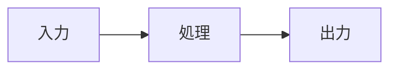

# Study

指定されたトピックを調べて、試験対策のノートを書く。ディレクトリ構成とチェックリストの書き方は CLAUDE.md に従う。

## Step 1: 対象を決める

引数 `$ARGUMENTS` から、資格とトピックを決める。

- **資格:** 引数の先頭がリポジトリ直下のディレクトリ名と一致すればそれを使う。資格ディレクトリが1つしか無ければ、それを使う。複数あって決められないときは聞く
- **トピック:** `<exam>/README.md` のチェックリストから、引数に合う項目を探す
  - ドメイン番号（例: `2`）だけのとき: そのドメインで、まだノートが無い項目のうち最初の1つ
  - 引数が無いとき: 比重の大きいドメインから順に見て、ノートがまだ無い最初の項目
  - チェックリストに無いトピックのとき: 一番近いドメインに項目を追加してから進める
- 同じ項目のノートが既にあるときは、新しく作らずにそのノートを読んで、足りないところを補う

何を書くか（資格・ドメイン・項目）を1行で伝えてから調べ始める。

## Step 2: 調べる

1. 公式ドキュメントを先に調べる（docs.claude.com、code.claude.com、anthropic.com のエンジニアリングブログなど）。WebSearch で探し、ページの中身は WebFetch（無ければ web-fetch エージェント）で読む
2. Claude Code の機能については、claude-code-guide エージェントに聞いてもよい
3. 公式で足りないところだけ、第三者の解説で補う。食い違うときは公式を優先し、食い違いがあったことをノートに書く
4. 実際に動かして確かめられるもの（Claude Code の設定、CLI のオプションなど）は、できる範囲で動かして確かめる

## Step 3: ノートを書く

保存先: `<exam>/notes/<NN>-<domain-slug>/<topic-slug>.md`（slug は英語の kebab-case）

次の構成で書く。読む人の認知負荷を下げるため、全体で A4 1枚（目安 80行）以内に収める。

```markdown
# <トピック名>

> ドメイン: <番号>. <ドメイン名>（<比重>%） ／ 更新: <YYYY-MM-DD>

## 3行まとめ
- <いちばん大事なこと>
- <いつ使う・いつ使わない>
- <試験での判断の決め手>

## 仕組み
<流れや関係は Mermaid の図で示す。比べるものは表にする。設定ファイルやコードは最小限の例だけ>



## 試験で問われそうなポイント
- <どういう状況で、どれを選ぶべきか、という判断の形で書く>

## 間違えやすいところ
- <似ている概念との違い、よくある誤解>

## 確認問題
1. <状況を示して、どうするべきかを問う問題>
   <details><summary>答え</summary>…理由も書く…</details>
2. …

## 出典
- [ページ名](URL)（公式）
- [ページ名](URL)（第三者）
```

書くときの注意（認知負荷を下げる）:
- 最初の「3行まとめ」だけ読めば要点が分かるようにする。詳しいことは下に回す
- 1つの見出しで扱う概念は1つにする
- 流れ・手順・関係は Mermaid の図、比較は表にする。長い文章の段落は作らない
- 箇条書きは1項目1行。入れ子は2段まで
- 専門用語は、最初に出たところで括弧で一言説明する（例: compaction（会話が長くなったとき、古い部分を要約して詰めること））
- 太字は1つの見出しの中で1か所まで
- 試験はシナリオから最適な設計を選ぶ形式なので、「何であるか」だけでなく「いつ使うか・いつ使わないか」を必ず書く
- 確認できなかったことは「未確認」と明記する。推測で埋めない
- 用語は英語の正式名を併記する（例: プロンプトキャッシュ（prompt caching））

## Step 4: 紐付けとコミット

1. `<exam>/README.md` のチェックリストの該当行の末尾に `→ [ノート](notes/...)` を付ける（既にあれば何もしない）。オーケストレータから任されたときは飛ばす（CLAUDE.md を参照）
2. `docs(<exam>): <トピック名>のノートを追加` でコミットする（更新のときは「を更新」）

## Step 5: 報告

チャットには、次の3点だけを書く。ノートの本文は貼らない。
- 作ったノートのパス
- 特に大事なポイント3つ
- 次の一手（例: `/quiz <ドメイン番号>` で確認する）
