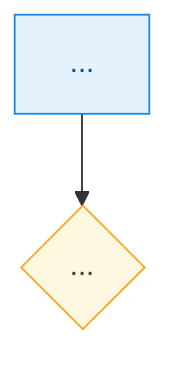

# Study

指定されたトピックを調べて、試験対策のノートを書く。ディレクトリ構成とチェックリストの書き方は CLAUDE.md に従う。

## Step 1: 対象を決める

引数 `$ARGUMENTS` から、資格とトピックを決める。

- **資格:** 引数の先頭がリポジトリ直下のディレクトリ名と一致すればそれを使う。資格ディレクトリが1つしか無ければ、それを使う。複数あって決められないときは聞く
- **トピック:** `<exam>/README.md` のチェックリストから、引数に合う項目を探す
  - ドメイン番号（例: `2`）だけのとき: そのドメインで、まだノートが無い項目のうち最初の1つ
  - 引数が無いとき: 比重の大きいドメインから順に見て、ノートがまだ無い最初の項目
  - チェックリストに無いトピックのとき: 一番近いドメインに項目を追加してから進める
- 同じ項目のノートが既にあるときは、新しく作らずにそのノートを読んで、足りないところを補う

何を書くか（資格・ドメイン・項目）を1行で伝えてから調べ始める。

## Step 2: 調べる

1. 公式ドキュメントを先に調べる（docs.claude.com、code.claude.com、anthropic.com のエンジニアリングブログなど）。WebSearch で探し、ページの中身は WebFetch（無ければ web-fetch エージェント）で読む
2. Claude Code の機能については、claude-code-guide エージェントに聞いてもよい
3. 公式で足りないところだけ、第三者の解説で補う。食い違うときは公式を優先し、食い違いがあったことをノートに書く
4. 実際に動かして確かめられるもの（Claude Code の設定、CLI のオプションなど）は、できる範囲で動かして確かめる

## Step 3: ノートを書く

保存先: `<exam>/notes/<NN>-<domain-slug>/<topic-slug>.md`（slug は英語の kebab-case）

ノートは GitHub Pages（MkDocs Material）で読む前提で書く。色の付いた箱（admonition）、折りたたみ、マーカーはサイトでだけ効く。見本は `ccaf/notes/01-agentic-architecture/agentic-loop-stop-reason.md`。全体で A4 1枚（目安 80行）以内に収める。

構成（見出しは `note_lint.py` が確かめる）:

````markdown
# <トピック名>

> ドメイン: <番号>. <ドメイン名>（<比重>%） ／ 更新: <YYYY-MM-DD>

!!! abstract "ひとことで"
    <このトピックの結論を1〜2文で。覚える部分に ==マーカー== を引く>

## 仕組み

<2〜4文の段落で、何が起きるか・なぜそうするかを説明する>



<比べるものがあれば表。続けて、図と表で言い切れないことを短い段落で>

??? info "<細かい決まり・例外の見出し>"
    - <試験に出にくい細部、例外、仕様の注記はここに入れる>

## 試験での見分け方

<div class="vs" markdown>

| 問われること | ○ 正しい | × ひっかけ |
|---|---|---|
| <判断の場面> | <選ぶべき設計> | <もっともらしいが誤りの設計と、その理由を短く> |

</div>

## 確認問題

??? question "Q1. <状況を示して、どうするかを問う>"
    <答え。理由も書く>

??? question "Q2. ..."
    ...

## 出典
- [ページ名](URL)（公式）
````

色の決まり（意味で使い分ける。飾りには使わない）:
- 箱: 結論は `abstract`（青）、細部は折りたたみの `??? info`、確認問題は `??? question`（緑、押すと答えが開く）。具体例が必要なときだけ `!!! example`、本番で失点しやすい点を1つだけ強調したいときは `!!! warning`
- 図の classDef: 処理は `run`（青）、判定・分岐は `judge`（黄）、正しい終わり方・推奨は `done`（緑）、誤り・避ける道は `ng`（赤）。上の4つ以外の色は作らない
- マーカー `==…==`: 1つの節で1〜2か所。暗記すべき語や条件だけに引く
- ○×の表: `<div class="vs" markdown>` で囲むと、○ の列が緑、× の列が赤になる。列は「問われること｜○ 正しい｜× ひっかけ」の3つに固定する

書き方（AI っぽい文章にしない）:
- 同じことを2回書かない。「ひとことで」「仕組み」「見分け方」で同じ内容を言い換えて繰り返さない。見分け方の表には、仕組みで説明した原則を「場面」に当てはめた形だけを書く
- 理由や因果は、箇条書きでなく文でつなぐ（「〜なので」「だから」）。箇条書きは、本当に並列の事柄（設定項目の一覧など）だけに使う
- 「→ 誤り」「→ 〇〇を選ぶ」のような矢印の羅列をしない。誤りは ○× の表に入れる
- 前置き（「〜について見ていこう」）、締めのまとめ直し、「重要です」「ポイントは」「〜と言えるでしょう」のような空の言葉を書かない
- 一文は短く。1文で1つのことだけを言う。常体（だ・である、または言い切り）で書く
- 英語の正式名の括弧書きは、試験に出る語の初出1回だけ（例: プロンプトキャッシュ（prompt caching））
- 太字は1つの節で1か所まで
- 具体例は、できれば1つの場面を通して使う（例: 「社内ナレッジを検索するエージェント」）
- 試験はシナリオから最適な設計を選ぶ形式なので、「何であるか」より「いつ使う・いつ使わない」を厚く書く
- 確認できなかったことは「未確認」と明記する。推測で埋めない。ガイドに無い自分の推論は「（推論）」と書く
- 本番の試験問題・ガイドの例題の文面や骨組みを借りない

## Step 4: 紐付けとコミット

1. `<exam>/README.md` のチェックリストの該当行の末尾に `→ [ノート](notes/...)` を付ける（既にあれば何もしない）。オーケストレータから任されたときは飛ばす（CLAUDE.md を参照）
2. `docs(<exam>): <トピック名>のノートを追加` でコミットする（更新のときは「を更新」）

## Step 5: 報告

チャットには、次の3点だけを書く。ノートの本文は貼らない。
- 作ったノートのパス
- 特に大事なポイント3つ
- 次の一手（例: `/quiz <ドメイン番号>` で確認する）
