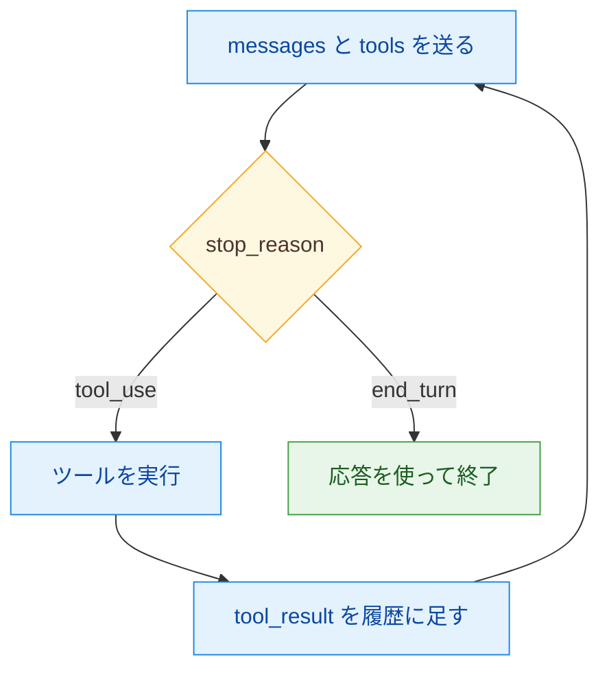

# エージェントループと stop_reason による制御

> ドメイン: 1. エージェントの構成とオーケストレーション（27%） ／ 更新: 2026-11-20

!!! abstract "ひとことで"
    ループを続けるか止めるかは、==応答の `stop_reason` だけで決める==。`tool_use` なら続け、`end_turn` なら止める。

## 仕組み

エージェントループは「Claude に聞く、言われたツールを実行する、結果を返す」の繰り返しだ。次に何をするかは毎回 Claude が決める。コードの側がするのは、`stop_reason` を見て続けるか止めるかを判断することだけ。

ツールの結果は、次のリクエストで ==`tool_result` として返す==。assistant の応答をそのまま履歴に足し、そのすぐ次の user メッセージの先頭に `tool_result` を置く。1回の応答でツールが3つ呼ばれたら、結果の3つは1つの user メッセージにまとめ、`tool_use_id` で呼び出しと対応させる。ツールが失敗しても結果は捨てず、`is_error: true` を付けて返す。

| stop_reason | 何が起きたか | どうするか |
|---|---|---|
| `tool_use` | ツールを呼びたい | 実行して結果を返し、続ける |
| `end_turn` | 応答を終えた | 終了する |
| `max_tokens` | 出力が上限で切れた | 完了扱いにしない。上限を上げて再送する |

回数や予算の上限（Agent SDK の `max_turns`、`max_budget_usd`）は、暴走を止める安全装置にすぎない。正常な終わりは、あくまで `end_turn` で判定する。

??? info "そのほかの stop_reason と細かい決まり"
    - `pause_turn`: サーバーツール（Anthropic 側で動くツール）のループが、反復の上限（既定で10回）に達した。応答をそのまま assistant として足し、user メッセージを足さずに再送する
    - `stop_sequence` / `refusal` / `model_context_window_exceeded`: それぞれ個別に処理する
    - `tool_result` の直後にテキストを足すと、空の `end_turn` 応答を招くことがある
    - 結果がまだ返っていないサーバーツールの呼び出しが同じ応答にあるときは、user メッセージに `tool_result` だけを入れる
    - Agent SDK はこのループを自動で回し、ツールを呼ばない応答が来たら終わる。`max_turns` と `max_budget_usd` の既定は無制限

あわせて、**エージェントとワークフローの違い**も押さえておく。エージェントでは、文脈を見て次のツールを Claude が選ぶ。ワークフローは決め打ちの手順で進むので、毎回同じ手順の作業なら、こちらの方が動きを予測しやすい。

## 試験での見分け方

| 問われること | ○ 正しい | × ひっかけ |
|---|---|---|
| 終了の判定 | `stop_reason` が `end_turn` なら終える | 「完了しました」などの文言や、テキストの有無で判定する（`tool_use` の応答にもテキストは付く） |
| 暴走への備え | 回数や予算の上限を、安全装置として添える | 「最大 N 回」を主な停止条件にする |
| ツールの結果 | 次の反復の前に `tool_result` を履歴に足す | 結果を捨てる、要約して system に書く |
| 上限で止まった | `max_tokens` は途中で切れたと判断する | 完了として扱う |
| 手順が毎回変わる作業 | モデル主導のループで回す | 決め打ちのワークフローにする（手順が固定なら逆） |

## 確認問題

??? question "Q1. 応答に「以上です」が含まれたらループを抜ける実装で、ときどき検索の途中で終わってしまう。どう直す？"
    終了の判定を `stop_reason` に変える。`end_turn` で終え、`tool_use` ならツールを実行して `tool_result` を返し、続ける。文面の合図は揺れるので、終了条件には使わない。

??? question "Q2. 暴走が心配なので「10回で必ず打ち切る」を唯一の停止条件にしたい。妥当か？"
    妥当ではない。上限だけだと、作業の途中で切れる。正常な終了は `end_turn` で判定し、回数や予算の上限は安全装置として添える。

??? question "Q3. Claude が1つの応答で `tool_use` を3つ返した。結果をどう返す？"
    assistant の応答をそのまま履歴に足す。次の user メッセージの先頭に、`tool_result` を3つ（それぞれの `tool_use_id` に対応させて）まとめて置く。失敗したものも `is_error: true` で返す。

## 出典
- Claude Certified Architect – Foundations Exam Guide v1.1, Task Statement 1.1（公式、PDF）: https://cc.sj-cdn.net/instructor/6nizmqk8tpzpfjvt6qmmav7rh/public/1794946250/Claude_Certified_Architect_-_Foundations_Exam_Guide.pdf
- [Stop reasons and fallback](https://platform.claude.com/docs/en/build-with-claude/handling-stop-reasons)（公式）
- [Handle tool calls](https://platform.claude.com/docs/en/agents-and-tools/tool-use/handle-tool-calls)（公式）
- [Parallel tool use](https://platform.claude.com/docs/en/agents-and-tools/tool-use/parallel-tool-use)（公式）
- [How the agent loop works](https://code.claude.com/docs/en/agent-sdk/agent-loop)（公式、Agent SDK）
- [Building effective agents](https://www.anthropic.com/engineering/building-effective-agents)（公式、エンジニアリングブログ。2024-12 の記事で、ツール類の記述は古い部分があると記事自身が注記）
