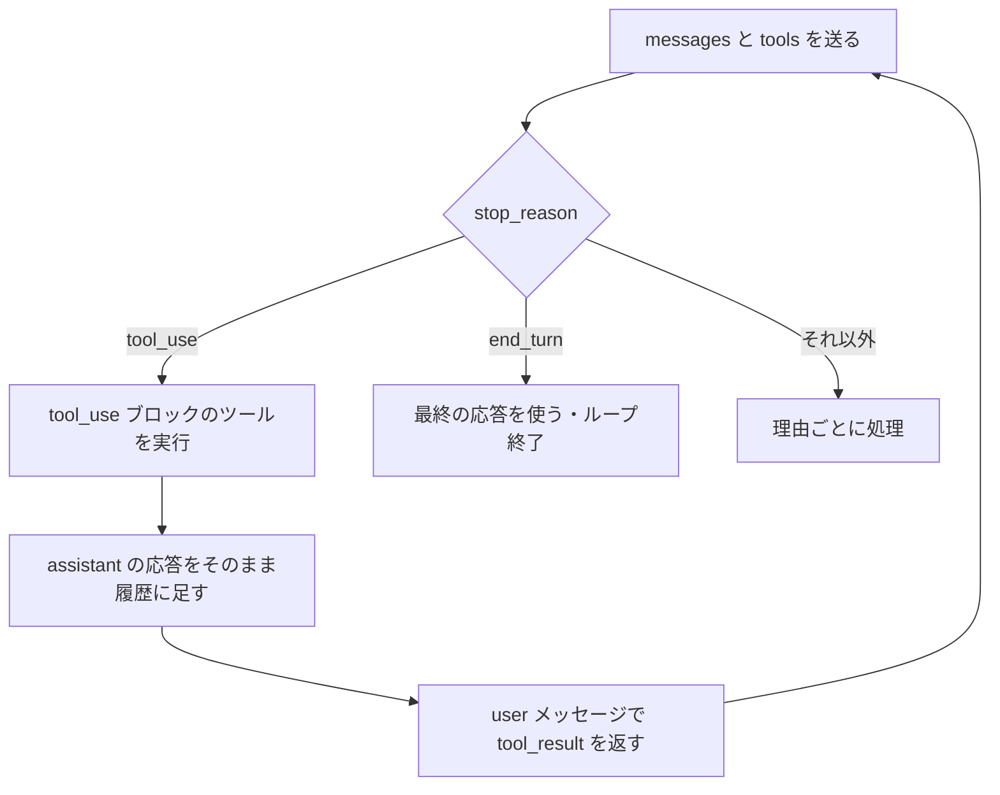

# エージェントループと stop_reason による制御

> ドメイン: 1. エージェントの構成とオーケストレーション（27%） ／ 更新: 2026-11-20

## 3行まとめ
- ループの継続・終了は **`stop_reason`** だけで決める。`"tool_use"` なら続け、`"end_turn"` なら終える
- ツールの結果は `tool_result` として会話履歴に足し、次のリクエストで Claude に渡す。次の一手は Claude が決める
- 自然言語の合図、テキストの有無、回数の上限を主な停止条件にする設計は誤り。回数や予算の上限は安全装置として添えるだけ

## 仕組み

| stop_reason | 意味 | ループでの扱い |
|---|---|---|
| `tool_use` | Claude がツールを呼んでいる | ツールを実行し、結果を返して続ける |
| `end_turn` | 応答を自然に終えた | 終了。応答を使う |
| `max_tokens` | `max_tokens` の上限に達した | 上限を上げて再送するか続きを頼む。途中で切れた `tool_use` は上限を上げて再送 |
| `pause_turn` | サーバーツール（Anthropic 側で実行するツール）のサーバー側ループが反復の上限（既定で10回）に達した | 応答をそのまま assistant として足し、後ろに user メッセージを足さずに再送 |
| `stop_sequence` / `refusal` / `model_context_window_exceeded` | 停止文字列・拒否・コンテキスト超過 | それぞれ個別に処理 |

- tool_result の形の決まり
  - assistant の `tool_use` のすぐ次の user メッセージで返す。間に別のメッセージを挟まない
  - `tool_use` 1つにつき `tool_result` 1つ（`tool_use_id` で対応）。並列呼び出しでも1つの user メッセージにまとめる
  - `tool_result` は content の先頭に置く。テキストはその後
  - 例外: 結果がまだ返っていないサーバーツールの呼び出しが同じ応答にあるときは、user メッセージに `tool_result` だけを入れる
  - ツールが失敗しても `is_error: true` で結果を返す
- モデル主導（model-driven）と決め打ちの違い
  - エージェント（agent）: 文脈を見て、次に呼ぶツールを Claude が決める
  - ワークフロー（workflow）: 決め打ちの決定木（decision trees）やツールの順番で進める。手順が決まった作業向き
- Agent SDK はこのループを自動で回す。Claude がツールを呼ばない応答を返すと終わる。`max_turns` と `max_budget_usd` は暴走を防ぐ上限（既定は無制限）

## 試験で問われそうなポイント
- 終了判定の書き方を選ぶ問題 → `stop_reason == "end_turn"` で終え、`"tool_use"` で続ける実装を選ぶ
- ツール結果の渡し方 → 次の反復の前に `tool_result` を履歴に足す。結果を捨てる・要約だけ system に書く案は外す
- 手順が毎回変わる調査・対応 → モデル主導のループ。手順が固定の処理 → 決め打ちのワークフローの方が予測しやすい
- 上限の位置づけ → 回数・予算の上限は安全装置。正常な終了は `end_turn` で判定する

## 間違えやすいところ
- 応答の文面に「完了しました」などの言葉があるかで終了を判定する → 誤り。自然言語の合図は揺れる
- 「最大 N 回で止める」を主な停止手段にする → 誤り。作業の途中で切れるか、無駄に回る
- assistant の応答にテキストがあれば完了とみなす → 誤り。`tool_use` の応答にもテキストが一緒に付く（handle-tool-calls の応答例、agent-loop の説明）
- `tool_result` の直後にテキストを足す → 空の `end_turn` 応答を招くことがある
- `pause_turn` と `tool_use` の混同 → 自分で実行するツールで止まったときは必ず `tool_use`
- `max_tokens` で終わった応答を完了扱いにする → 出力が途中で切れている

## 確認問題
1. 社内ナレッジを検索して回答するエージェントで、応答に「以上です」が含まれたらループを抜ける実装になっている。ときどき検索の途中で終わる。どう直すか
   

答え
終了判定を stop_reason に変える。"end_turn" で終え、"tool_use" ならツールを実行して tool_result を返し続ける。文面の合図は揺れるので終了条件に使わない。

2. ループの暴走が心配なので「10回で必ず打ち切る」を唯一の停止条件にしたい。妥当か
   

答え
妥当ではない。正常な終了は "end_turn" で判定し、回数や予算の上限は暴走を防ぐ安全装置として添える。上限だけだと作業の途中で切れる。

3. Claude が1つの応答で `tool_use` ブロックを3つ返した。結果をどう返すか
   

答え
assistant の応答をそのまま履歴に足し、次の user メッセージに tool_result を3つ（各 tool_use_id に対応）まとめて先頭に置いて返す。失敗したものも is_error: true で返す。

## 出典
- Claude Certified Architect – Foundations Exam Guide v1.1, Task Statement 1.1（公式、PDF）: https://cc.sj-cdn.net/instructor/6nizmqk8tpzpfjvt6qmmav7rh/public/1794946250/Claude_Certified_Architect_-_Foundations_Exam_Guide.pdf
- [Stop reasons and fallback](https://platform.claude.com/docs/en/build-with-claude/handling-stop-reasons)（公式）
- [Handle tool calls](https://platform.claude.com/docs/en/agents-and-tools/tool-use/handle-tool-calls)（公式）
- [Parallel tool use](https://platform.claude.com/docs/en/agents-and-tools/tool-use/parallel-tool-use)（公式）
- [How the agent loop works](https://code.claude.com/docs/en/agent-sdk/agent-loop)（公式、Agent SDK）
- [Building effective agents](https://www.anthropic.com/engineering/building-effective-agents)（公式、エンジニアリングブログ。2024-12 の記事で、ツール類の記述は古い部分があると記事自身が注記）
