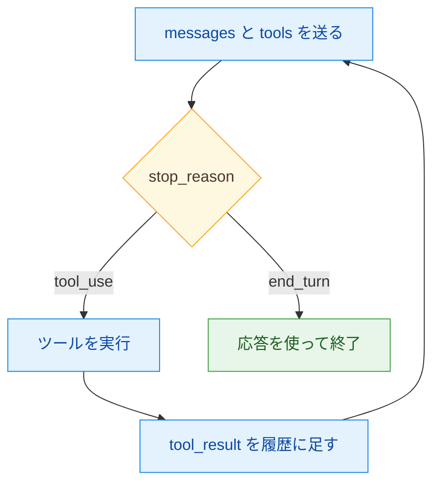

# エージェントループと stop_reason による制御

> ドメイン: 1. エージェントの構成とオーケストレーション（27%） ／ 更新: 2026-11-20

!!! abstract "ひとことで"
    ループを続けるか止めるかは、==応答の `stop_reason` だけで決める==。`tool_use` なら続け、`end_turn` なら止める。

## 仕組み

エージェントループは「Claude に聞く、言われたツールを実行する、結果を返す」の繰り返しだ。次に何をするかは毎回 Claude が決める。コードの側がするのは、`stop_reason` を見て続けるか止めるかを判断することだけ。

ツールの結果は、次のリクエストで ==`tool_result` として返す==。assistant の応答をそのまま履歴に足し、そのすぐ次の user メッセージの先頭に `tool_result` を置く。1回の応答でツールが3つ呼ばれたら、結果の3つは1つの user メッセージにまとめ、`tool_use_id` で呼び出しと対応させる。ツールが失敗しても結果は捨てず、`is_error: true` を付けて返す。

| stop_reason | 何が起きたか | どうするか |
|---|---|---|
| `tool_use` | ツールを呼びたい | 実行して結果を返し、続ける |
| `end_turn` | 応答を終えた | 終了する |
| `max_tokens` | 出力が上限で切れた | 完了扱いにしない。上限を上げて再送するか、続きを生成させる。途中で切れた `tool_use` は上限を上げて再送する |

回数や予算の上限（Agent SDK の `max_turns`、`max_budget_usd`）は、暴走を止める安全装置にすぎない。正常な終わりは、あくまで `end_turn` で判定する。

??? info "そのほかの stop_reason と細かい決まり"
    - `pause_turn`: サーバーツール（Anthropic 側で動くツール）のループが、反復の上限（既定で10回）に達した。応答をそのまま assistant として足し、user メッセージを足さずに再送する。自分で実行するツールで止まったときは必ず `tool_use` で、`pause_turn` にはならない
    - `stop_sequence` / `refusal` / `model_context_window_exceeded`: それぞれ個別に処理する
    - `tool_result` の直後にテキストを足すと、空の `end_turn` 応答を招くことがある
    - 結果がまだ返っていないサーバーツールの呼び出しが同じ応答にあるときは、user メッセージに `tool_result` だけを入れる
    - Agent SDK はこのループを自動で回し、ツールを呼ばない応答が来たら終わる。`max_turns` と `max_budget_usd` の既定は無制限

あわせて、**エージェントとワークフローの違い**も押さえておく。エージェントでは、文脈を見て次のツールを Claude が選ぶ。ワークフローは決め打ちの手順で進むので、毎回同じ手順の作業なら、こちらの方が動きを予測しやすい。

## 試験での見分け方

| 問われること | ○ 正しい | × ひっかけ |
|---|---|---|
| 終了の判定 | `stop_reason` が `end_turn` なら終える | 「完了しました」などの文言や、テキストの有無で判定する（`tool_use` の応答にもテキストは付く） |
| 暴走への備え | 回数や予算の上限を、安全装置として添える | 「最大 N 回」を主な停止条件にする |
| ツールの結果 | 次の反復の前に `tool_result` を履歴に足す | 結果を捨てる、要約して system に書く |
| 上限で止まった | `max_tokens` は途中で切れたと判断する | 完了として扱う |
| 手順が毎回変わる作業 | モデル主導のループで回す | 決め打ちのワークフローにする（手順が固定なら逆） |

## 確認問題

**Q1.** 開発者向けに、社内のリポジトリとドキュメントを検索して質問に答えるエージェントを Claude API で作っている。ループは「応答のテキストに『以上です』が含まれたら終える」という実装で、ときどき検索の途中で終わってしまう。最も適切な直し方はどれか。（1つ選べ）
{ .quiz-q }

- A. システムプロンプトに「調べ終わるまで『以上です』と書かないこと」と書き足す
- B. 応答にテキストが含まれていなければ続け、含まれていれば終える判定に変える
- C. `stop_reason` が `tool_use` ならツールを実行して続け、`end_turn` なら終える判定に変える
- D. ループを固定で10回まわし、10回目の応答を最終回答として使う

??? success "答えと解説"
    **正解: C。** 続けるか止めるかは `stop_reason` で決める。

    - A: 文面の合図に頼る点が変わらない。言い回しは揺れるので、終了条件には使えない
    - B: `tool_use` の応答にもテキストは付く。テキストの有無では判定できない
    - D: 回数は安全装置にすぎない。作業の途中で切れるか、終わっても無駄に回る

**Q2.** 同じエージェントで、ツール呼び出しが止まらなくなる事態に備えたい。ループの設計として適切なものはどれか。（2つ選べ）
{ .quiz-q }

- A. 正常な終了は、`stop_reason` が `end_turn` かどうかで判定する
- B. 「最大10回」を唯一の停止条件にし、`stop_reason` は見ない
- C. 回数や予算の上限は設けず、`end_turn` が返るまで待ち続ける
- D. 回数や予算の上限（Agent SDK なら `max_turns`、`max_budget_usd`）を、安全装置として添える
- E. 応答に「完了」の語が含まれたら終了とし、上限は設けない

??? success "答えと解説"
    **正解: A と D。** 終わりの判定は `end_turn`、暴走への備えは上限、と役割を分ける。

    - B: 上限だけだと、作業の途中で切れる
    - C: 上限が無いと、暴走したときに止まらない。Agent SDK の `max_turns` と `max_budget_usd` は既定で無制限なので、自分で設定する
    - E: 文面の合図は揺れるうえ、暴走への備えも無い

**Q3.** Claude が1つの応答で `tool_use` ブロックを3つ返した。そのうち1つのツールは、タイムアウトで失敗した。次のリクエストの組み立てとして最も適切なものはどれか。（1つ選べ）
{ .quiz-q }

- A. 成功した2つの `tool_result` だけを user メッセージで返し、失敗したものは省く
- B. assistant の応答をそのまま履歴に足し、次の user メッセージの先頭に、3つの `tool_result` をまとめて置く。失敗したものには `is_error: true` を付ける
- C. `tool_result` を1つずつ別の user メッセージにして、3回に分けて返す
- D. 3つの結果を要約してシステムプロンプトに書き足し、user メッセージで続きを頼む

??? success "答えと解説"
    **正解: B。** `tool_use` 1つにつき `tool_result` 1つを、`tool_use_id` で対応させて、1つの user メッセージにまとめて返す。

    - A: 失敗も `is_error: true` を付けて返す。省くと、Claude はその呼び出しの結果を知らないまま進む
    - C: 並列の呼び出しの結果は、1つの user メッセージにまとめる
    - D: 結果は `tool_result` として会話履歴で返す。system に書いても、呼び出しへの応答にならない

## 出典
- Claude Certified Architect – Foundations Exam Guide v1.1, Task Statement 1.1（公式、PDF）: https://cc.sj-cdn.net/instructor/6nizmqk8tpzpfjvt6qmmav7rh/public/1794946250/Claude_Certified_Architect_-_Foundations_Exam_Guide.pdf
- [Stop reasons and fallback](https://platform.claude.com/docs/en/build-with-claude/handling-stop-reasons)（公式）
- [Handle tool calls](https://platform.claude.com/docs/en/agents-and-tools/tool-use/handle-tool-calls)（公式）
- [Parallel tool use](https://platform.claude.com/docs/en/agents-and-tools/tool-use/parallel-tool-use)（公式）
- [How the agent loop works](https://code.claude.com/docs/en/agent-sdk/agent-loop)（公式、Agent SDK）
- [Building effective agents](https://www.anthropic.com/engineering/building-effective-agents)（公式、エンジニアリングブログ。2024-12 の記事で、ツール類の記述は古い部分があると記事自身が注記）
