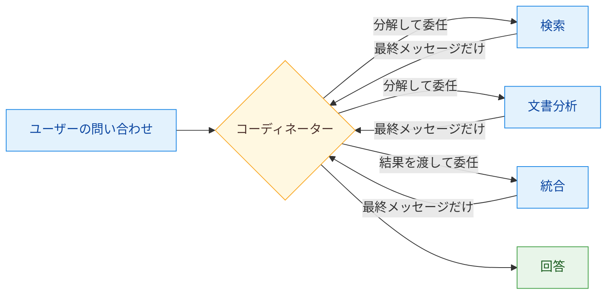

# コーディネーターとサブエージェントのハブ＆スポーク構成

> ドメイン: 1. エージェントの構成とオーケストレーション（27%） ／ 更新: 2026-11-20 ／ 公式ガイド TS 1.2

!!! abstract "ひとことで"
    コーディネーターがハブになり、サブエージェント同士の連絡・エラー処理・情報の受け渡しを==すべて自分を通す==。呼ぶサブエージェントは、==問い合わせの複雑さを見て毎回選ぶ==。

## 仕組み

コーディネーター（全体を仕切るエージェント）は、問い合わせを分解してサブエージェントに委任し、返ってきた結果を集約する。連絡の経路が1か所に集まるので、流れを観測でき、エラー処理をそろえられ、誰に何を渡すかを制御できる。

| コーディネーターの役割 | 中身 |
|---|---|
| 分解（task decomposition） | 問い合わせを、抜けなく重ならないサブタスクに分ける |
| 委任（delegation） | どのサブエージェントを呼ぶかを複雑さで決める。目的・出力の形・使うツールと情報源の指針・範囲を渡す |
| 集約（result aggregation） | 返ってきた結果をまとめ、次に誰へ何を渡すかを決める |
| 経路の一元化 | 連絡をすべて自分を通す。観測しやすさ（observability）・一貫したエラー処理・情報の流れの制御が得られる |

サブエージェントは自分専用の会話で動く（コンテキストの分離、isolated context）。親の会話履歴・ツール結果・システムプロンプトは受け継がない（fork を除く）。親から渡るのは Agent ツール（旧称 Task ツール）の prompt 文字列だけなので、必要な事実はそこに書く。親に返るのは最終メッセージだけで、途中のツール呼び出しは親の文脈を汚さない。渡し方の詳細は [サブエージェントへのコンテキストの渡し方](subagent-context-passing.md)。

単純な問い合わせに全員を通すと、遅く高くつく。Anthropic の Research システムの初期版でも、単純な問い合わせに過剰に手をかける失敗が多かった（公式ブログ）。各サブエージェントが正常に終わったのに範囲に抜けがあるなら、原因はコーディネーターの分解（どう仕事を割ったか）が狭すぎることだ。ただしタイムアウトなどサブエージェント側の失敗が原因のこともあるので、まず何が起きたかを確かめる。範囲の分け方と抜けを埋める反復は [調査範囲の分割と反復ループ](scope-partitioning-iterative-refinement.md) で扱う。

??? info "規模の目安とコスト（公式ブログ）"
    - Research システムでは、規模の目安をプロンプトに書いている。単純な事実確認は1エージェント・ツール 3〜10 回、比較は 2〜4 サブエージェント、複雑な調査は 10 以上
    - マルチエージェントはチャットの約15倍のトークンを使う。価値が高く、並列にしやすい作業に向く

??? info "ハブ＆スポークの例外と SDK の現行仕様"
    - 「ハブ＆スポーク＝例外なく全部中継」ではない。公式ブログは、大きな成果物を外部に保存して参照だけ返す方法も挙げている
    - SDK の現行仕様では、サブエージェントが子を作る入れ子（既定で3層まで）や、SendMessage による直接の連絡もできる。試験の設計原則（コーディネーター経由）との関係をガイドがどう扱うかは未確認

## 試験での見分け方

| 問われること | ○ 正しい | × ひっかけ |
|---|---|---|
| 単純な質問でも遅く高い | コーディネーターが要件を見て、呼ぶサブエージェントを動的に選ぶ | 複雑さによらず、毎回すべてのサブエージェントを通す |
| レポートが一部の分野しか扱っていない | サブエージェントの失敗が無いかを確かめ、正常ならコーディネーターの分解を見直す | 検索や統合など下流の担当を直す |
| 失敗を追えず、エラー処理がばらばら | サブエージェント間の連絡をすべてコーディネーター経由にする | サブエージェント同士で直接やり取りさせる |
| サブエージェントが前提を知らずに的外れな作業をした | 委任のプロンプトに前提を明示して渡す | サブエージェントがコーディネーターの会話履歴を見られると思い込む |

## 確認問題

??? question "Q1. 社内 FAQ ボットに、検索・分析・統合・レポート作成の4サブエージェントがある。「営業時間は？」のような質問でも応答に1分かかる。最初に直すところは？"
    コーディネーターが質問の複雑さを判断し、必要なサブエージェントだけを呼ぶようにする。単純な事実確認は1エージェントで足りる。全員を毎回通すのはアンチパターンだ。

??? question "Q2. 検索サブエージェントが結果を統合サブエージェントへ直接送り、統合側も足りない情報を検索側に直接頼んでいる。障害時にどこで何が失敗したか追えず、エラーの扱いもばらばら。どう設計し直す？"
    サブエージェント間の連絡をすべてコーディネーター経由にする（ハブ＆スポーク）。経路が1か所に集まるので、流れを観測でき、エラー処理をそろえられ、誰に何を渡すかをコーディネーターが制御できる。

??? question "Q3. 分析サブエージェントが「さっきユーザーが言った条件」を無視して結果を返した。原因と対策は？"
    サブエージェントは親の会話履歴を受け継がない。必要な条件を、コーディネーターが委任のプロンプトに明示して渡す。

## 出典
- [Subagents in the SDK](https://code.claude.com/docs/en/agent-sdk/subagents)（公式。コンテキストの分離、受け継ぐもの・受け継がないもの、入れ子の上限）
- [Create custom subagents](https://code.claude.com/docs/en/sub-agents)（公式。入れ子のサブエージェント、SendMessage）
- [How we built our multi-agent research system](https://www.anthropic.com/engineering/multi-agent-research-system)（公式ブログ。orchestrator-worker、複雑さに応じた規模、トークン量）
- [Building effective agents](https://www.anthropic.com/engineering/building-effective-agents)（公式ブログ。Orchestrator-workers）
- Claude Certified Architect – Foundations Exam Guide v1.1、Task Statement 1.2（公式。PDF の URL は ccaf/README.md）
