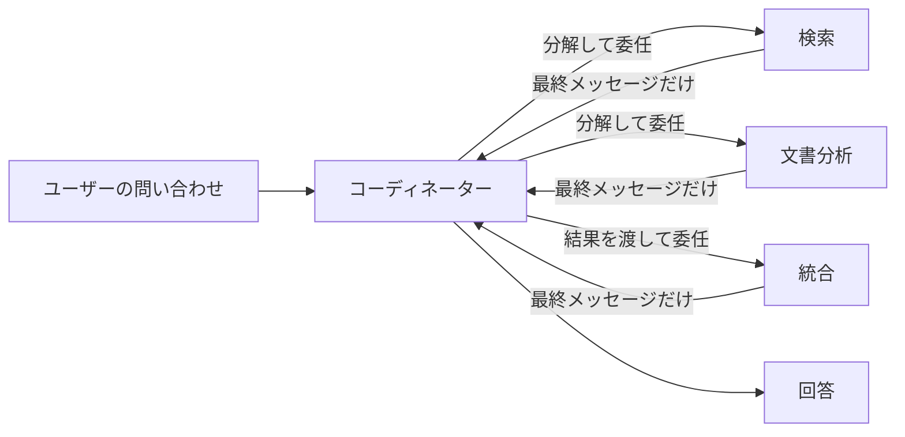

# コーディネーターとサブエージェントのハブ＆スポーク構成

> ドメイン: 1. エージェントの構成とオーケストレーション（27%） ／ 更新: 2026-11-20 ／ 公式ガイド TS 1.2

## 3行まとめ
- コーディネーター（全体を仕切るエージェント）が中心のハブになり、サブエージェント同士の連絡・エラー処理・情報の受け渡しをすべて引き受ける
- 問い合わせの複雑さを見て、呼ぶサブエージェントを毎回選ぶ。単純な問い合わせに全員を通さない
- 結果がおかしいとき、まずコーディネーターの分解（どう仕事を割ったか）を疑う。サブエージェントは渡された範囲を正しくこなしているだけのことが多い

## 仕組み

| コーディネーターの役割 | 中身 |
|---|---|
| 分解（task decomposition） | 問い合わせを、抜けなく重ならないサブタスクに分ける |
| 委任（delegation） | どのサブエージェントを呼ぶかを複雑さで決め、目的・出力の形・範囲を渡す |
| 集約（result aggregation） | 返ってきた結果をまとめ、次に誰へ何を渡すかを決める |
| 経路の一元化 | 連絡をすべて自分を通すことで、観測しやすさ（observability）・一貫したエラー処理・情報の流れの制御を得る |

## コンテキストの分離（isolated context）
- サブエージェントは自分専用の会話で動き、親の会話履歴・ツール結果・システムプロンプトは受け継がない（fork を除く）
- 親から渡るのは Agent ツール（旧称 Task ツール）の prompt 文字列だけ。必要な事実はそこに書く → 別ノート（サブエージェントへのコンテキストの渡し方）
- 親に返るのはサブエージェントの最終メッセージだけ。途中のツール呼び出しは親の文脈を汚さない

## 複雑さに応じた選択
- Anthropic の Research システムでは、規模の目安をプロンプトに書いている: 単純な事実確認は1エージェント・ツール 3〜10 回、比較は 2〜4 サブエージェント、複雑な調査は 10 以上
- 初期版では、単純な問い合わせに過剰に手をかける失敗が多かった（公式ブログ）
- マルチエージェントはチャットの約15倍のトークンを使う。価値の高い、並列にしやすい作業に向く

## 試験で問われそうなポイント
- 単純な質問にも全パイプラインを通して遅く高い → コーディネーターが要件を見て、呼ぶサブエージェントを動的に選ぶ設計にする
- レポートが一部の分野しか扱っていない → 下流のエージェントではなく、コーディネーターの分解が狭すぎないかを見る
- サブエージェント同士が直接やり取りして、失敗の追跡やエラー処理がばらばら → すべてコーディネーター経由にする
- サブエージェントが前提を知らずに的外れな作業をした → 履歴は自動で引き継がれないので、プロンプトに明示して渡す
- 調査範囲の分割と、統合結果の抜けを埋める反復ループ → 別ノート（Scope partitioning & iterative refinement）

## 間違えやすいところ
- 問い合わせの複雑さによらず、毎回すべてのサブエージェントを通す（アンチパターン）
- 分解を狭くしすぎて、広いテーマの一部しか扱わない（アンチパターン。原因は分解で、検索や統合の担当ではない）
- サブエージェントがコーディネーターの会話履歴を見られると思い込む
- 「ハブ＆スポーク＝例外なく全部中継」ではない。公式ブログは、大きな成果物を外部に保存して参照だけ返す方法も挙げている
- SDK の現行仕様では、サブエージェントが子を作る入れ子（既定で3層まで）や SendMessage による直接の連絡もできる。試験の設計原則（コーディネーター経由）との関係をガイドがどう扱うかは未確認

## 確認問題
1. 社内 FAQ ボットに、検索・分析・統合・レポート作成の4サブエージェントがある。「営業時間は？」のような質問でも応答に1分かかる。最初に直すべきところは？
   

答え
コーディネーターが質問の複雑さを判断し、必要なサブエージェントだけを呼ぶようにする。単純な事実確認は1エージェントで足りる。全員を毎回通すのはアンチパターン。

2. 「再生可能エネルギーの政策動向」の調査で、各サブエージェントは正常終了したのに、レポートが太陽光だけを扱っていた。ログでは、分解されたサブタスクが3つとも太陽光関連だった。原因はどこか？
   

答え
コーディネーターの分解が狭すぎる。サブエージェントは割り当てられた範囲を正しくこなしており、検索や統合の担当を直しても解決しない。

3. 分析サブエージェントが「さっきユーザーが言った条件」を無視して結果を返した。考えられる原因と対策は？
   

答え
サブエージェントは親の会話履歴を受け継がない。必要な条件をコーディネーターが委任のプロンプトに明示して渡す。

## 出典
- [Subagents in the SDK](https://code.claude.com/docs/en/agent-sdk/subagents)（公式。コンテキストの分離、受け継ぐもの・受け継がないもの、入れ子の上限）
- [Create custom subagents](https://code.claude.com/docs/en/sub-agents)（公式。入れ子のサブエージェント、SendMessage）
- [How we built our multi-agent research system](https://www.anthropic.com/engineering/multi-agent-research-system)（公式ブログ。orchestrator-worker、複雑さに応じた規模、トークン量）
- [Building effective agents](https://www.anthropic.com/engineering/building-effective-agents)（公式ブログ。Orchestrator-workers）
- Claude Certified Architect – Foundations Exam Guide v1.1、Task Statement 1.2（公式。PDF の URL は ccaf/README.md）
