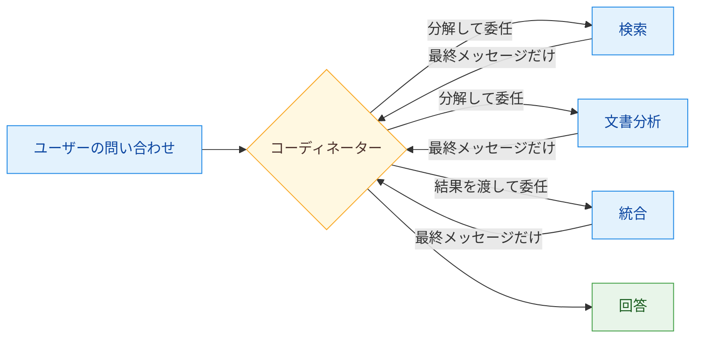

# コーディネーターとサブエージェントのハブ＆スポーク構成

> ドメイン: 1. エージェントの構成とオーケストレーション（27%） ／ 更新: 2026-11-20 ／ 公式ガイド TS 1.2

!!! abstract "ひとことで"
    コーディネーターがハブになり、サブエージェント同士の連絡・エラー処理・情報の受け渡しを==すべて自分を通す==。呼ぶサブエージェントは、==問い合わせの複雑さを見て毎回選ぶ==。

## 仕組み

コーディネーター（全体を仕切るエージェント）は、問い合わせを分解してサブエージェントに委任し、返ってきた結果を集約する。

| コーディネーターの役割 | 中身 |
|---|---|
| 分解（task decomposition） | 問い合わせを、抜けなく重ならないサブタスクに分ける |
| 委任（delegation） | どのサブエージェントを呼ぶかを複雑さで決める。目的・出力の形・使うツールと情報源の指針・範囲を渡す |
| 集約（result aggregation） | 返ってきた結果をまとめ、次に誰へ何を渡すかを決める |
| 経路の一元化 | 連絡をすべて自分を通す。観測しやすさ（observability）・一貫したエラー処理・情報の流れの制御が得られる |

サブエージェントは自分専用の会話で動く（コンテキストの分離、isolated context）。親の会話履歴・ツール結果・システムプロンプトは受け継がない（fork を除く）。親から渡るのは Agent ツール（旧称 Task ツール）の prompt 文字列だけなので、必要な事実はそこに書く。親に返るのは最終メッセージだけで、途中のツール呼び出しは親の文脈を汚さない。渡し方の詳細は [サブエージェントへのコンテキストの渡し方](subagent-context-passing.md)。

単純な問い合わせに全員を通すと、遅く高くつく。Anthropic の Research システムの初期版でも、単純な問い合わせに過剰に手をかける失敗が多かった（公式ブログ）。各サブエージェントが正常に終わったのに範囲に抜けがあるなら、原因はコーディネーターの分解（どう仕事を割ったか）が狭すぎることだ。ただしタイムアウトなどサブエージェント側の失敗が原因のこともあるので、まず何が起きたかを確かめる。範囲の分け方と抜けを埋める反復は [調査範囲の分割と反復ループ](scope-partitioning-iterative-refinement.md) で扱う。

??? info "規模の目安とコスト（公式ブログ）"
    - Research システムでは、規模の目安をプロンプトに書いている。単純な事実確認は1エージェント・ツール 3〜10 回、比較は 2〜4 サブエージェント、複雑な調査は 10 以上
    - マルチエージェントはチャットの約15倍のトークンを使う。価値が高く、並列にしやすい作業に向く

??? info "ハブ＆スポークの例外と SDK の現行仕様"
    - 「ハブ＆スポーク＝例外なく全部中継」ではない。公式ブログは、大きな成果物を外部に保存して参照だけ返す方法も挙げている
    - SDK の現行仕様では、サブエージェントが子を作る入れ子（既定で3層まで）や、SendMessage による直接の連絡もできる。試験の設計原則（コーディネーター経由）との関係をガイドがどう扱うかは未確認

## 試験での見分け方

| 問われること | ○ 正しい | × ひっかけ |
|---|---|---|
| 単純な質問でも遅く高い | コーディネーターが要件を見て、呼ぶサブエージェントを動的に選ぶ | 複雑さによらず、毎回すべてのサブエージェントを通す |
| レポートが一部の分野しか扱っていない | サブエージェントの失敗が無いかを確かめ、正常ならコーディネーターの分解を見直す | 検索や統合など下流の担当を直す |
| 失敗を追えず、エラー処理がばらばら | サブエージェント間の連絡をすべてコーディネーター経由にする | サブエージェント同士で直接やり取りさせる |
| サブエージェントが前提を知らずに的外れな作業をした | 委任のプロンプトに前提を明示して渡す | サブエージェントがコーディネーターの会話履歴を見られると思い込む |

## 確認問題

**Q1.** 社内の開発者向けに、コードベースと設計文書を調べて答える調査アシスタントを作っている。コーディネーターの下に、検索・分析・統合・レポート作成の4つのサブエージェントがある。「このリポジトリの Node のバージョンは？」のような質問でも、毎回4つすべてを通るので応答に1分以上かかる。最も適切な直し方はどれか。（1つ選べ）
{ .quiz-q }

- A. コーディネーターが質問の複雑さを見て、呼ぶサブエージェントを毎回選ぶようにする
- B. 4つのサブエージェントを並列に起動し、待ち時間を最も遅い1つ分に縮める
- C. 各サブエージェントのシステムプロンプトに「簡潔に答えること」と書き足す
- D. レポート作成サブエージェントを外し、どの質問も残りの3つで処理する

??? success "答えと解説"
    **正解: A。** 呼ぶサブエージェントは、問い合わせの複雑さを見てコーディネーターが毎回選ぶ。

    - B: 全員を通すこと自体は変わらない。待ち時間は縮んでも、トークンの消費は減らない
    - C: 全員を通す構成のままなので、遅さと費用の原因が残る
    - D: 複雑さによらず固定の顔ぶれを通す点が同じ。単純な質問には多すぎ、複雑な調査には足りない

**Q2.** 同じ調査アシスタントで、検索サブエージェントが結果を統合サブエージェントへ直接送り、統合側も足りない情報を検索側に直接頼んでいる。障害のときにどこで失敗したか追えず、エラーの扱いもサブエージェントごとにばらばらだ。設計し直す方針として適切なものはどれか。（2つ選べ）
{ .quiz-q }

- A. 失敗したら、相手のサブエージェントへ直接再依頼する処理を各サブエージェントに足す
- B. サブエージェント同士の直接のやり取りをやめ、結果はすべてコーディネーターに返させる
- C. 統合サブエージェントの会話履歴を検索サブエージェントにも共有し、再依頼を減らす
- D. 各サブエージェントにログとリトライを個別に実装させ、障害時はログを突き合わせる
- E. 情報が足りなければ、次に誰へ何を渡すかをコーディネーターが決めて委任し直す

??? success "答えと解説"
    **正解: B と E。** 連絡をすべてコーディネーター経由にすると、流れを観測でき、エラー処理をそろえられ、情報の流れを制御できる。

    - A: 直接のやり取りが増えるだけで、経路はさらに追いにくくなる
    - C: サブエージェントは自分専用の会話で動く。履歴を共有させる設計は、コンテキストの分離に反する
    - D: エラー処理がサブエージェントごとにばらばらなまま残る

**Q3.** 別の調査アシスタントでは、コーディネーターがサブエージェントを使わず、検索ツールを自分で直接呼んでいる。大量の検索結果がその文脈に溜まり、後半の判断が雑になってきた。最も適切な対応はどれか。（1つ選べ）
{ .quiz-q }

- A. 検索サブエージェントを作り、途中のツール呼び出しもすべて親に転送させる
- B. 検索をサブエージェントに委任し、親には最終メッセージだけを返させる
- C. 「検索結果は要点だけを読むこと」とコーディネーターのプロンプトに書き足す
- D. 検索は親に残したまま、分析と統合だけをサブエージェントに任せる

??? success "答えと解説"
    **正解: B。** サブエージェントは自分専用の会話で動き、親に返るのは最終メッセージだけだ。途中のツール呼び出しは親の文脈を汚さない。

    - A: 途中のツール呼び出しを親に流すと、親の文脈に溜まる点が変わらない
    - C: プロンプトで頼んでも、検索結果そのものは親の文脈に溜まり続ける
    - D: 大量の結果を生むのは検索だ。検索を親に残すと、溜まる原因が残る

## 出典
- [Subagents in the SDK](https://code.claude.com/docs/en/agent-sdk/subagents)（公式。コンテキストの分離、受け継ぐもの・受け継がないもの、入れ子の上限）
- [Create custom subagents](https://code.claude.com/docs/en/sub-agents)（公式。入れ子のサブエージェント、SendMessage）
- [How we built our multi-agent research system](https://www.anthropic.com/engineering/multi-agent-research-system)（公式ブログ。orchestrator-worker、複雑さに応じた規模、トークン量）
- [Building effective agents](https://www.anthropic.com/engineering/building-effective-agents)（公式ブログ。Orchestrator-workers）
- Claude Certified Architect – Foundations Exam Guide v1.1、Task Statement 1.2（公式。PDF の URL は ccaf/README.md）
