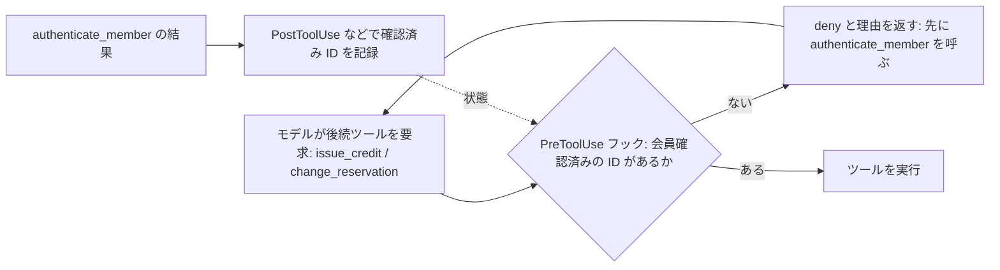

# ワークフローの順序をプログラムで強制する（前提ゲートとプロンプト指示の違い）

> ドメイン: 1. エージェントの構成とオーケストレーション（27%） ／ 更新: 2026-11-20

## 3行まとめ
- 「Aを終えてからBを呼ぶ」を必ず守らせたいなら、プロンプトではなくコードの前提ゲート（prerequisite gate: 条件を満たすまで後続のツール呼び出しを止める仕組み）で強制する
- プロンプト指示（prompt-based guidance）は確率的で、失敗率がゼロにならない。間違えても害が小さい手順の誘導に使う
- 決め手: 本人確認の前の送金のように、順序違反がお金・安全・規約の問題になるなら、プログラムでの強制（programmatic enforcement）を選ぶ

## 仕組み
フック（hook: ツール呼び出しの前後でアプリのコードを動かす仕組み）で、状態を見て止める。例は自作の会員予約エージェント。

| | プログラムでの強制 | プロンプト指示 |
|---|---|---|
| 実体 | PreToolUse フック、canUseTool、ツールの実装の中の検査 | システムプロンプト、few-shot の例 |
| 保証 | 決定的（毎回同じ判定） | 確率的（守らないことがある） |
| 向く場面 | 順序違反が実害になる手順 | 好ましい進め方の誘導、判断が要る場面 |
| 違反したとき | 呼び出し自体が実行されない | 実行されてから気づく |

- Agent SDK の PreToolUse フックは `permissionDecision: "deny"` で呼び出しを止め、`permissionDecisionReason` でモデルに理由を伝える
- フックの入力には `session_id` があり、`tool_use_id` で同じ呼び出しの PreToolUse と PostToolUse を対応づけられる（セッションごとに確認済みの状態を持てる）
- 複数の PreToolUse フックの判定が食い違うと、deny が最優先（deny > defer > ask > allow）
- 権限の評価はフックが最初。フックが allow を返しても、deny ルールは後で評価される（評価の6段階のうち一部を省略）
- Messages API で自前のループを書くときは、アプリがツールを実行する。ゲートで止めた呼び出しは実行せず、`is_error: true` の tool_result で理由を返せばよい
- 金額の上限で止めて人に回すなど、フックでの遮断とデータの正規化の詳細 → 別ノート（Agent SDK のフック、1.5）
- 途中で人に引き継ぐときの要約の項目と、複数の用件を含む依頼の分解 → 別ノート（Structured handoff、1.4）

## 試験で問われそうなポイント
- 順序の違反が実害になる → 違反が起きる前に、コードで後続ツールを止める設計を選ぶ
- 守らせたい規則が「必ず」かどうかで分ける: 必ず → フック・ゲート、できれば → プロンプト
- ゲートは「前のツールが呼ばれたか」ではなく「前のツールが確認済みの値を返したか」で判定する
- 確認済みの値に頼る後続のツールすべてに、同じゲートを掛ける（1つだけ止めても、別のツールが抜け道になる）
- 止めたら、モデルが次に何をすべきか分かる理由を返す（黙って失敗させない）

## 間違えやすいところ
- アンチパターン: 金銭・本人確認が絡む順序を、モデルへの指示だけで守らせる（指示は確率的に守られるだけで、失敗率がゼロにならない）
- アンチパターン: ゲートで止めたのに理由を返さず、モデルが同じ呼び出しを繰り返す
- allowedTools は承認なしで通すか、disallowedTools は拒否・除外するかを決めるだけで、「どの順に呼ぶか」は決めない（allowedTools に無いツールも使える。ツール名だけの disallowedTools は定義ごと外し、`Bash(rm *)` のような書き方は合う呼び出しだけを拒否する）
- allowedTools で自動承認されたツールの呼び出しは canUseTool に届かない。必ず通したい検査は PreToolUse フックに置く
- Claude Code のプロンプト型フック（`type: "prompt"`）はモデルが判定するので、決定的な強制にはならない
- ガイドの言う「non-zero failure rate」の具体的な数値は、公式ドキュメントでは未確認

## 確認問題
1. 経費精算エージェントで、`check_receipt` の照合が済むまで `approve_expense` を止めるフックを入れた。ところが、照合前の経費が `pay_expense` で直接支払われた。設計のどこに抜けがあるか。
   

答え
ゲートを `approve_expense` にしか掛けていない。照合済みの結果に頼る後続ツール（`pay_expense` も含む）すべてに同じ判定を掛け、照合済みでなければ deny して「先に check_receipt を呼ぶ」と理由を返す。

2. 回答の文体を「です・ます」にそろえたい。フックで強制すべきか。
   

答え
不要。文体の揺れは実害が小さく、順序の強制でもない。プロンプト指示で十分。決定的な強制は、違反が許されない規則に絞る。

3. ゲートを「`authenticate_member` が1回でも呼ばれたら通す」にした。何が問題か。
   

答え
確認に失敗した場合や、別の会員の ID で確認した場合も通ってしまう。確認済みの ID を記録し、後続の呼び出しの ID と一致するかで判定する。

## 出典
- 公式の Exam Guide v1.1（Claude Certified Architect – Foundations）タスクステートメント 1.4・1.5（公式）
- [Intercept and control agent behavior with hooks（Agent SDK）](https://code.claude.com/docs/en/agent-sdk/hooks)（公式）
- [Configure permissions（Agent SDK）](https://code.claude.com/docs/en/agent-sdk/permissions)（公式）
- [Automate workflows with hooks（Claude Code）](https://code.claude.com/docs/en/hooks-guide)（公式）
- [Handle tool calls](https://platform.claude.com/docs/en/agents-and-tools/tool-use/handle-tool-calls)（公式）
