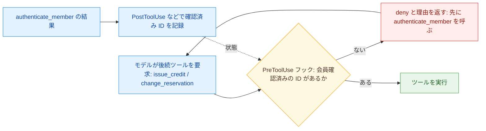

# ワークフローの順序をプログラムで強制する（前提ゲートとプロンプト指示の違い）

> ドメイン: 1. エージェントの構成とオーケストレーション（27%） ／ 更新: 2026-11-20

!!! abstract "ひとことで"
    「A を終えてから B を呼ぶ」を必ず守らせたいなら、プロンプトではなく==コードの前提ゲート==で止める。順序違反がお金・安全・規約の問題になる手順は、プログラムでの強制（programmatic enforcement）を選ぶ。

## 仕組み

前提ゲート（prerequisite gate）は、条件を満たすまで後続のツール呼び出しを止める仕組みだ。フック（hook）でツール呼び出しの前に状態を見て、満たしていなければ止める。例は自作の会員予約エージェントで、`authenticate_member` が確認済みの ID を返すまで、`issue_credit` と `change_reservation` を通さない。

| | プログラムでの強制 | プロンプト指示（prompt-based guidance） |
|---|---|---|
| 実体 | PreToolUse フック、canUseTool、ツールの実装の中の検査 | システムプロンプト、few-shot の例 |
| 保証 | 決定的（毎回同じ判定） | 確率的（守らないことがある） |
| 向く場面 | 順序違反が実害になる手順 | 好ましい進め方の誘導、判断が要る場面 |
| 違反したとき | 呼び出し自体が実行されない | 実行されてから気づく |

プロンプト指示は失敗率がゼロにならないので、間違えても害が小さい手順の誘導に使う。ゲートは「前のツールが呼ばれたか」ではなく、==「前のツールが確認済みの値を返したか」==で判定する。確認済みの値に頼る後続ツールが複数あるなら、すべてに同じゲートを掛ける。1つだけ止めても、別のツールが抜け道になるからだ。止めたときは、モデルが次に何をすべきか分かる理由を返す。黙って失敗させると、モデルは同じ呼び出しを繰り返す。

??? info "フックと権限の細かい決まり"
    - Agent SDK の PreToolUse フックは `permissionDecision: "deny"` で呼び出しを止め、`permissionDecisionReason` でモデルに理由を伝える
    - フックの入力には `session_id` があり、`tool_use_id` で同じ呼び出しの PreToolUse と PostToolUse を対応づけられる（セッションごとに確認済みの状態を持てる）
    - 複数の PreToolUse フックの判定が食い違うと、deny が最優先（deny > defer > ask > allow）
    - 権限の評価はフックが最初。フックが allow を返しても、deny ルールは後で評価される（評価の6段階のうち一部を省略）
    - allowedTools は承認なしで通すか、disallowedTools は拒否・除外するかを決めるだけで、「どの順に呼ぶか」は決めない。allowedTools に無いツールも使える。ツール名だけの disallowedTools は定義ごと外し、`Bash(rm *)` のような書き方は合う呼び出しだけを拒否する
    - allowedTools で自動承認されたツールの呼び出しは canUseTool に届かない。必ず通したい検査は PreToolUse フックに置く
    - Claude Code のプロンプト型フック（`type: "prompt"`）はモデルが判定するので、決定的な強制にはならない
    - Messages API で自前のループを書くときは、アプリがツールを実行する。ゲートで止めた呼び出しは実行せず、`is_error: true` の tool_result で理由を返せばよい
    - ガイドの言う「non-zero failure rate」の具体的な数値は、公式ドキュメントでは未確認
    - 金額の上限で止めて人に回すなど、フックでの遮断とデータの正規化の詳細は別ノート（Agent SDK のフック、1.5）。途中で人に引き継ぐときの要約の項目と、複数の用件を含む依頼の分解も別ノート（Structured handoff、1.4）

## 試験での見分け方

| 問われること | ○ 正しい | × ひっかけ |
|---|---|---|
| 本人確認の前の送金を防ぐ | 違反が起きる前に、コードで後続ツールを止める | システムプロンプトで「必ず先に確認」と指示する（確率的にしか守られない） |
| 規則の強さで選ぶ | 「必ず」ならフック・ゲート、「できれば」ならプロンプト | 文体の統一のような軽い規則までフックで強制する |
| ゲートの判定条件 | 確認済みの値を記録し、後続の呼び出しの値と照合する | 前のツールが1回でも呼ばれたら通す |
| ゲートを掛ける範囲 | 確認済みの値に頼る後続ツールすべて | 代表の1つにだけ掛ける |
| 止めたあと | 次に呼ぶべきツールを理由として返す | 理由なしで失敗させる |
| 順序を決める手段 | PreToolUse フックでの判定 | allowedTools / disallowedTools で順序を決めようとする |

## 確認問題

**Q1.** 社員の経費精算を受け付けるサポートエージェントを Agent SDK で作っている。`check_receipt` の照合が済むまで `approve_expense` を止める PreToolUse フックを入れた。ところが、照合前の経費が `pay_expense` で直接支払われた。最も適切な直し方はどれか。（1つ選べ）
{ .quiz-q }

- A. システムプロンプトに「`pay_expense` は `check_receipt` の後にだけ呼ぶこと」と書き足す
- B. allowedTools から `pay_expense` を外し、承認なしでは呼べないようにする
- C. `pay_expense` にも同じゲートを掛け、照合済みでなければ deny して理由を返す
- D. disallowedTools に `pay_expense` を入れ、エージェントから支払えないようにする

??? success "答えと解説"
    **正解: C。** 照合済みの結果に頼る後続ツールすべてに、同じゲートを掛ける。

    - A: プロンプト指示は確率的で、守られないことがある。順序違反がお金の問題になる手順には足りない
    - B: allowedTools は承認なしで通すかを決めるだけで、呼ぶ順は決めない。外しても使える
    - D: ツール名だけの disallowedTools は定義ごと外すので、照合済みの正しい支払いもできなくなる

**Q2.** 同じエージェントに、次の4つの規則を守らせたい。プロンプト指示ではなく、コードの前提ゲートで強制すべきものはどれか。（1つ選べ）
{ .quiz-q }

- A. 回答の文体を「です・ます」にそろえる
- B. 回答の最初の1文で、申請の結論を述べる
- C. 領収書の画像が読みにくければ、撮り直しを頼む
- D. 照合が済んでいない申請には、支払いを実行しない

??? success "答えと解説"
    **正解: D。** 順序違反がお金の実害になる手順は、決定的に止めるゲートで強制する。

    - A: 文体の揺れは実害が小さい。軽い規則までフックで強制する必要はない
    - B: 好ましい進め方の誘導なので、プロンプト指示で足りる
    - C: 読みにくいかどうかは判断が要る。判断が要る場面はプロンプト指示が向く

**Q3.** ゲートを「`check_receipt` が1回でも呼ばれたら `pay_expense` を通す」と実装した。すると、照合に失敗した申請や、別の申請の領収書を照合しただけの申請まで支払われた。最も適切な直し方はどれか。（1つ選べ）
{ .quiz-q }

- A. `check_receipt` を呼べる回数を、申請ごとに1回までに制限する
- B. 照合済みと返った申請 ID を記録し、`pay_expense` の申請 ID と一致するときだけ通す
- C. ゲートは今のままにし、システムプロンプトに「照合に失敗したら支払わない」と書き足す
- D. `pay_expense` の直前の1回の `check_receipt` 呼び出しだけを、照合として有効にする

??? success "答えと解説"
    **正解: B。** ゲートは「前のツールが呼ばれたか」ではなく、「確認済みの値を返したか」で判定する。

    - A: 回数を絞っても、呼ばれたかどうかで判定する点は変わらない
    - C: 抜けているのはゲートの条件だ。プロンプトで補っても確率的にしか守られない
    - D: 直前に呼ばれたかを見るだけで、照合の結果も申請 ID も確かめていない

## 出典
- 公式の Exam Guide v1.1（Claude Certified Architect – Foundations）タスクステートメント 1.4・1.5（公式）
- [Intercept and control agent behavior with hooks（Agent SDK）](https://code.claude.com/docs/en/agent-sdk/hooks)（公式）
- [Configure permissions（Agent SDK）](https://code.claude.com/docs/en/agent-sdk/permissions)（公式）
- [Automate workflows with hooks（Claude Code）](https://code.claude.com/docs/en/hooks-guide)（公式）
- [Handle tool calls](https://platform.claude.com/docs/en/agents-and-tools/tool-use/handle-tool-calls)（公式）
