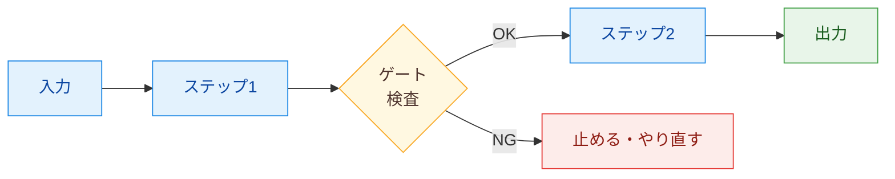

# タスク分解の選び方: プロンプトチェーンと動的な分解（Prompt chaining vs dynamic decomposition）

> ドメイン: 1. エージェントの構成とオーケストレーション（27%） ／ 更新: 2026-11-20

!!! abstract "ひとことで"
    決め手は ==サブタスクを開始前に書き出せるか== の1つ。書き出せるならプロンプトチェーン（prompt chaining）、途中で分かったことで次の手が変わるなら動的な分解（dynamic decomposition）を選ぶ。

## 仕組み

プロンプトチェーンは、決まった順に LLM を呼び、前の出力を次へ渡す。観点の決まった複数の確認に向く。動的な分解は、途中の発見からサブタスクを作る。ゴールだけ決まっていて道筋が見えない調査に向く。書き出せない仕事をチェーンで固めると、見つかったことに合わせて計画を直せない。

| | プロンプトチェーン | 動的な分解 |
|---|---|---|
| サブタスクが決まる時点 | 設計時（コードの順序で固定） | 実行時（途中の発見から作る） |
| 公式の呼び名 | Prompt chaining（ワークフローの一種） | Orchestrator-workers（中心の LLM が分解して配り、まとめる） |
| 向く仕事 | 観点が決まった多面的なレビュー、定型の変換 | 原因調査、リサーチ、手探りの大きな改修 |
| 強み | 各ステップが簡単になり正確さが上がる。途中にゲート（gate、プログラムによる検査）を挟める | 発見に合わせて計画を足し・直せる |
| 弱み | 呼び出しが増えて遅くなる。想定外の発見に対応できない | 動きが読みにくく、トークンも増えやすい |

チェーンの各ステップは別の API 呼び出しなので、途中で記録・評価・分岐ができる。ステップ間にゲートを挟めば、ずれたときに早めに止められる。

動的な分解は、いきなり作業しない。最初の一手は構造の把握と優先度づけだ。ガイドの例「テストの無い古いコードベースに網羅的なテストを足す」では、まず構造を描き出し、影響の大きい所から順に計画する。依存が見つかるたびに計画を組み直す。最初から全ファイルを均等に順番に処理する固定の手順にはしない。

「動的な方が賢いので常に上」ではない。手順が決まる仕事を動的にすると、遅く・高く・ぶれやすくなるだけだ。迷ったら単純な方から始め、複雑な構成は結果が良くなると示せるときだけ足す（公式の推奨）。

??? info "細かい注記と、関連するノート"
    - 現行の公式のチェーンの例は自己修正（下書き → 基準で見直し → 直す）
    - タスク分解の一例: 大きなレビューを「1ファイルずつのパス＋ファイル横断のパス」に分けて注意の分散（attention dilution）を防ぐ。詳しくは 4.6 のノート（`ccaf/notes/04-prompt-engineering/independent-multipass-review.md`）
    - Claude Code では、構造の把握のような広い探索を組み込みの Explore エージェントに任せられる
    - 分解の粒度が細かすぎる・狭すぎると、範囲に抜けが出る（1.2 のコーディネーターの論点と同じ）
    - ガイドの「prompt chaining」は、今の公式では「Prompting best practices」ページの1節にまとまっている（旧「Chain complex prompts」ページの URL はそこへ移る）
    - ガイドの「legacy にテストを足す」の3段の手順（構造把握 → 高影響箇所 → 適応する計画）は、公式ドキュメントで同じ形の記述は未確認（考え方は orchestrator-workers と調査エージェントの記事に一致）

## 試験での見分け方

| 問われること | ○ 正しい | × ひっかけ |
|---|---|---|
| 毎回同じ観点で処理する（例: 契約書の条項チェック、用語の統一、要約） | プロンプトチェーン | 動的な分解（遅く・高く・ぶれやすくなるだけ） |
| 「なぜ夜間バッチだけ失敗するのか」を調べる | 動的な分解 | 固定のパイプライン（発見に合わせて計画を直せない） |
| チェーンの精度を上げる | ステップ間にゲートを挟み、ずれたら早めに止める | ステップ間に検査を置かない（ずれが後段まで流れる） |
| 動的な分解の最初の一手 | 構造の把握と優先度づけ | 全ファイルを均等に順番に処理し始める |
| チェーンとサブエージェントの区別 | チェーンはコードが順序を決め、動的な分解は LLM が決める | チェーン＝サブエージェントと考える |

## 確認問題

**Q1.** カスタマーサポート部門で、毎日届く問い合わせメールを「言語判定 → 個人情報のマスク → カテゴリ分類 → 返信案」の順に処理する仕組みを作る。手順と観点は前もって決まっている。最も適切な設計はどれか。（1つ選べ）
{ .quiz-q }

- A. プロンプトチェーンにし、マスクの後に個人情報の残りを調べるゲートを挟む
- B. 動的な分解にし、中心の LLM にメールごとの処理の手順を決めさせる
- C. 4つの指示を1回の呼び出しにまとめ、最後の返信案だけを検査する
- D. プロンプトチェーンにし、ステップ間に検査は置かず、最後の返信案だけを確かめる

??? success "答えと解説"
    **正解: A。** サブタスクを開始前に書き出せるので、プロンプトチェーンを選び、ステップ間のゲートでずれを早めに止める。

    - B: 手順が決まる仕事を動的にすると、遅く・高く・ぶれやすくなるだけだ
    - C: ステップに分けないので、各ステップを簡単にして正確さを上げる利点も、途中のゲートも得られない
    - D: ステップ間に検査が無いと、マスクの漏れが後段まで流れる

**Q2.** 開発チームが、本番環境だけで起きるメモリリークの原因を Claude に調べさせている。今は「ログ収集 → キャッシュ調査 → 結論」の固定のチェーンで調べさせている。最初に疑ったキャッシュは、調べた結果、無関係と分かった。最も適切な設計はどれか。（1つ選べ）
{ .quiz-q }

- A. 今のチェーンを残し、各段の間にゲートを挟んで精度を上げる
- B. 疑わしいモジュールを最初にすべて書き出し、一覧の上から均等に1つずつ調べる
- C. キャッシュの段を飛ばす分岐をコードに書き足し、残りの段で調べ続ける
- D. 動的な分解にし、途中の発見から次に調べるサブタスクを作り直す

??? success "答えと解説"
    **正解: D。** 途中で分かったことで次の手が変わる調査なので、動的な分解を選ぶ。

    - A: ゲートを挟んでも、固定の手順は発見に合わせて計画を直せない
    - B: 最初の一手は構造の把握と優先度づけだ。均等に順番に処理する固定の手順にはしない
    - C: 分岐を足しても、想定していない次の発見には対応できない

**Q3.** 社内の数百本の古い集計スクリプトを、新しいジョブ基盤へ移す作業を Claude Code に任せる。チームは「全スクリプトを名前順に1つずつ書き換えるチェーン」を提案した。どのスクリプトが別のスクリプトの出力を読んでいるかは、まだ分かっていない。最も適切な進め方はどれか。（1つ選べ）
{ .quiz-q }

- A. 提案どおり名前順のチェーンで進め、各スクリプトの後にテストのゲートを挟む
- B. 名前順のチェーンで進め、依存で詰まったスクリプトは最後にまとめて直す
- C. まずスクリプト間の依存を把握し、影響の大きい所から計画して、依存が見つかるたびに直す
- D. 全スクリプトを同じ手順で書き換えるよう、最初に1つの固定の計画を書き切る

??? success "答えと解説"
    **正解: C。** 先の読めない仕事は、構造の把握と優先度づけから始め、発見に合わせて計画を組み直す。

    - A: ゲートでずれは止められるが、名前順の固定の手順は依存の発見に合わせて直せない
    - B: 依存は進めて初めて分かる。後回しにしても、計画を直さない点は変わらない
    - D: 書き出せない仕事を固定の計画で固めると、見つかったことに合わせて直せない

## 出典
- Claude Certified Architect – Foundations Exam Guide v1.1（公式 PDF、Task Statement 1.6）
- [Building effective agents](https://www.anthropic.com/engineering/building-effective-agents)（公式。Prompt chaining、Orchestrator-workers、ワークフローとエージェントの違い、単純な方から始める）
- [Prompting best practices – Chain complex prompts](https://platform.claude.com/docs/en/build-with-claude/prompt-engineering/claude-prompting-best-practices)（公式。別の API 呼び出しに分ける利点、自己修正のチェーン）
- [How we built our multi-agent research system](https://www.anthropic.com/engineering/multi-agent-research-system)（公式。調査は手順を前もって決めにくい、発見に合わせて計画を直す、依存の多い仕事は不向き）
- [Best practices for Claude Code](https://code.claude.com/docs/en/best-practices)（公式。広い探索は Explore エージェントに任せる、まず数ファイルで試してから残りを進める）
