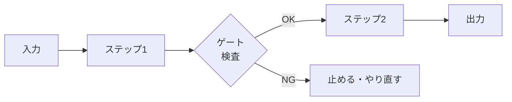

# タスク分解の選び方: プロンプトチェーンと動的な分解（Prompt chaining vs dynamic decomposition）

> ドメイン: 1. エージェントの構成とオーケストレーション（27%） ／ 更新: 2026-11-20

## 3行まとめ
- 手順を前もって決められるならプロンプトチェーン（prompt chaining、決まった順に LLM を呼び、前の出力を次へ渡す）、途中で分かったことで次の手が変わるなら動的な分解（dynamic decomposition）を選ぶ
- チェーンは「観点の決まった複数の確認」に向き、動的な分解は「ゴールだけ決まっていて道筋が見えない調査」に向く
- 決め手は1つ: サブタスクを開始前に書き出せるか。書き出せないのにチェーンで固めると、見つかったことに合わせて計画を直せない

## 仕組み

### 2つの方式を並べる

| | プロンプトチェーン | 動的な分解 |
|---|---|---|
| サブタスクが決まる時点 | 設計時（コードの順序で固定） | 実行時（途中の発見から作る） |
| 公式の呼び名 | Prompt chaining（ワークフローの一種） | Orchestrator-workers（中心の LLM が分解して配り、まとめる） |
| 向く仕事 | 観点が決まった多面的なレビュー、定型の変換 | 原因調査、リサーチ、手探りの大きな改修 |
| 強み | 各ステップが簡単になり正確さが上がる。途中にゲート（gate、プログラムによる検査）を挟める | 発見に合わせて計画を足し・直せる |
| 弱み | 呼び出しが増えて遅くなる。想定外の発見に対応できない | 動きが読みにくく、トークンも増えやすい |

### プロンプトチェーンの流れ

- 各ステップは別の API 呼び出しなので、途中で記録・評価・分岐ができる
- 現行の公式の例は自己修正（下書き → 基準で見直し → 直す）
- タスク分解の一例: 大きなレビューを「1ファイルずつのパス＋ファイル横断のパス」に分けて注意の分散（attention dilution）を防ぐ。詳しくは 4.6 のノート（`ccaf/notes/04-prompt-engineering/independent-multipass-review.md`）

### 動的な分解の流れ

- 例: 「テストの無い古いコードベースに網羅的なテストを足す」（ガイドの例）
  - まず構造を描き出し、影響の大きい所から順に計画する。依存が見つかるたびに計画を組み直す
  - 最初から全ファイルを均等に順番に処理する固定の手順にはしない
- Claude Code では、構造の把握のような広い探索を組み込みの Explore エージェントに任せられる

## 試験で問われそうなポイント
- 毎回同じ観点（例: 契約書の条項チェック → 用語の統一 → 要約）で処理する仕事 → プロンプトチェーン
- 「なぜ夜間バッチだけ失敗するのか」のように、調べるまで次の手が分からない仕事 → 動的な分解
- チェーンで精度を上げたいとき → ステップ間にゲートを挟み、ずれたら早めに止める
- 動的な分解の最初の一手 → いきなり作業せず、構造の把握と優先度づけから始める
- 迷ったら単純な方から。複雑な構成は、結果が良くなると示せるときだけ足す（公式の推奨）

## 間違えやすいところ
- 「動的な方が賢いので常に上」ではない。手順が決まる仕事を動的にすると、遅く・高く・ぶれやすくなるだけ
- 逆に、先の読めない調査を固定のパイプラインで組むのは誤り（発見に合わせて計画を直せない）
- 分解の粒度が細かすぎる・狭すぎると、範囲に抜けが出る（1.2 のコーディネーターの論点と同じ）
- チェーン＝サブエージェントではない。チェーンはコードが順序を決め、動的な分解は LLM が順序を決める
- ガイドの「prompt chaining」は今の公式では「Prompting best practices」ページの1節にまとまっている（旧「Chain complex prompts」ページの URL はそこへ移る）
- ガイドの「legacy にテストを足す」の3段の手順（構造把握 → 高影響箇所 → 適応する計画）は、公式ドキュメントで同じ形の記述は未確認（考え方は orchestrator-workers と調査エージェントの記事に一致）

## 確認問題
1. 社内の問い合わせメールを毎日「言語判定 → 個人情報のマスク → カテゴリ分類 → 返信案」の順に処理したい。どの分解を選ぶか。
   

答え
プロンプトチェーン。手順と観点が前もって決まっている。マスクの後にゲート（個人情報が残っていないかの検査）を挟むと、後段に誤りを流さない。

2. 本番だけで起きるメモリリークの原因を探す。最初に疑ったキャッシュは無関係と分かった。どう設計すべきか。
   

答え
動的な分解。途中の発見（キャッシュは無関係）で次の調査対象が変わるため、固定の手順では対応できない。発見ごとにサブタスクを作り直す。

3. 古いモノリスを新しいフレームワークへ移したい。チームは「全モジュールを名前順に1つずつ書き換えるチェーン」を提案した。何が問題か。
   

答え
移行は先の読めない仕事で、依存は進めて初めて分かる。まず構造と依存を把握し、影響の大きい所から優先順の計画を立て、依存が見つかるたびに計画を直す動的な分解にすべき。

## 出典
- Claude Certified Architect – Foundations Exam Guide v1.1（公式 PDF、Task Statement 1.6）
- [Building effective agents](https://www.anthropic.com/engineering/building-effective-agents)（公式。Prompt chaining、Orchestrator-workers、ワークフローとエージェントの違い、単純な方から始める）
- [Prompting best practices – Chain complex prompts](https://platform.claude.com/docs/en/build-with-claude/prompt-engineering/claude-prompting-best-practices)（公式。別の API 呼び出しに分ける利点、自己修正のチェーン）
- [How we built our multi-agent research system](https://www.anthropic.com/engineering/multi-agent-research-system)（公式。調査は手順を前もって決めにくい、発見に合わせて計画を直す、依存の多い仕事は不向き）
- [Best practices for Claude Code](https://code.claude.com/docs/en/best-practices)（公式。広い探索は Explore エージェントに任せる、まず数ファイルで試してから残りを進める）
