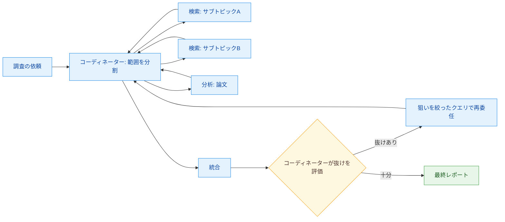

# 調査範囲の分割と、統合結果の抜けを埋める反復ループ（Scope partitioning & iterative refinement）

> ドメイン: 1. エージェントの構成とオーケストレーション（27%） ／ 更新: 2026-11-20

!!! abstract "ひとことで"
    コーディネーターは調査範囲を==重ならず抜けもない単位==に分けて渡す。統合（synthesis）の結果に抜けがあれば、その領域だけを狙いを絞ったクエリで再委任し、==網羅が十分になるまで==統合し直す。

## 仕組み

コーディネーターは範囲をサブトピックや情報源の種類で分け、サブエージェントに割り当てる。サブエージェントは独立したコンテキストで動き、最終の報告だけを親に返す。だから範囲の指定はプロンプトで明示する。通信はすべてコーディネーター経由になる（[ハブ＆スポーク構成](coordinator-subagent-pattern.md)）。

| 分け方（partitioning） | 例 | ねらい |
|---|---|---|
| サブトピックごと | 「医療」「教育」「金融」を別々のエージェントに | 重複を減らす |
| 情報源の種類ごと | Web 記事／学術論文／社内文書 | 同じ資料を何度も読まない |

渡す指示には、目的、出力の形式、使うツールと情報源、担当の境界を入れる（公式ブログ）。指示があいまいだと、同じ範囲を2体が調べ、別の範囲が誰にも割り当てられない。

反復ループ（iterative refinement）では、コーディネーターが統合結果を読んで足りない領域を見つけ、その領域だけを再委任してから統合を呼び直す。抜けを埋めるのは、統合エージェント単独ではなく、評価して再委任するコーディネーターだ。終わりは「網羅が十分か」で判定し（具体的な基準は未確認）、回数の上限だけでは止めない（1.1 のアンチパターンと同じ考え方）。再委任しても取れなかった領域は、統合結果に「この領域は情報源が無く抜けている」と注記する（5.3 の範囲）。

報告に一部の領域が丸ごと無く、各サブエージェントは割り当て通りに動いているなら、原因は**コーディネーターの分解が狭すぎる**ことだ。たとえば「都市の交通問題」を鉄道とバスだけに分けると、道路・自転車・物流が落ちる。「検索クエリが狭い」とは別の問題で、直すのは割り当て側になる。

## 試験での見分け方

| 問われること | ○ 正しい | × ひっかけ |
|---|---|---|
| 一部の分野が丸ごと抜けた | コーディネーターの分解（割り当て）を直す | 下流のエージェントや検索クエリを直す |
| 複数のサブエージェントが同じ資料を集めている | 担当の境界を、サブトピックか情報源の種類で分ける | 境界をあいまいにしたまま任せる（重複し、抜けも出る） |
| 統合結果に浅い領域がある | その領域だけ追加クエリで再委任し、統合し直す | 全体をやり直す |
| 反復をいつ止めるか | コーディネーターが網羅を評価して止める | 「最大N回」だけで止める |
| 単純な質問 | 少数のエージェントで済ませる（規模を複雑さに合わせる） | 全パイプラインを回す |

## 確認問題

??? question "Q1. 反復ループを「再委任は最大2回」だけで止める設計にした。2回目の統合のあとも一部の領域の網羅が足りず、最終レポートはその抜けに触れずに出た。どう直す？"
    終わりの判定を、回数ではなく「網羅が十分か」というコーディネーターの評価にする。再委任しても情報源が無く取れなかった領域は、黙って落とさず、統合結果に「この領域は抜けている」と注記する。

??? question "Q2. 3体の検索エージェントが、同じ有名な記事を何度も要約してトークンを無駄にしている。どう設計を変える？"
    担当の境界を明示して範囲を分ける。サブトピックごと、または情報源の種類（Web・論文・業界レポートなど）ごとに割り当て、目的と出力形式も指示に入れる。

??? question "Q3. 統合結果を読むと、規制の動向の節だけが極端に薄い。いちばん効率のよい対応は？"
    コーディネーターが抜けと判定し、規制の動向に絞ったクエリで検索・分析のエージェントに再委任する。得た結果で統合を呼び直す。全体のやり直しや、回数だけでの打ち切りは不適切だ。

## 出典
- Claude Certified Architect – Foundations Exam Guide v1.1（公式 PDF）タスクステートメント 1.2
- [How we built our multi-agent research system](https://www.anthropic.com/engineering/multi-agent-research-system)（公式: 指示に入れる4要素、規模の調整、追加の調査の判断）
- [Building effective AI agents](https://www.anthropic.com/engineering/building-effective-agents)（公式: orchestrator-workers、evaluator-optimizer）
- [Subagents in the SDK](https://code.claude.com/docs/en/agent-sdk/subagents)（公式: 独立したコンテキスト、最終の報告だけを返す）
- 未確認: 「網羅が十分」と判定する具体的な基準や手順は、公式ドキュメントでは確認できなかった
