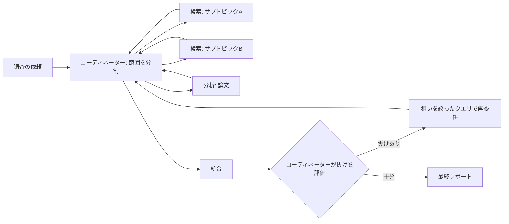

# 調査範囲の分割と、統合結果の抜けを埋める反復ループ（Scope partitioning & iterative refinement）

> ドメイン: 1. エージェントの構成とオーケストレーション（27%） ／ 更新: 2026-11-20

## 3行まとめ
- コーディネーターは調査範囲を、重ならず抜けもない単位（サブトピック・情報源の種類）に分けてサブエージェントに渡す
- 統合（synthesis）の結果に抜けがあれば、狙いを絞ったクエリで再委任し、統合し直す。十分な網羅になるまで回す
- 報告に一部の領域が丸ごと無く、各サブエージェントは正しく動いているなら、原因は**コーディネーターの分解が狭すぎる**こと

## 仕組み

### 範囲の分け方（Partitioning）
| 分け方 | 例 | ねらい |
|---|---|---|
| サブトピックごと | 「音楽」「映画」「出版」を別々のエージェントに | 重複を減らす |
| 情報源の種類ごと | Web 記事／学術論文／社内文書 | 同じ資料を何度も読まない |

- 渡す指示に入れるもの: 目的、出力の形式、使うツールと情報源、担当の境界（公式ブログ）
- 指示があいまいだと、同じ範囲を2体が調べ、別の範囲が誰にも割り当てられない

### 反復ループ（Iterative refinement）
- コーディネーターが統合結果を読み、足りない領域を見つける → その領域だけを再委任 → 統合を呼び直す
- 終わりの判定は「網羅が十分か」。回数の上限だけで止めない（1.1 のアンチパターンと同じ考え方）
- 取れなかった領域は、統合結果に「この領域は情報源が無く抜けている」と注記する（5.3 の範囲）

### 前提になる仕組み（→ 別ノート: coordinator-subagent-pattern）
- サブエージェントは独立したコンテキストで動き、最終の報告だけを親に返す。範囲の指定はプロンプトで明示する
- 通信はすべてコーディネーター経由（ハブ＆スポーク）。詳しくは別ノート

## 試験で問われそうなポイント
- 一部の分野が丸ごと抜けた → 下流のエージェントではなく、コーディネーターの分解（割り当て）を直す
- 複数のサブエージェントが同じ資料を集めている → 担当の境界をサブトピックか情報源の種類で分ける
- 統合結果に浅い領域がある → 全体をやり直さず、その領域だけ追加クエリで再委任する
- 単純な質問 → 全パイプラインを回さず、少数のエージェントで済ませる（規模を質問の複雑さに合わせる）

## 間違えやすいところ
- アンチパターン: 分解が狭すぎて、広いテーマの一部しか調べない（例: 「都市の交通問題」を鉄道とバスだけに分け、道路・自転車・物流を落とす）
- アンチパターン: 担当の境界があいまいで、作業が重複し、抜けも出る
- アンチパターン: 反復を「最大N回」だけで止める。網羅の評価で止める
- 「検索クエリが狭い」と「分解が狭い」は別。各エージェントが割り当て通りに動いているなら、問題は割り当て側
- 抜けを埋めるのは統合エージェント単独ではなく、評価して再委任するコーディネーター

## 確認問題
1. 「再生可能エネルギーの普及の課題」を調べさせたところ、報告は太陽光と風力だけで、送電網・蓄電・政策が無かった。各サブエージェントのログに失敗は無い。最初に見直すべきところは？
   

答え
コーディネーターのタスク分解。各エージェントは割り当て通りに動いており、割り当てが狭いのが原因。分解の段階で送電網・蓄電・政策などを含む範囲に分け直す。

2. 3体の検索エージェントが、同じ有名な記事を何度も要約して、トークンを無駄にしている。どう設計を変える？
   

答え
担当の境界を明示して範囲を分ける。サブトピックごと、または情報源の種類（Web・論文・業界レポートなど）ごとに割り当て、目的と出力形式も指示に入れる。

3. 統合結果を読むと、規制の動向の節だけが極端に薄い。いちばん効率のよい対応は？
   

答え
コーディネーターが抜けとして判定し、規制の動向に絞ったクエリで検索・分析のエージェントに再委任し、得た結果で統合を呼び直す。全体のやり直しや、回数だけで打ち切るのは不適切。

## 出典
- Claude Certified Architect – Foundations Exam Guide v1.1（公式 PDF）タスクステートメント 1.2
- [How we built our multi-agent research system](https://www.anthropic.com/engineering/multi-agent-research-system)（公式: 指示に入れる4要素、規模の調整、追加の調査の判断）
- [Building effective AI agents](https://www.anthropic.com/engineering/building-effective-agents)（公式: orchestrator-workers、evaluator-optimizer）
- [Subagents in the SDK](https://code.claude.com/docs/en/agent-sdk/subagents)（公式: 独立したコンテキスト、最終の報告だけを返す）
- 未確認: 「網羅が十分」と判定する具体的な基準や手順は、公式ドキュメントでは確認できなかった
