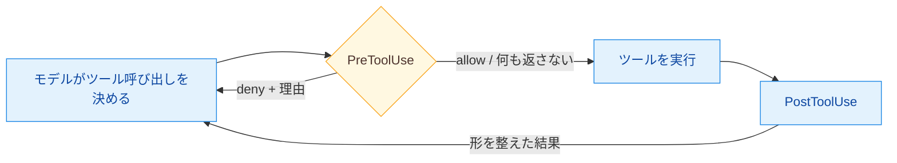

# Agent SDK のフックによるツール呼び出しの遮断とデータの正規化

> ドメイン: 1. エージェントの構成とオーケストレーション（27%） ／ 更新: 2026-11-20

!!! abstract "ひとことで"
    呼び出す前に止めるなら ==PreToolUse==、結果をモデルに渡す前に整えるなら ==PostToolUse==。業務ルールを「必ず」守らせるなら、プロンプトの指示ではなくフックを選ぶ。

## 仕組み

フック（hook）は、エージェントの実行の決まった時点で必ず呼ばれる自分のコードだ。プロンプトの指示は確率的で、守られない率がゼロにならない。フックはコードなので、確定的に制御できる。PostToolUse の時点でツールはもう実行済みなので、変えられるのはモデルに見える結果だけだ。止めたいなら PreToolUse に置く。



| 時点 | できること（返す値） | 試験での用途 |
|---|---|---|
| PreToolUse | `permissionDecision: "deny"` で止める。`permissionDecisionReason` でモデルに理由を伝える。`updatedInput` で引数を書き換える | ルール違反の操作を止めて、別の手順（人への引き継ぎなど）に回す |
| PostToolUse | `updatedToolOutput` で結果を差し替える。`additionalContext` で結果に情報を足す | MCP ツールごとにばらばらな形式をそろえる |

フックは `ClaudeAgentOptions(hooks=...)` に、イベント名ごとに matcher とコールバックの組で登録する。matcher は、どのツールに効かせるかの絞り込みだ。matcher なしだと全ツールで動く。MCP ツールの名前は `mcp__<サーバー名>__<ツール名>` なので、`mcp__crm__.*` のような正規表現で絞れる。

!!! example "最小の例（Python。割引率の上限を強制する。題材は自作）"
    ```python
    async def cap_discount(input_data, tool_use_id, context):
        if input_data["tool_input"].get("discount_pct", 0) > 20:
            return {"hookSpecificOutput": {
                "hookEventName": "PreToolUse",
                "permissionDecision": "deny",
                "permissionDecisionReason": "20%超の割引は不可。request_manager_approval で承認を依頼すること"}}
        return {}  # 意見なし

    options = ClaudeAgentOptions(hooks={
        "PreToolUse": [HookMatcher(matcher="mcp__billing__apply_discount", hooks=[cap_discount], on_failure="block")],
        "PostToolUse": [HookMatcher(matcher="mcp__(orders|shipping)__.*", hooks=[normalize_dates])]})
    ```
    `normalize_dates` は、Unix 時刻（1970年からの秒数）や数値のステータスコードを ISO 8601 の日時や `"shipped"` などの語に直し、`updatedToolOutput` で返す想定。

??? info "細かい決まりと、ガイドとの対応"
    - 複数のフックの判断が食い違うと、制限が強いほうが勝つ（deny ＞ defer ＞ ask ＞ allow）
    - PostToolUse の `decision: "block"` は理由を結果の横に添えるだけで、元の出力はモデルに見える。差し替えるのは `updatedToolOutput`
    - 組み込みツールの `updatedToolOutput` は、出力の形が合わないと無視され、元の出力が使われる。MCP ツールの出力は形を検証されない
    - 既定では、コールバックが例外を出すと操作はそのまま進む。ガードは `on_failure="block"`（TS は `onFailure`）で、失敗時も止まるようにする（SDK の版の条件あり）
    - `systemMessage` はユーザー向けの表示。モデルに伝えるのは `permissionDecisionReason` や `additionalContext`
    - `updatedMCPToolOutput` は MCP ツール専用の古い項目。現行の公式は `updatedToolOutput` を勧める。ガイドはこの項目名を挙げていない
    - ガイドの Knowledge は PreToolUse という名前を出さず「呼び出しを遮るフック」と書く。公式ドキュメントでは PreToolUse にあたる
    - ツールの呼び出し順の強制（前提ゲート）は、1.4 の `programmatic-workflow-enforcement` のノートが主

## 試験での見分け方

<div class="vs" markdown>

| 問われること | ○ 正しい | × ひっかけ |
|---|---|---|
| 金額や割合の上限を絶対に超えさせない | PreToolUse で deny する | システムプロンプトに「必ず〜すること」と書き足す |
| 止めたあとの行き先 | `permissionDecisionReason` で代わりの手順（エスカレーション用ツールなど）を示す | 理由を `systemMessage` に書く（ユーザー向けの表示でモデルに届かない） |
| MCP ツールごとに日時やステータスの形式がばらばら | PostToolUse で1つの形式にそろえてから渡す | プロンプトで「変換して比べよ」と頼む |
| 実行前に止めたい | PreToolUse に置く | PostToolUse で確かめる（もう実行済み） |
| 1つの操作だけに効かせる | matcher でツール名を絞る | matcher なしで登録する（全ツールで動く） |

</div>

## 確認問題

**Q1.** 通販サイトのサポートエージェントを Agent SDK で作っている。注文の MCP サーバーは更新日時を Unix 時刻で、配送の MCP サーバーは ISO 8601 で返す。エージェントは「どちらの更新が新しいか」をよく取り違える。最も確実な対策はどれか。（1つ選べ）
{ .quiz-q }

<div class="quiz" data-answer="D" markdown>

- A. システムプロンプトに「Unix 時刻は ISO 8601 に直してから比べること」と書き足す
- B. PostToolUse フックで `decision: "block"` を返し、形式が違うことを理由に添える
- C. PostToolUse フックで日時を変換し、変換した値を `systemMessage` に書いて伝える
- D. PostToolUse フックで両方の日時を ISO 8601 にそろえ、`updatedToolOutput` で差し替える

</div>

??? success "答えと解説"
    **正解: D。** ばらばらな形式は、PostToolUse で1つにそろえてからモデルに渡す。

    - A: プロンプトでの依頼は確率的で、取り違えが残る
    - B: `decision: "block"` は理由を添えるだけで、元の出力はそのままモデルに見える
    - C: `systemMessage` はユーザー向けの表示で、モデルには届かない

**Q2.** 同じエージェントに、ポイントを手動で付ける `grant_points` ツールがある。1回に 3,000 ポイントを超える付与は、`request_supervisor_approval` で上長の承認を取る決まりだ。最も適切な実装はどれか。（1つ選べ）
{ .quiz-q }

<div class="quiz" data-answer="B" markdown>

- A. PostToolUse フックで付与量を確かめ、超えていれば `additionalContext` で警告を足す
- B. PreToolUse フックで付与量を見て deny し、`permissionDecisionReason` で承認依頼を示す
- C. システムプロンプトに「3,000 ポイントを超える付与は必ず承認を依頼すること」と書き足す
- D. PreToolUse フックで付与量を見て deny し、承認依頼への案内を `systemMessage` に書く

</div>

??? success "答えと解説"
    **正解: B。** 実行前に止めるのは PreToolUse で、代わりの手順は `permissionDecisionReason` でモデルに伝える。

    - A: PostToolUse の時点で、ポイントはもう付与されている
    - C: プロンプトの指示は守られない率がゼロにならない。「必ず」守らせる規則には足りない
    - D: 止める点は正しいが、`systemMessage` はモデルに届かない。モデルは次に何をすべきか分からない

**Q3.** 上の PreToolUse のガードが、入力に想定した項目が無かったため例外を出した。その呼び出しでは、3,000 ポイントを超える付与がそのまま実行された。最も適切な対応はどれか。（1つ選べ）
{ .quiz-q }

<div class="quiz" data-answer="B" markdown>

- A. 例外が出れば既定で止まるはずなので、matcher のツール名の書き間違いを疑って直す
- B. 既定では例外のとき操作が進むので、HookMatcher に `on_failure="block"` を付ける
- C. 同じ matcher に、常に allow を返す2つ目のフックを足して、判定を二重にする
- D. ガードを PostToolUse に移し、例外が出ても結果の差し替えで影響を打ち消す

</div>

??? success "答えと解説"
    **正解: B。** 既定では、コールバックが例外を出すと操作はそのまま進む。ガードは `on_failure="block"`（TS は `onFailure`）で、失敗時も止まるようにする。

    - A: 例外のときに止まるのは既定の動作ではない。原因は matcher ではない
    - C: allow を足しても、止める判定にはならない。失敗したガードは deny を返していない
    - D: PostToolUse では、付与はもう実行済みだ。結果を差し替えても付与は取り消せない

## 出典
- [Claude Certified Architect – Foundations Exam Guide v1.1](https://cc.sj-cdn.net/instructor/6nizmqk8tpzpfjvt6qmmav7rh/public/1794946250/Claude_Certified_Architect_-_Foundations_Exam_Guide.pdf)（公式、Task Statement 1.5）
- [Intercept and control agent behavior with hooks](https://code.claude.com/docs/en/agent-sdk/hooks)（公式、Agent SDK）
- [Hooks reference](https://code.claude.com/docs/en/hooks)（公式、PostToolUse decision control と matcher のルール）
- [Get started with hooks](https://code.claude.com/docs/en/hooks-guide)（公式、フックは確定的な制御を与えるという説明）
