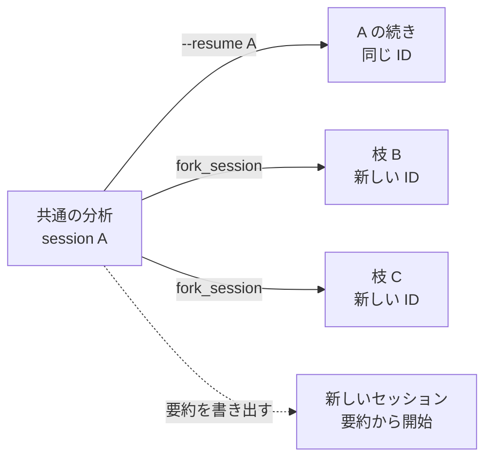

# セッションの再開とフォーク

> ドメイン: 1. エージェントの構成とオーケストレーション（27%） ／ 更新: 2026-11-20

## 3行まとめ
- 再開（resume）は同じ会話の続き、フォーク（fork_session）は会話の写しから別の枝を作る。どちらもファイルの状態は戻らない
- 前の文脈がほぼ有効なら再開、ツール結果（tool result）が古くなったら要約を渡して新しいセッションで始め直す
- 再開するときは、どのファイルが変わったかを伝えて、そこだけ調べ直させる

## 仕組み

| やり方 | Claude Code（CLI） | Agent SDK | 会話の履歴 | セッション ID |
|---|---|---|---|---|
| 名前で再開 | `claude -n <名前>` で名付け → `claude --resume <名前>` | `resume=<session_id>` | すべて戻る | 同じ |
| 直近を再開 | `claude --continue` | `continue_conversation=True`（TS: `continue: true`） | すべて戻る | 同じ |
| フォーク | `--resume <名前> --fork-session`、`/branch` | `resume=...` と `fork_session=True`（TS: `forkSession`） | 写しを持つ | 新しい ID。元は変わらない |
| 要約から始め直す | 新しいセッションに要約を貼る | 新しい `query()` の最初に要約を入れる | 要約だけ | 新しい ID |

- 再開で戻るのは、メッセージ・ツールの呼び出し・ツールの結果（記録した時点のもの）
- 例外: compaction（古い部分を要約して詰めること）をしたセッションは、最後の要約とそれ以降だけが読み込まれる
- セッションが保存するのは会話だけ。ファイルの変更を戻すには別の仕組み（file checkpointing）を使う
- フォークした枝がファイルを書き換えると、同じディレクトリで動くほかのセッションにも見える
- セッションのファイルは作ったマシンの中だけにある（`~/.claude/projects/<作業ディレクトリ>/` の `.jsonl`）

### サブエージェントのフォーク（1.3 との境界）
- 普通のサブエージェントは空の文脈で始まり、必要な情報はプロンプトで明示的に渡す
- フォークしたサブエージェント（forked subagent）は、親の会話をそのまま引き継いで別の方向を試す。親に返るのは最後の結果だけ
- forked subagent を自分で起動するのは `/subtask <task>`
- `/fork` は agent view が有効なら会話を写したバックグラウンドセッションを作る。forked subagent になるのは agent view が無効なときだけ

## 試験で問われそうなポイント
- 前日の調査を名前で続けたい → 名前を付けておき `--resume <名前>` で再開する
- 1回の調査結果をもとに、別々の直し方を並行して試したい（例: 設定で直すか、コードで直すか） → `fork_session` で枝を2本作る
- 再開の前にコードが変わった → 変わったファイルと変更の中身を伝え、そこだけ調べ直させる。全部を調べ直させない
- 中断の間にファイルが大きく変わり、前のツール結果の多くが古い → 要点を構造化した要約で新しいセッションを始める
- 前の文脈の大半がまだ正しい → 要約し直さず、そのまま再開する

## 間違えやすいところ
- アンチパターン: 変更を伝えずに再開する。エージェントは古いツール結果を事実として使い続ける
- アンチパターン: 古いツール結果だらけのセッションを無理に再開する。要約から始め直す方が確実
- フォークは会話だけを分ける。ファイルシステムは分かれないので、枝どうしが同じファイルを書き換えると干渉する
- 再開は元のセッション ID に書き足す。元を残したいならフォークする
- `--continue` は「直近の1つ」。複数の調査を並行しているなら名前か ID で `--resume` する
- `claude --fork-session` で別のプロセスにすると、「このセッションだけ許可」した権限は引き継がれない
- ガイドは Task ツールと書くが、現行の Claude Code では Agent ツールと書かれている

## 確認問題
1. 月曜に API の遅延の原因調査を進めた。火曜、同僚が `db/pool.ts` だけ書き換えた。調査を続けるには？
   

答え
名前で再開し、`db/pool.ts` が変わったことと変更の要点を伝えて、そこに関わる分析だけ見直させる。前の文脈の大半は有効なので、始め直す必要はない。

2. 依存ライブラリの調査を終えたセッションから、「段階的に上げる案」と「一度に上げる案」を両方試したい。どうする？
   

答え
`fork_session` で枝を2本作る。共通の調査結果を引き継げ、元のセッションも残る。ただしファイルの書き換えは共有されるので、別のブランチや作業ツリーで試す。

3. 2週間ぶりに大規模なリファクタリング後のリポジトリで調査を続けたい。前回のツール結果のほとんどは古い。どうする？
   

答え
前回の結論・未解決の問い・見るべきファイルを構造化した要約にまとめ、新しいセッションの最初に渡す。古い結果を持ったまま再開すると、誤った前提で答えやすい。

## 出典
- [Exam Guide v1.1 タスクステートメント 1.3・1.7](https://cc.sj-cdn.net/instructor/6nizmqk8tpzpfjvt6qmmav7rh/public/1794946250/Claude_Certified_Architect_-_Foundations_Exam_Guide.pdf)（公式）
- [Work with sessions（Agent SDK）](https://code.claude.com/docs/en/agent-sdk/sessions)（公式）
- [Manage sessions](https://code.claude.com/docs/en/sessions)（公式。再開で戻るもの、compaction の例外）
- [CLI reference](https://code.claude.com/docs/en/cli-reference)（公式。`--resume`、`-n`、`--continue`、`--fork-session`）
- [Commands](https://code.claude.com/docs/en/commands)（公式。`/fork`、`/subtask`、`/branch`）
- [Create custom subagents](https://code.claude.com/docs/en/sub-agents)（公式。Fork the current conversation の節）
- 「要約から始め直す方が確実」は Exam Guide が根拠。近い記述として、Agent SDK の sessions ページ「Resume across hosts」に、必要な結果を新しいセッションのプロンプトに渡す方が頑健なことが多い、とある（別のマシンで続ける場面の話）
