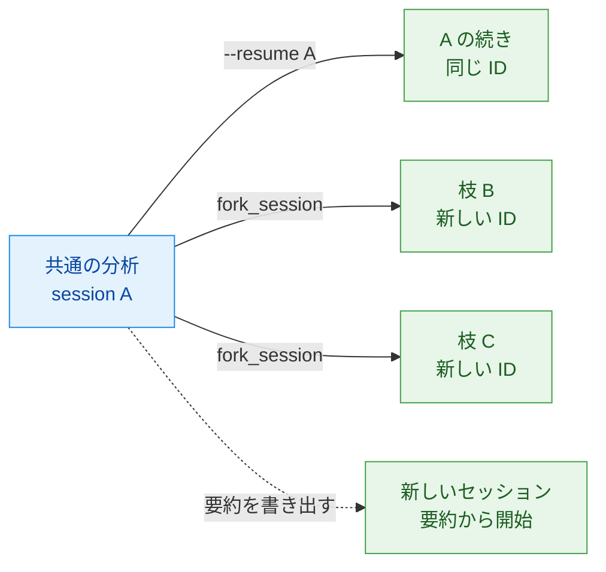

# セッションの再開とフォーク

> ドメイン: 1. エージェントの構成とオーケストレーション（27%） ／ 更新: 2026-11-20

!!! abstract "ひとことで"
    前の文脈がほぼ有効なら再開（resume）し、変わったファイルを伝えてそこだけ調べ直させる。ツール結果（tool result）の多くが古くなったら、==要約を渡して新しいセッションで始め直す==。別の案を並行して試すならフォーク（fork_session）する。

## 仕組み

再開は同じ会話の続きで、元のセッション ID に書き足す。フォークは会話の写しから別の枝を作り、新しい ID を持つ。元を残したいならフォークする。どちらも会話だけを扱うので、==ファイルの状態は戻らない==。

| やり方 | Claude Code（CLI） | Agent SDK | 会話の履歴 | セッション ID |
|---|---|---|---|---|
| 名前で再開 | `claude -n <名前>` で名付け → `claude --resume <名前>` | `resume=<session_id>` | すべて戻る | 同じ |
| 直近を再開 | `claude --continue` | `continue_conversation=True`（TS: `continue: true`） | すべて戻る | 同じ |
| フォーク | `--resume <名前> --fork-session`、`/branch` | `resume=...` と `fork_session=True`（TS: `forkSession`） | 写しを持つ | 新しい ID。元は変わらない |
| 要約から始め直す | 新しいセッションに要約を貼る | 新しい `query()` の最初に要約を入れる | 要約だけ | 新しい ID |

再開で戻るのは、メッセージ・ツールの呼び出し・ツールの結果で、どれも記録した時点のものだ。だから、変更を伝えずに再開すると、エージェントは古いツール結果を事実として使い続ける。ファイルシステムも分かれないので、フォークした枝がファイルを書き換えると、同じディレクトリで動くほかのセッションにも見える。枝どうしが同じファイルを書き換えると干渉する。

普通のサブエージェントは空の文脈で始まり、必要な情報はプロンプトで明示的に渡す。フォークしたサブエージェント（forked subagent）は、親の会話をそのまま引き継いで別の方向を試し、親には最後の結果だけを返す（1.3 との境界）。

??? info "細かい決まりと、ガイドとの食い違い"
    - 例外: compaction（古い部分を要約して詰めること）をしたセッションは、最後の要約とそれ以降だけが読み込まれる
    - ファイルの変更を戻すには、別の仕組み（file checkpointing）を使う
    - セッションのファイルは作ったマシンの中だけにある（`~/.claude/projects/<作業ディレクトリ>/` の `.jsonl`）
    - `--continue` は「直近の1つ」。複数の調査を並行しているなら、名前か ID で `--resume` する
    - `claude --fork-session` で別のプロセスにすると、「このセッションだけ許可」した権限は引き継がれない
    - forked subagent を自分で起動するのは `/subtask <task>`
    - `/fork` は、agent view が有効なら会話を写したバックグラウンドセッションを作る。forked subagent になるのは agent view が無効なときだけ
    - ガイドは Task ツールと書くが、現行の Claude Code では Agent ツールと書かれている

## 試験での見分け方

| 問われること | ○ 正しい | × ひっかけ |
|---|---|---|
| 前日の調査を名前で続けたい | 名前を付けておき、`--resume <名前>` で再開する | 並行の調査があるのに `--continue` で直近を開く |
| 1回の調査結果から、2つの直し方を並行して試す（例: 設定で直すか、コードで直すか） | `fork_session` で枝を2本作る | 同じセッションを再開して順に試す（元が残らない） |
| 再開の前に一部のコードが変わった | 変わったファイルと変更の中身を伝え、そこだけ調べ直させる | 何も伝えずに再開する。全部を調べ直させる |
| 中断の間にファイルが大きく変わり、前のツール結果の多くが古い | 要点を構造化した要約で、新しいセッションを始める | 古いツール結果だらけのセッションを無理に再開する |
| 前の文脈の大半がまだ正しい | 要約し直さず、そのまま再開する | わざわざ要約から始め直す |
| フォークした枝でファイルを書き換える | 別のブランチや作業ツリーで試す | ファイルも枝ごとに分かれると考える |

## 確認問題

**Q1.** 開発者が Claude Code で、月曜に API の遅延の原因調査を `api-latency` という名前のセッションで進めた。並行して別の調査のセッションもある。火曜、同僚が `db/pool.ts` だけを書き換えた。最も適切な続け方はどれか。（1つ選べ）
{ .quiz-q }

- A. `claude --continue` で直近のセッションを開き、そのまま調査を続ける
- B. 月曜の結論を要約し、新しいセッションの最初に渡して始め直す
- C. `--resume api-latency` で再開し、`db/pool.ts` の変更を伝えて関わる分析だけ見直させる
- D. `--resume api-latency` で再開し、リポジトリ全体を最初から調べ直させる

??? success "答えと解説"
    **正解: C。** 前の文脈の大半が有効なら名前で再開し、変わったファイルを伝えてそこだけ調べ直させる。

    - A: 並行の調査があるので、直近が目当てのセッションとは限らない。変更も伝えていない
    - B: 文脈の大半はまだ正しい。わざわざ要約から始め直す必要はない
    - D: 変わったのは1ファイルだけだ。全部を調べ直させるのは無駄になる

**Q2.** 依存ライブラリの調査を終えたセッションから、「段階的に上げる案」と「一度に上げる案」の両方を試したい。調査の結果は両案に共通で使う。最も適切なやり方はどれか。（1つ選べ）
{ .quiz-q }

- A. `fork_session` で枝を2本作り、それぞれを別のブランチや作業ツリーで試す
- B. 同じセッションを再開し、段階的な案を試した後に、一度に上げる案を試す
- C. `fork_session` で枝を2本作り、同じ作業ディレクトリで並行に書き換えさせる
- D. 空の新しいセッションを2つ作り、それぞれで依存ライブラリの調査からやり直させる

??? success "答えと解説"
    **正解: A。** フォークは共通の調査結果を引き継ぎ、元のセッションも残る。ファイルは分かれないので、作業場所を分ける。

    - B: 順に試すと元の状態が残らず、2つの案を並べて比べられない
    - C: フォークしてもファイルシステムは分かれない。同じファイルを書き換えると枝どうしが干渉する
    - D: 共通の調査結果を引き継げず、同じ調査を2回やることになる

**Q3.** 2週間ぶりに、前回の調査を続けたい。その間に大規模なリファクタリングがあり、前回のツール結果のほとんどは古くなった。最も適切な続け方はどれか。（1つ選べ）
{ .quiz-q }

- A. 名前で再開し、「リファクタリングがあった」とだけ伝えて調査を続ける
- B. `--fork-session` でフォークし、元を残したまま枝の上で調査を続ける
- C. 名前で再開し、古いツール結果は残したまま、新しい質問から先に答えさせる
- D. 結論・未解決の問い・見るべきファイルを要約にまとめ、新しいセッションの最初に渡す

??? success "答えと解説"
    **正解: D。** ツール結果の多くが古くなったら、構造化した要約を渡して新しいセッションで始め直す。

    - A: 再開で戻るのは記録した時点のツール結果だ。中身を伝えないと、古い結果を事実として使い続ける
    - B: フォークも会話の写しを持つので、古いツール結果をそのまま引き継ぐ
    - C: 古いツール結果だらけのセッションを無理に再開すると、誤った前提で答えやすい

## 出典
- [Exam Guide v1.1 タスクステートメント 1.3・1.7](https://cc.sj-cdn.net/instructor/6nizmqk8tpzpfjvt6qmmav7rh/public/1794946250/Claude_Certified_Architect_-_Foundations_Exam_Guide.pdf)（公式）
- [Work with sessions（Agent SDK）](https://code.claude.com/docs/en/agent-sdk/sessions)（公式）
- [Manage sessions](https://code.claude.com/docs/en/sessions)（公式。再開で戻るもの、compaction の例外）
- [CLI reference](https://code.claude.com/docs/en/cli-reference)（公式。`--resume`、`-n`、`--continue`、`--fork-session`）
- [Commands](https://code.claude.com/docs/en/commands)（公式。`/fork`、`/subtask`、`/branch`）
- [Create custom subagents](https://code.claude.com/docs/en/sub-agents)（公式。Fork the current conversation の節）
- 「要約から始め直す方が確実」は Exam Guide が根拠。近い記述として、Agent SDK の sessions ページ「Resume across hosts」に、必要な結果を新しいセッションのプロンプトに渡す方が頑健なことが多い、とある（別のマシンで続ける場面の話）
