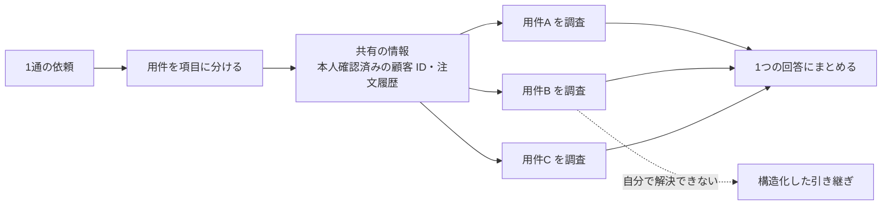

# 人への引き継ぎの要約と、複数の用件を含む依頼の分解（Structured handoff、1.4）

> ドメイン: 1. エージェントの構成とオーケストレーション（27%） ／ 更新: 2026-11-20

## 3行まとめ
- 人に引き継ぐときは、会話ログ（transcript）を読めない相手でも動けるよう、顧客 ID・根本原因・金額・推奨アクションを構造化した要約で渡す
- 1通に複数の用件があれば、まず別々の項目に分け、共有の情報を使って並行に調べ、最後に1つの回答にまとめる
- 決め手は「受け手が会話を見ずに次の一手を打てるか」と「用件を1つも取りこぼさず、返事は1つか」

## 仕組み

### 複数の用件の分解（decomposition）

- 並行の調査は、API ではパラレルツール使用（parallel tool use、1回の応答で複数のツールを呼ぶこと）で行える。既定で有効
- 並行に呼んだときは、すべての tool_result を次の user メッセージ1通にまとめて返す。分けて返すと、以後 Claude が並行に呼ばなくなる
- 実行しなかった呼び出しにも、`is_error: true` の tool_result を返す
- 「共有の情報（shared context）」は、ガイドに定義が無い。ここでは「各調査が使う、一度だけ取得した顧客情報」と解釈した（未確認）

### 構造化した引き継ぎ（structured handoff）

| 項目 | ガイドの記載 | 入れる理由 |
|---|---|---|
| 顧客 ID・顧客の情報 | あり | 受け手が本人確認と検索をやり直さずに済む |
| 根本原因（root cause） | あり | 「何が起きたか」を調べ直さずに済む |
| 金額（例: 返金額） | あり | 判断に要る数値をぼかさずに渡す |
| 推奨アクション | あり | 受け手は承認・却下を決めるだけにできる |
| 対応済みのこと・引き継ぐ理由 | なし（自作の補足） | 二重の対応と、同じ説明の繰り返しを防ぐ |

- 作業の途中で人に回すときは、そこまでの調査結果も引き継ぐ（mid-process escalation）
- 形の例（自作）: `{"customer_id": "...", "issue": "...", "root_cause": "...", "amount": 0, "recommended_action": "..."}`

## 試験で問われそうなポイント
- 受け手の人が会話ログを見られない設定なら、ログへの参照ではなく、要点を項目に分けた要約を渡す設計を選ぶ
- 1通に用件が複数あれば、項目に分けて全部を調べ、まとめて1回答する設計を選ぶ
- 互いに依存しない調査は並行に、前の結果が要る調査は順番に行う
- 用件のうち1つだけが人の判断を要するなら、残りは自分で解決し、その1つだけを構造化して引き継ぐ
- いつ引き継ぐか（基準）は 5.2 が主 → 別ノート（escalation-ambiguity）
- 前提の手順をプログラムで強制する話は同じ 1.4 の → 別ノート（programmatic-workflow-enforcement）

## 間違えやすいところ
- アンチパターン: 「詳しくは会話を参照」「返金希望」だけの引き継ぎ。受け手はログを読めず、調べ直しになる
- アンチパターン: 最初の用件だけに答え、残りを落とす。または用件ごとにばらばらの返事を返す
- 要約で金額・日付・顧客の言った期待をぼかすと、引き継ぎが役に立たない（要約の劣化は 5.1 の論点）
- 分解は「依頼を項目に分ける」こと。多エージェントのタスク分解（1.6 のプロンプトチェーンと動的な分解）とは別の論点
- 公式ドキュメントに引き継ぎ要約の決まった形式は無い。項目はガイドの記載に基づく（docs 上は未確認）
- `escalate_to_human` はガイドのシナリオの架空のツール名。公式のツールではない

## 確認問題
1. 旅行予約のエージェントに「ホテルの日付変更」「二重請求の返金」「ポイントが付いていない」の3件が1通で届いた。どう処理するべきか
   

答え
3つの項目に分け、本人確認済みの会員情報を共有して並行に調べ、結果を1つの返事にまとめる。最初の1件だけ答える・3回に分けて返すと、取りこぼしや混乱が起きる。

2. 上の返金が上限を超え、人の担当者へ回す。担当者のツールには会話ログが表示されない。何を渡すか
   

答え
会員 ID、二重請求の根本原因（どの決済が重複したか）、返金額、推奨アクション（例: 2件目の決済の全額返金）を構造化して渡す。他の2件は解決済みと添えると二重対応を防げる。

3. 「ポイントの付与状況」と「付与の規約」を調べたい。どちらも会員 ID だけで引ける。順番に呼ぶべきか
   

答え
互いに依存しないので、1回の応答で並行に呼んでよい。結果の tool_result 2つは、次の user メッセージ1通にまとめて返す。

## 出典
- Claude Certified Architect – Foundations Exam Guide v1.1、Task Statement 1.4・Exercise 1（公式。PDF はリポジトリに置かない）
- [Parallel tool use](https://platform.claude.com/docs/en/agents-and-tools/tool-use/parallel-tool-use)（公式）
- [Handle tool calls](https://platform.claude.com/docs/en/agents-and-tools/tool-use/handle-tool-calls)（公式）
- [Building effective agents](https://www.anthropic.com/engineering/building-effective-agents)（公式ブログ。並列化の sectioning、人の判断に戻す checkpoint）
- [How we built our multi-agent research system](https://www.anthropic.com/engineering/multi-agent-research-system)（公式ブログ。委任時に目的・出力形式・境界を渡す、並行の調査と統合）
- [Customer support agent](https://platform.claude.com/docs/en/about-claude/use-case-guides/customer-support-chat)（公式。エスカレーションの指標はあるが、引き継ぎの形式は書かれていない）
