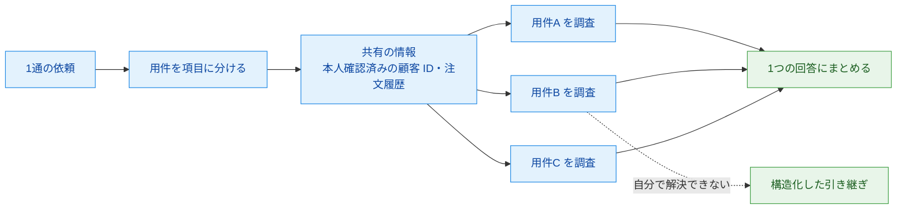

# 人への引き継ぎの要約と、複数の用件を含む依頼の分解（Structured handoff、1.4）

> ドメイン: 1. エージェントの構成とオーケストレーション（27%） ／ 更新: 2026-11-20

!!! abstract "ひとことで"
    1通に複数の用件があれば、項目に分けて全部を調べ、==1つの回答にまとめる==。人に引き継ぐときは、会話ログを読めない相手でも次の一手を打てるよう、==構造化した要約==で渡す。

## 仕組み

### 複数の用件の分解（decomposition）

まず依頼を別々の項目に分ける。次に、本人確認済みの顧客 ID のような共有の情報を使って、各項目を並行に調べる。最後に結果を1つの回答にまとめる。互いに依存しない調査は並行に、前の結果が要る調査は順番に行う。用件のうち1つだけが人の判断を要するなら、残りは自分で解決し、その1つだけを引き継ぐ。

並行の調査は、API ではパラレルツール使用（parallel tool use）で行える。1回の応答で複数のツールを呼ぶ機能で、既定で有効だ。並行に呼んだときは、すべての tool_result を次の user メッセージ1通にまとめて返す。分けて返すと、以後 Claude が並行に呼ばなくなる。

### 構造化した引き継ぎ（structured handoff）

受け手の人は会話ログ（transcript）を見られないことがある。だから、ログへの参照ではなく、要点を項目に分けた要約を渡す。作業の途中で人に回すとき（mid-process escalation）も、そこまでの調査結果を引き継ぐ。

| 項目 | ガイドの記載 | 入れる理由 |
|---|---|---|
| 顧客 ID・顧客の情報 | あり | 受け手が本人確認と検索をやり直さずに済む |
| 根本原因（root cause） | あり | 「何が起きたか」を調べ直さずに済む |
| 金額（例: 返金額） | あり | 判断に要る数値をぼかさずに渡す |
| 推奨アクション | あり | 受け手は承認・却下を決めるだけにできる |
| 対応済みのこと・引き継ぐ理由 | なし（自作の補足） | 二重の対応と、同じ説明の繰り返しを防ぐ |

??? info "細かい決まりと、未確認のこと"
    - 実行しなかった呼び出しにも、`is_error: true` の tool_result を返す
    - 「共有の情報（shared context）」は、ガイドに定義が無い。ここでは「各調査が使う、一度だけ取得した顧客情報」と解釈した（未確認）
    - 公式ドキュメントに引き継ぎ要約の決まった形式は無い。項目はガイドの記載に基づく（docs 上は未確認）
    - 形の例（自作）: `{"customer_id": "...", "issue": "...", "root_cause": "...", "amount": 0, "recommended_action": "..."}`
    - `escalate_to_human` はガイドのシナリオの架空のツール名。公式のツールではない
    - 要約で金額・日付・顧客の言った期待をぼかすと、引き継ぎが役に立たない（要約の劣化は 5.1 の論点）
    - ここでの分解は「依頼を項目に分ける」こと。多エージェントのタスク分解（1.6 のプロンプトチェーンと動的な分解）とは別の論点
    - いつ引き継ぐか（基準）は 5.2 が主で、別ノート（escalation-ambiguity）。前提の手順をプログラムで強制する話は、同じ 1.4 の別ノート（programmatic-workflow-enforcement）

## 試験での見分け方

| 問われること | ○ 正しい | × ひっかけ |
|---|---|---|
| 受け手が会話ログを見られない | 顧客 ID・根本原因・金額・推奨アクションを項目にした要約を渡す | 「詳しくは会話を参照」「返金希望」だけを渡す（受け手が調べ直しになる） |
| 1通に用件が3つ | 項目に分けて全部を調べ、1つの返事にまとめる | 最初の用件だけに答える。用件ごとにばらばらの返事を返す |
| 独立した調査が2つ | 1回の応答で並行に呼ぶ | 依存が無いのに順番に呼ぶ |
| 1件だけ人の判断が要る | 残りは自分で解決し、その1件だけ引き継ぐ | 全件をまとめて人に回す |

## 確認問題

**Q1.** 旅行予約サイトのサポートエージェントに、1通のメッセージで「ホテルの日付を変えたい」「航空券の座席指定が反映されていない」「先月の旅行のポイントが付いていない」の3件が届いた。会員の本人確認は済んでいる。最も適切な処理はどれか。（1つ選べ）
{ .quiz-q }

- A. 最初の用件の日付変更に答え、残りの2件は別のメッセージで送り直すよう頼む
- B. 用件ごとに調べ、結果が出た順に、別々の返事を3通に分けて返す
- C. 用件が複数あるので、3件とも人の担当者にまとめて引き継ぐ
- D. 3つの項目に分け、確認済みの会員情報を共有して調べ、1つの返事にまとめる

??? success "答えと解説"
    **正解: D。** 依頼を項目に分けて全部を調べ、結果を1つの回答にまとめる。

    - A: 最初の用件だけに答えると、残りの2件を取りこぼす
    - B: ばらばらの返事は、顧客の混乱を招く
    - C: 人の判断が要る用件だけを引き継ぐ。自分で解決できる用件まで回さない

**Q2.** 日付変更には 18,000 円の違約金がかかり、その免除は人の担当者が決める。座席とポイントの2件は、エージェントが解決した。担当者の画面には会話ログが表示されない。引き継ぎの要約に入れるべきものはどれか。（2つ選べ）
{ .quiz-q }

- A. 会員 ID と、違約金の額（18,000 円）
- B. 「詳しくは会話ログを参照」という一文と、会話へのリンク
- C. 違約金が発生した根本原因と、推奨アクション（例: 全額の免除）
- D. 「違約金の免除希望」という件名だけ
- E. 座席とポイントの2件についても、担当者に最終の判断を任せる旨

??? success "答えと解説"
    **正解: A と C。** 会話ログを読めない相手には、顧客 ID・根本原因・金額・推奨アクションを項目にした要約を渡す。

    - B: 受け手はログを見られない。ログへの参照では、調べ直しになる
    - D: 件名だけでは、受け手が本人確認や原因の調査をやり直すことになる
    - E: 解決済みの2件まで回すと二重の対応になる。引き継ぐのは人の判断が要る1件だけだ

**Q3.** 日付変更の件を調べている途中で、違約金の免除が自分の権限外だと分かり、担当者に回すことにした。予約の変更履歴と違約金の規定は調べ終えている。引き継ぎ方として最も適切なものはどれか。（1つ選べ）
{ .quiz-q }

- A. 担当者が一から確かめられるよう、調査の結果は入れずに用件だけを引き継ぐ
- B. 調べ終えた変更履歴と違約金の規定の要点を、要約に入れて引き継ぐ
- C. 座席とポイントの件も含め、会話の最初からの経緯を時系列で書き写して渡す
- D. 調査を途中で止め、違約金の件は顧客から担当者へ改めて問い合わせてもらう

??? success "答えと解説"
    **正解: B。** 作業の途中で人に回すときも、そこまでの調査結果を引き継ぐ。担当者は調べ直さずに判断に入れる。

    - A: 調べ終えた結果を渡さないと、担当者が同じ調査をやり直すことになる
    - C: 解決済みの件まで書き写すと要点の要約にならず、担当者が必要な点を探すことになる
    - D: そこまでの調査が無駄になり、顧客が同じ説明をやり直すことになる

## 出典
- Claude Certified Architect – Foundations Exam Guide v1.1、Task Statement 1.4・Exercise 1（公式。PDF はリポジトリに置かない）
- [Parallel tool use](https://platform.claude.com/docs/en/agents-and-tools/tool-use/parallel-tool-use)（公式）
- [Handle tool calls](https://platform.claude.com/docs/en/agents-and-tools/tool-use/handle-tool-calls)（公式）
- [Building effective agents](https://www.anthropic.com/engineering/building-effective-agents)（公式ブログ。並列化の sectioning、人の判断に戻す checkpoint）
- [How we built our multi-agent research system](https://www.anthropic.com/engineering/multi-agent-research-system)（公式ブログ。委任時に目的・出力形式・境界を渡す、並行の調査と統合）
- [Customer support agent](https://platform.claude.com/docs/en/about-claude/use-case-guides/customer-support-chat)（公式。エスカレーションの指標はあるが、引き継ぎの形式は書かれていない）
