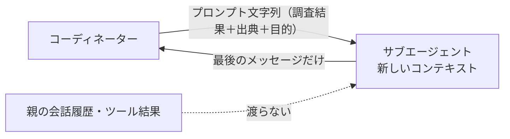

# サブエージェントへのコンテキストの渡し方

> ドメイン: 1. エージェントの構成とオーケストレーション（27%） ／ 更新: 2026-11-20

## 3行まとめ
- サブエージェントは親の会話を**引き継がない**。必要な情報は、起動するときのプロンプトに全部書いて渡す
- 前段の調査結果は要約せず、完全な形で渡す。出典（URL・文書名・ページ）は本文と分けた構造化データで渡す
- コーディネーター（指揮役のエージェント）のプロンプトには、手順ではなく「目的と品質の基準」を書く

## 仕組み
親から子への唯一の経路は、Agent ツール（ガイドでは Task ツール）のプロンプト文字列。子から親へは最後のメッセージだけが返る。



| サブエージェントが受け取るもの | 受け取らないもの |
|---|---|
| 自分のシステムプロンプト（AgentDefinition.prompt）と、Agent ツールのプロンプト | 親の会話履歴とツール結果 |
| プロジェクトの CLAUDE.md（omitClaudeMd を指定すると読まない。この欄は TypeScript SDK だけ） | 親のシステムプロンプト |
| ツールの定義（親から継承、または指定した一部） | 先に読み込んだスキル（AgentDefinition.skills に書いたものは除く） |

出典を保つ渡し方の例（本文とメタデータ（その情報についての情報）を分ける）:

```json
{"findings": [{"claim": "…", "evidence": "抜粋…", "source_url": "https://…", "document": "…", "page": 12, "published": "2025-06"}]}
```

## 試験で問われそうなポイント
- 統合役のサブエージェントの出力に情報が抜ける → 前段（Web 検索・文書分析）の結果をそのままプロンプトに含めているかを疑う
- 最終レポートで出典が消える → 各発見を claim・抜粋・出典 URL・文書名・ページ番号・日付の構造化データで渡す設計を選ぶ
- コーディネーターの指示の書き方 → 「何を調べ、どの水準なら十分か」を示し、子が状況に応じて動けるようにする
- 新しく呼んだ子は前回を覚えていない → 続けさせたいなら resume（再開）するか、必要な結果をプロンプトに入れ直す
- Task ツールでの起動・AgentDefinition・並列起動 → 別ノート（Task ツールによるサブエージェントの起動と AgentDefinition）
- 分岐した方針を共通の分析から試すフォーク → 別ノート（セッションの再開とフォーク）

## 間違えやすいところ
- 「子は親のコンテキストを自動で引き継ぐ」は誤り。引き継ぐのはフォーク（会話をまるごと複製した子）だけ
- 前段の結果を親が短く要約してから渡す → 根拠や出典が落ちる。完全な結果を渡す
- 出典を本文の文章に混ぜ込む → 統合の途中で失われやすい。メタデータの欄を分ける
- アンチパターン: コーディネーターのプロンプトで手順を1つずつ細かく指定する。子が想定外の状況に合わせられない
- 逆に、目的だけの短すぎる指示も失敗する。目的・出力形式・使うツールや情報源・担当範囲の境界は示す（Anthropic のブログ）
- 子の途中のツール呼び出しは親に返らない。親に要るものは最後のメッセージに含めさせる

## 確認問題
1. 調査用と分析用のサブエージェントの結果を、統合用のサブエージェントに渡したい。コーディネーターは「前の調査結果を踏まえて統合して」とだけ書いた。何が起きて、どう直すか。
   <details><summary>答え</summary>統合用の子は前の結果を見ていないので、根拠の無い統合になる。両方の結果を完全な形でプロンプトに含める。子は親の会話を引き継がない。</details>
2. 統合されたレポートで、どの主張がどの文書の何ページから来たかが分からなくなった。最も効果的な対策は？
   <details><summary>答え</summary>サブエージェント間の受け渡しを、主張・抜粋・出典 URL・文書名・ページを別の欄に持つ構造化データにする。文章で「出典を残して」と頼むだけより確実。</details>
3. コーディネーターのプロンプトに「1. 検索を3回 2. 上位5件を読む 3. 箇条書きで要約」と書いたら、資料が少ない話題で質が落ちた。どう書き直すか。
   <details><summary>答え</summary>調べる目的と、十分といえる基準（例: 独立した情報源で裏付ける、出典を付ける）を示し、進め方は子に任せる。</details>

## 出典
- [Subagents in the SDK — What subagents inherit](https://code.claude.com/docs/en/agent-sdk/subagents)（公式）
- [Subagents in the SDK — Resume subagents](https://code.claude.com/docs/en/agent-sdk/subagents#resume-subagents)（公式）
- [Create custom subagents（Claude Code）](https://code.claude.com/docs/en/sub-agents)（公式）
- [How we built our multi-agent research system](https://www.anthropic.com/engineering/multi-agent-research-system)（公式・エンジニアリングブログ）
- Claude Certified Architect – Foundations Exam Guide v1.1、Task Statement 1.3（公式）
- 未確認: 試験がツール名を Task と Agent のどちらで出すか（ガイドは Task。現行の SDK は Agent で、旧名 Task も残る）
