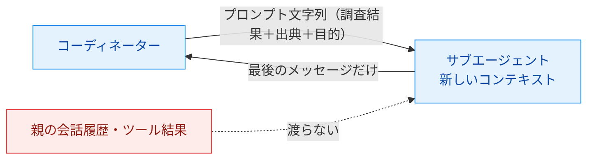

# サブエージェントへのコンテキストの渡し方

> ドメイン: 1. エージェントの構成とオーケストレーション（27%） ／ 更新: 2026-11-20

!!! abstract "ひとことで"
    サブエージェントは親の会話を引き継がないので、必要な情報は==起動時のプロンプトに全部書く==。前段の結果は要約せず完全な形で渡し、出典は==本文と分けた構造化データ==にする。

## 仕組み

親から子への唯一の経路は、Agent ツール（ガイドでは Task ツール）のプロンプト文字列だ。子から親へは、最後のメッセージだけが返る。子の途中のツール呼び出しは親に届かないので、親に要るものは最後のメッセージに含めさせる。



| サブエージェントが受け取るもの | 受け取らないもの |
|---|---|
| 自分のシステムプロンプト（AgentDefinition.prompt）と、Agent ツールのプロンプト | 親の会話履歴とツール結果 |
| プロジェクトの CLAUDE.md（omitClaudeMd を指定すると読まない。この欄は TypeScript SDK だけ） | 親のシステムプロンプト |
| ツールの定義（親から継承、または指定した一部） | 先に読み込んだスキル（AgentDefinition.skills に書いたものは除く） |

親のコンテキストを引き継ぐのは、会話をまるごと複製したフォークの子だけだ（[セッションの再開とフォーク](session-resume-fork.md)）。新しく呼んだ子は前回を覚えていない。続けさせたいなら resume（再開）するか、必要な結果をプロンプトに入れ直す。

前段の結果を親が短く要約してから渡すと、根拠や出典が落ちる。出典を本文の文章に混ぜ込んでも、統合の途中で失われやすい。だから各発見を、本文とメタデータ（その情報についての情報）を分けた形で渡す。

```json
{"findings": [{"claim": "…", "evidence": "抜粋…", "source_url": "https://…", "document": "…", "page": 12, "published": "2025-06"}]}
```

コーディネーターのプロンプトには、手順ではなく「何を調べ、どの水準なら十分か」を書く。手順を1つずつ細かく指定すると、子が想定外の状況に合わせられない。逆に、目的だけの短すぎる指示も失敗する。目的・出力形式・使うツールや情報源・担当範囲の境界は示す（Anthropic のブログ）。起動の仕組みと AgentDefinition・並列起動は [Task ツールと AgentDefinition](task-tool-agent-definition.md) で扱う。

## 試験での見分け方

<div class="vs" markdown>

| 問われること | ○ 正しい | × ひっかけ |
|---|---|---|
| 統合役の出力に情報が抜ける | 前段（Web 検索・文書分析）の結果をそのままプロンプトに含める | 子が親のコンテキストを自動で引き継ぐと考える |
| 前段の結果の渡し方 | 完全な結果を渡す | 親が短く要約してから渡す（根拠や出典が落ちる） |
| 最終レポートで出典が消える | claim・抜粋・出典 URL・文書名・ページ番号・日付を構造化データで渡す | 出典を本文の文章に混ぜ込む |
| コーディネーターの指示 | 目的と十分といえる基準を示し、進め方は子に任せる | 手順を1つずつ細かく指定する／目的だけの短すぎる指示にする |
| 前回の続きをさせたい | resume するか、必要な結果をプロンプトに入れ直す | 新しく呼んだ子が前回を覚えていると考える |

</div>

## 確認問題

**Q1.** 業界動向を調べるマルチエージェントの調査システムで、Web 検索と文書分析のサブエージェントの結果を、統合用のサブエージェントに渡したい。コーディネーターは統合用の起動プロンプトに「前の調査結果を踏まえて統合して」とだけ書いた。統合の出力には根拠がほとんど無い。最も適切な直し方はどれか。（1つ選べ）
{ .quiz-q }

<div class="quiz" data-answer="A" markdown>

- A. Web 検索と文書分析の結果を、要約せず完全な形で、統合用の起動プロンプトに含める
- B. 前段の結果をコーディネーターが数行に要約し、統合用の起動プロンプトに含める
- C. 統合用の AgentDefinition の `prompt` に「親の会話を参照して統合すること」と書き足す
- D. 統合用のサブエージェントに Web 検索ツールを持たせ、必要な情報を自分で調べ直させる

</div>

??? success "答えと解説"
    **正解: A。** サブエージェントは親の会話を引き継がないので、前段の結果は完全な形でプロンプトに含める。

    - B: 親が要約してから渡すと、根拠や出典が落ちる
    - C: 親の会話履歴は子に渡らない。参照しろと書いても読めない
    - D: 前段の作業をやり直すだけで、すでにある結果は渡っていない

**Q2.** 同じ調査システムで、統合されたレポートの主張が、どの文書の何ページから来たのか分からなくなった。前段のサブエージェントは、出典を文中の括弧書きで添えた文章で結果を返している。最も効果的な対策はどれか。（1つ選べ）
{ .quiz-q }

<div class="quiz" data-answer="C" markdown>

- A. 統合用の起動プロンプトに「出典を必ず残すこと」と書き足す
- B. 括弧書きをやめ、出典を各段落の末尾にまとめて書く文章で渡させる
- C. 主張・抜粋・出典 URL・文書名・ページ番号・日付を、別々の欄に持つ構造化データで渡す
- D. 前段の結果を要約して渡し、出典はレポートの末尾に一覧でまとめさせる

</div>

??? success "答えと解説"
    **正解: C。** 各発見を、本文とメタデータを分けた構造化データにして渡す。

    - A: 本文に出典が混ざった形が変わらないので、統合の途中で失われやすい
    - B: 置き場所を変えても、出典は本文の文章に混ざったままだ
    - D: 要約で根拠が落ちるうえ、どの主張がどの出典から来たかの対応も消える

**Q3.** 同じ調査システムで、コーディネーターから調査サブエージェントへの指示に「1. 検索を3回 2. 上位5件を読む 3. 箇条書きで要約」と書いた。資料が少ない話題では、調査の質が落ちた。指示の書き直し方として最も適切なものはどれか。（1つ選べ）
{ .quiz-q }

<div class="quiz" data-answer="D" markdown>

- A. 手順をさらに細かくし、資料が少ないときの分岐も手順として書き足す
- B. 指示を「この話題を調べて」の一文だけにし、ほかはすべて子に任せる
- C. 検索を10回、読む件数を上位15件に増やし、手順の形はそのまま残す
- D. 調べる目的と、十分といえる基準（例: 独立した情報源で裏付ける）を示し、進め方は子に任せる

</div>

??? success "答えと解説"
    **正解: D。** 手順でなく、何を調べ、どの水準なら十分かを書く。

    - A: 手順を細かくするほど、想定外の状況に合わせられなくなる
    - B: 目的だけの短すぎる指示も失敗する。目的・出力形式・情報源・担当範囲の境界は示す
    - C: 回数を変えても手順の指定のままで、状況に合わせられない点は同じ

## 出典
- [Subagents in the SDK — What subagents inherit](https://code.claude.com/docs/en/agent-sdk/subagents)（公式）
- [Subagents in the SDK — Resume subagents](https://code.claude.com/docs/en/agent-sdk/subagents#resume-subagents)（公式）
- [Create custom subagents（Claude Code）](https://code.claude.com/docs/en/sub-agents)（公式）
- [How we built our multi-agent research system](https://www.anthropic.com/engineering/multi-agent-research-system)（公式・エンジニアリングブログ）
- Claude Certified Architect – Foundations Exam Guide v1.1、Task Statement 1.3（公式）
- 未確認: 試験がツール名を Task と Agent のどちらで出すか（ガイドは Task。現行の SDK は Agent で、旧名 Task も残る）
