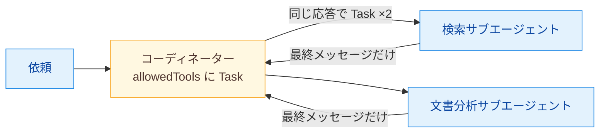

# Task ツールによるサブエージェントの起動と AgentDefinition

> ドメイン: 1. エージェントの構成とオーケストレーション（27%） ／ 更新: 2026-11-20

!!! abstract "ひとことで"
    サブエージェントは Task ツール（現行名 Agent ツール）で起動する。試験ガイドでは、コーディネーターの許可ツールに =="Task" が無いと起動できない==（現行 SDK とはずれがある。下の折りたたみを参照）。独立した仕事は、==1回の応答で Task 呼び出しを複数出して==並列に起動する。

## 仕組み

コーディネーターは Task ツールを呼んで、サブエージェントを起動する。サブエージェントの種類ごとの設定は AgentDefinition（`description`・`prompt`・`tools`）で決め、役割に合うツールだけを渡す。互いの結果を使わない仕事なら、1回の応答で Task 呼び出しを複数出すので、待ち時間は合計でなく最も遅い1つ分になる。統合のように前の結果を使う仕事は、並列にせず、結果がそろってから起動する。



| AgentDefinition の項目 | 役割 | 必須 |
|---|---|---|
| `description` | いつこのエージェントを使うか。コーディネーターが委任先を選ぶ手がかり | 必須 |
| `prompt` | サブエージェントのシステムプロンプト（役割・振る舞い） | 必須 |
| `tools` | 使えるツールの一覧。省略するとサブエージェントが使えるツールをすべて継承 | 任意 |
| `model` ほか | `model`・`disallowedTools`・`maxTurns` など（試験ガイドには出てこない） | 任意 |

```python
options = ClaudeAgentOptions(
    allowed_tools=["Read", "Grep", "Task"],  # 現行 SDK の例では "Agent"
    agents={"doc-reviewer": AgentDefinition(
        description="文書の品質を点検する。レビューの依頼で使う",
        prompt="あなたは文書レビューの専門家です。…",
        tools=["Read", "Grep"])})  # 読むだけ。書き換えさせない
```

`description` は人向けの説明ではなく、モデルが委任先を選ぶ判断材料になる。だから「いつ使うか」が分かる具体的な文で書く。`prompt` はシステムプロンプトなので、個々の依頼内容は Task 呼び出しのプロンプトで渡す。コーディネーターのプロンプトには、手順ではなく調査の目標と品質の基準を書く。そうするとサブエージェントが状況に合わせて動ける。

コンテキストの渡し方（明示的な受け渡し、出典の保持）は [サブエージェントへのコンテキストの渡し方](subagent-context-passing.md)、共通の分析から分岐して別の案を試す fork は [セッションの再開とフォーク](session-resume-fork.md)（1.7）で扱う。

??? info "名前の変更と、現行 SDK とのずれ"
    - Claude Code v2.1.63 で Task ツールは Agent に改名された。`Task(...)` の指定は別名として今も効く。試験ガイドは "Task" と書いている
    - 試験で "Agent" 表記が出るかは未確認。どちらも同じツールと覚える
    - 現行 SDK の `allowedTools` は「自動で許可する」一覧で、書かないツールも消えない（Agent は許可を求めずに動く）。ツールを使わせないのは `disallowedTools`。試験ガイドの「"Task" を含める必要がある」とはずれがある
    - 現行の Claude Code の既定では、サブエージェントはバックグラウンドで動き、報告は後のターンに届く。そのため別のターンで起動しても並行しうる

## 試験での見分け方

<div class="vs" markdown>

| 問われること | ○ 正しい | × ひっかけ |
|---|---|---|
| コーディネーターがサブエージェントを呼べない | 試験ガイドの前提では、まず許可ツールに "Task" があるかを疑う | AgentDefinition だけを見直し、許可ツールを確かめない |
| 調査と分析が互いに独立 | 1回の応答で Task 呼び出しを複数出す | 1ターンに1つずつ出す（結果を待つと逐次になる。現行 Claude Code の既定には例外あり。折りたたみを参照） |
| 統合など前の結果を使う仕事 | 結果がそろってから起動する | 前段と並列に起動する |
| 文書を読むだけの役割 | `tools` を読むツールに絞る | 全サブエージェントに全ツールを渡す（役割外の操作を招く。ガイドの 2.3 も参照） |
| 委任先がうまく選ばれない | `description` を「いつ使うか」が分かる具体的な文に直す | 人向けの紹介文のままにする |
| 想定外の状況で止まる | 細かい手順の指示をやめ、目標と合格の基準を渡す | 手順をさらに細かく書き足す |

</div>

## 確認問題

**Q1.** 取引先との契約書から必要な情報を抜き出すシステムを作っている。コーディネーターは、条項抽出と判例検索の2つのサブエージェントを1ターンに1つずつ起動していて、処理が遅い。2つの仕事は互いの結果を使わない。最も適切な直し方はどれか。（1つ選べ）
{ .quiz-q }

<div class="quiz" data-answer="A" markdown>

- A. 1回の応答で Task 呼び出しを2つ出させ、2つのサブエージェントを並列に起動する
- B. 2つのサブエージェントを1つにまとめ、条項抽出と判例検索を続けて行わせる
- C. 各サブエージェントの `model` に、より速いモデルを指定して1体ずつの処理を縮める
- D. 各サブエージェントの `tools` を絞り、1体あたりの処理を軽くして速くする

</div>

??? success "答えと解説"
    **正解: A。** 互いに独立した仕事は、1回の応答で Task 呼び出しを複数出す。待ち時間は合計でなく、最も遅い1つ分になる。

    - B: 1体の中で続けて行うので、逐次のままだ
    - C: 1体ずつは速くなっても、1ターンに1つずつ起動するので、逐次の待ちは残る
    - D: `tools` を絞るのは役割外の操作を防ぐためで、逐次に待つことは解消しない

**Q2.** 社内の調査システムで、3種類のサブエージェントを AgentDefinition で定義し、`description` も「いつ使うか」が分かる具体的な文で書いた。それでもコーディネーターはどれにも委任せず、自分で全部こなしてしまう。試験ガイドの前提で、最初に確かめる設定はどれか。（1つ選べ）
{ .quiz-q }

<div class="quiz" data-answer="B" markdown>

- A. 各 AgentDefinition の `tools` に、"Task" が含まれているか
- B. コーディネーターの許可ツールに、"Task" が含まれているか
- C. 各 AgentDefinition の `prompt` に、委任されたときの振る舞いが書かれているか
- D. コーディネーターのプロンプトに、手順ではなく目標と品質の基準が書かれているか

</div>

??? success "答えと解説"
    **正解: B。** 試験ガイドの前提では、サブエージェントは Task ツールで起動するので、コーディネーターの許可ツールに "Task" が無いと起動できない。現行 SDK の `allowedTools` とはずれがある点は、本文の折りたたみを参照。

    - A: 起動するのはコーディネーターだ。サブエージェント側の `tools` に足しても、起動できるようにはならない
    - C: `prompt` はサブエージェントのシステムプロンプトで、起動されたあとの振る舞いを決める
    - D: プロンプトの書き方は委任の質に効くが、許可ツールに Task が無ければ、そもそも起動できない

**Q3.** 開発チーム向けに、社内 wiki を読んで要約するだけのサブエージェントを用意した。ところが、ときどき wiki のファイルを書き換えてしまう。AgentDefinition の直し方として最も適切なものはどれか。（1つ選べ）
{ .quiz-q }

<div class="quiz" data-answer="C" markdown>

- A. `prompt` に「ファイルを書き換えてはならない」と書き足す
- B. `description` に「読むだけのエージェント」と書き足す
- C. `tools` を、Read や Grep などの読むツールだけに絞る
- D. `tools` を省略し、使えるツールをコーディネーターから継承させる

</div>

??? success "答えと解説"
    **正解: C。** 役割に合うツールだけを `tools` で渡す。読むだけの役割なら、読むツールに絞る。

    - A: プロンプトで頼むだけでは、書き換えるツールが手元に残る
    - B: `description` は委任先を選ぶ手がかりで、使えるツールは変わらない
    - D: `tools` を省略すると、使えるツールをすべて継承する。書き換えるツールも残る

## 出典
- [Claude Certified Architect – Foundations Exam Guide v1.1（Task Statement 1.3、Exercise 4）](https://cc.sj-cdn.net/instructor/6nizmqk8tpzpfjvt6qmmav7rh/public/1794946250/Claude_Certified_Architect_-_Foundations_Exam_Guide.pdf)（公式）
- [Subagents in the SDK](https://code.claude.com/docs/en/agent-sdk/subagents)（公式。AgentDefinition の項目、Task と Agent の表記、Troubleshooting）
- [Create custom subagents](https://code.claude.com/docs/en/sub-agents)（公式。v2.1.63 の改名、`Agent(agent_type)` の制限）
- [Configure permissions（Agent SDK）](https://code.claude.com/docs/en/agent-sdk/permissions)（公式。allowedTools は自動で許可する一覧、使わせないのは disallowedTools）
- [Parallel tool use](https://platform.claude.com/docs/en/agents-and-tools/tool-use/parallel-tool-use)（公式。1回の応答で複数のツール呼び出し）
- [How we built our multi-agent research system](https://www.anthropic.com/engineering/multi-agent-research-system)（公式ブログ。サブエージェントの並列起動、委任の書き方）
