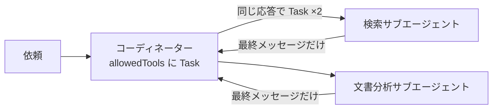

# Task ツールによるサブエージェントの起動と AgentDefinition

> ドメイン: 1. エージェントの構成とオーケストレーション（27%） ／ 更新: 2026-11-20

## 3行まとめ
- サブエージェントは Task ツール（現行名 Agent ツール）で起動する。試験ガイドでは、コーディネーターの許可ツールに **"Task" が無いと起動できない**（現行 SDK とのずれは下に）
- 種類ごとの設定は AgentDefinition（description・prompt・tools）で決める。役割に合うツールだけを渡す
- 独立した仕事は、1回の応答で Task 呼び出しを複数出して並列に起動する。ターンをまたいで1つずつ出さない

## 仕組み


| AgentDefinition の項目 | 役割 | 必須 |
|---|---|---|
| `description` | いつこのエージェントを使うか。コーディネーターが委任先を選ぶ手がかり | 必須 |
| `prompt` | サブエージェントのシステムプロンプト（役割・振る舞い） | 必須 |
| `tools` | 使えるツールの一覧。省略するとサブエージェントが使えるツールをすべて継承 | 任意 |
| `model` ほか | `model`・`disallowedTools`・`maxTurns` など（試験ガイドには出てこない） | 任意 |

```python
options = ClaudeAgentOptions(
    allowed_tools=["Read", "Grep", "Task"],  # 現行 SDK の例では "Agent"
    agents={"doc-reviewer": AgentDefinition(
        description="文書の品質を点検する。レビューの依頼で使う",
        prompt="あなたは文書レビューの専門家です。…",
        tools=["Read", "Grep"])})  # 読むだけ。書き換えさせない
```

- 名前の変更: Claude Code v2.1.63 で Task ツールは Agent に改名。`Task(...)` の指定は別名として今も効く。試験ガイドは "Task" と書いている
- 委任の仕方: コーディネーターのプロンプトには、手順ではなく調査の目標と品質の基準を書く。サブエージェントが状況に合わせて動ける
- コンテキストの渡し方（明示的な受け渡し、出典の保持）は → 別ノート「サブエージェントへのコンテキストの渡し方」
- fork（共通の分析から分岐して別の案を試す）は → 別ノート「セッションの再開とフォーク」（1.7）

## 試験で問われそうなポイント
- コーディネーターがサブエージェントを呼べない → 試験ガイドの前提では、まず許可ツールに "Task" があるかを疑う
- 調査と分析が互いに独立 → 1回の応答で Task 呼び出しを複数出す（待ち時間は合計でなく最も遅い1つ分）
- 前の結果を使う仕事（統合など） → 並列にせず、結果がそろってから起動する
- 文書を読むだけの役割 → `tools` を読むツールに絞る。役割外のツールは渡さない
- 委任先がうまく選ばれない → `description` を「いつ使うか」が分かる具体的な文に直す
- サブエージェントが想定外の状況で止まる → 細かい手順の指示をやめ、目標と合格の基準を渡す

## 間違えやすいところ
- 並列のつもりで、Task 呼び出しを1ターンに1つずつ出す（結果を待つと逐次になる。現行の Claude Code の既定ではサブエージェントはバックグラウンドで動き、報告は後のターンに届くので、別のターンでも並行しうる）
- 全サブエージェントに全ツールを渡す（役割外の操作を招く。ガイドの 2.3 も参照）
- `description` は人向けの説明ではない。モデルが委任先を選ぶ判断材料になる
- AgentDefinition の `prompt` はシステムプロンプト。個々の依頼内容は Task 呼び出しのプロンプトで渡す
- 現行 SDK の `allowedTools` は「自動で許可する」一覧で、書かないツールも消えない（Agent は許可を求めずに動く）。ツールを使わせないのは `disallowedTools`。試験ガイドの「"Task" を含める必要がある」とはずれがある
- 試験で "Agent" 表記が出るかは未確認。どちらも同じツールと覚える

## 確認問題
1. 契約書レビューのコーディネーターが、条項抽出と判例検索の2つのサブエージェントを順に1つずつ起動していて遅い。2つは互いの結果を使わない。どう直す？
   <details><summary>答え</summary>1回の応答で Task 呼び出しを2つ出して並列に起動する。互いに独立しているので、待ち時間が最も遅い1つ分になる。</details>
2. 3種類のサブエージェントを AgentDefinition で定義したが、コーディネーターはどれにも委任せず、自分で全部こなしてしまう。description はどれも具体的に書いてある。最初に確かめる設定は？
   <details><summary>答え</summary>ガイドの前提では、コーディネーターの allowedTools に "Task" が含まれているか。Task ツールが起動の仕組みなので、無いとどの種類も呼べない。現行の公式の Troubleshooting は、プロンプトで名前を挙げて頼む・description を明確にする、を挙げる。</details>
3. 社内 wiki を読んで要約するだけのサブエージェントが、ときどきファイルを書き換えてしまう。AgentDefinition のどこを直す？
   <details><summary>答え</summary>`tools` を Read などの読むツールだけに絞る。プロンプトで「書き換えるな」と頼むより確実。</details>

## 出典
- [Claude Certified Architect – Foundations Exam Guide v1.1（Task Statement 1.3、Exercise 4）](https://cc.sj-cdn.net/instructor/6nizmqk8tpzpfjvt6qmmav7rh/public/1794946250/Claude_Certified_Architect_-_Foundations_Exam_Guide.pdf)（公式）
- [Subagents in the SDK](https://code.claude.com/docs/en/agent-sdk/subagents)（公式。AgentDefinition の項目、Task と Agent の表記、Troubleshooting）
- [Create custom subagents](https://code.claude.com/docs/en/sub-agents)（公式。v2.1.63 の改名、`Agent(agent_type)` の制限）
- [Configure permissions（Agent SDK）](https://code.claude.com/docs/en/agent-sdk/permissions)（公式。allowedTools は自動で許可する一覧、使わせないのは disallowedTools）
- [Parallel tool use](https://platform.claude.com/docs/en/agents-and-tools/tool-use/parallel-tool-use)（公式。1回の応答で複数のツール呼び出し）
- [How we built our multi-agent research system](https://www.anthropic.com/engineering/multi-agent-research-system)（公式ブログ。サブエージェントの並列起動、委任の書き方）
