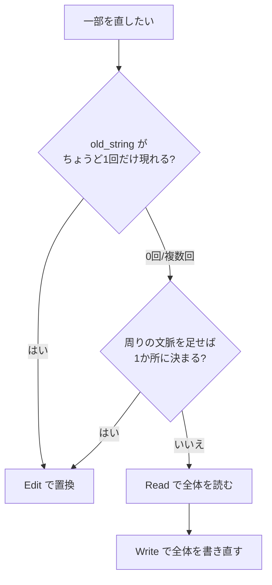

# 組み込みツールの選び方と、コードを段階的に読む進め方

> ドメイン: 2. ツール設計と MCP の組み込み（18%） ／ 更新: 2026-11-20

## 3行まとめ
- 中身（関数名・エラー文・import）を探すなら Grep、ファイル名・拡張子で探すなら Glob
- 部分の書き換えは Edit（一意な文字列の置換）。一意に決まらず失敗したら、Read で全体を読んで Write で書き直す
- コードは全部を先に読まない。Grep で入口を見つけ、Read で import をたどって流れを追う

## 仕組み

### ツールごとの使いどころ

| ツール | すること | 使うとき | 使わないとき |
|---|---|---|---|
| Grep | ファイルの中身を正規表現で探す（ripgrep ベース） | 呼び出し元、エラー文、import 文を探す | ファイル名で探したい |
| Glob | パスのパターン（`**/*.test.tsx` など）でファイルを探す | 命名規則・拡張子でファイルを集める | 中身の文字列で探したい |
| Read | ファイル全体を行番号付きで読む | 入口が分かったファイルを読む、Edit・Write の前 | まだどこを読むか決まっていない |
| Edit | `old_string` を `new_string` に完全一致で置き換える | ファイルの一部だけを直す | 一致が一意に決まらない |
| Write | ファイルを丸ごと新規作成・上書きする | 新しいファイル、全体の書き直し | 一部だけの修正（Edit を使う） |
| Bash | シェルのコマンドを実行する | テスト・ビルド・git など、専用ツールが無い操作 | Read・Edit・Write で済むファイルの読み書き |

### Edit が通る条件と、通らないときの切り替え

- Edit は正規表現もあいまい一致も使わない。空白1文字の違いでも外れる
- 同じ文字列をすべて置き換えたいときは `replace_all: true` もある（公式ドキュメント）

### 段階的にコードを読む流れ（incremental exploration）

- ラッパーモジュール（別モジュールの関数を包み直して再エクスポートするファイル）は、先にエクスポート名をすべて洗い出し、名前ごとに Grep で利用箇所を探す
- 大きなコードベースでのコンテキストの節約（サブエージェント、/compact など）は 5.4 のノートで扱う

## 試験で問われそうなポイント
- 「ある関数の呼び出し元をすべて見つけたい」→ Grep（中身の検索）
- 「テストファイルを全部集めたい」→ Glob（`**/*.test.tsx` のようなパス検索）
- 「Edit が "複数箇所に一致" で失敗した」→ 文脈を足すか、Read＋Write に切り替える
- 「初めてのリポジトリでバグの原因を追う」→ 全ファイルを読まず、Grep で入口 → Read で追跡
- 「ラッパー経由の利用箇所を漏れなく追う」→ エクスポート名を列挙してから、名前ごとに Grep

## 間違えやすいところ
- 一意に一致しないのに Edit を何度も繰り返す → Read＋Write に切り替えるのが確実
- 調べ始めに全ファイルを Read する → コンテキスト（会話に積まれる情報）を無駄に使う。読むたびに積み上がる
- ラッパーモジュールの元の関数名だけを Grep する → 別名で再エクスポートされた呼び出しを見落とす
- Grep と Glob を逆に覚える: Grep は「行の中身」、Glob は「パス名」
- 一部の修正に Write を使う → 全体の上書きになり、ほかの部分を壊しやすい。部分の修正は Edit
- ずれ: ガイドは6つを組み込みツールとして扱うが、現行の Claude Code は macOS・Linux・WSL では Glob・Grep を既定で外し、Bash の `find`・`grep` で探す（`--tools` などで戻せる）。試験はガイドの書き方で考える
- Grep は `.gitignore` の対象を飛ばすが、Glob は既定で飛ばさない（公式ドキュメント）

## 確認問題
1. 料金計算の処理で「negative quantity」というエラーが出る。初めて触るリポジトリで原因の箇所を探すとき、最初にすることは？
   

答え
Grep でエラー文を探して投げている箇所（入口）を見つけ、Read でその関数と import 先をたどる。全ファイルを先に読むのはコンテキストの無駄。

2. 設定ファイルで `timeout: 30` が5か所にあり、そのうち1か所だけを 60 にしたい。Edit が一意に一致せず失敗した。どうする？
   

答え
前後の行を含めて old_string を1か所に絞る。絞れなければ Read で全体を読み、該当箇所だけ直した全文を Write で書く。同じ Edit を繰り返さない。

3. `utils/http.ts` が `fetchJson` を `getJson` という名前で再エクスポートしている。`fetchJson` の利用箇所を漏れなく洗い出すには？
   

答え
`utils/http.ts` のエクスポート名（`getJson` など）を先にすべて確かめ、元の名前と再エクスポート名のそれぞれで Grep する。元の名前だけでは別名経由の呼び出しを見落とす。

4. `src` の下にある `*.stories.tsx` をすべて一覧にしたい。Grep と Glob のどちらを使う？
   

答え
Glob（`src/**/*.stories.tsx`）。ファイル名のパターンで探すため。Grep は中身の検索。

## 出典
- [Claude Certified Architect – Foundations Exam Guide v1.1（タスクステートメント 2.5）](https://cc.sj-cdn.net/instructor/6nizmqk8tpzpfjvt6qmmav7rh/public/1794946250/Claude_Certified_Architect_-_Foundations_Exam_Guide.pdf)（公式）
- [Tools reference](https://code.claude.com/docs/en/tools-reference)（公式。Read・Write・Edit・Bash・Grep・Glob の動き）
- [Common workflows: Understand new codebases](https://code.claude.com/docs/en/common-workflows)（公式。広い質問から絞る、流れをたどる）
- [Explore the context window](https://code.claude.com/docs/en/context-window)（公式。ファイルを読むたびにコンテキストに積まれる）
- 未確認: 「Grep で入口 → Read で import をたどる」「ラッパーモジュールはエクスポート名を列挙してから名前ごとに Grep」という手順そのものを書いた公式ドキュメントのページは見つからなかった（ガイドの記述のみ）
