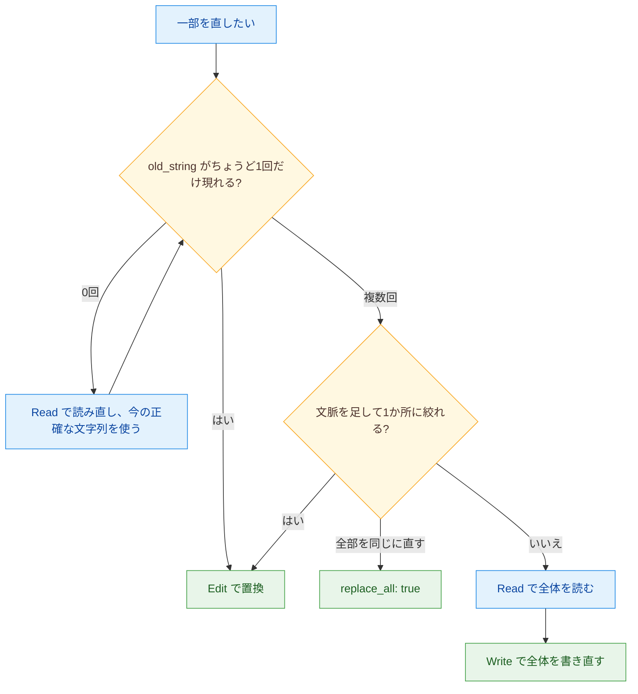

# 組み込みツールの選び方と、コードを段階的に読む進め方

> ドメイン: 2. ツール設計と MCP の組み込み（18%） ／ 更新: 2026-11-20

!!! abstract "ひとことで"
    中身（関数名・エラー文・import）を探すなら ==Grep==、ファイル名・拡張子で探すなら ==Glob==。コードは全部を先に読まず、Grep で入口を見つけてから Read で import をたどる。

## 仕組み

Grep は「行の中身」を、Glob は「パス名」を探す。Edit は一部の書き換え、Write は丸ごとの書き換えだ。Write で一部を直すと全体の上書きになり、ほかの部分を壊しやすいので、部分の修正は Edit に任せる。

| ツール | すること | 使うとき | 使わないとき |
|---|---|---|---|
| Grep | ファイルの中身を正規表現で探す（ripgrep ベース） | 呼び出し元、エラー文、import 文を探す | ファイル名で探したい |
| Glob | パスのパターン（`**/*.test.tsx` など）でファイルを探す | 命名規則・拡張子でファイルを集める | 中身の文字列で探したい |
| Read | ファイル全体を行番号付きで読む | 入口が分かったファイルを読む、Edit・Write の前 | まだどこを読むか決まっていない |
| Edit | `old_string` を `new_string` に完全一致で置き換える | ファイルの一部だけを直す | 一致が一意に決まらない |
| Write | ファイルを丸ごと新規作成・上書きする | 新しいファイル、全体の書き直し | 一部だけの修正（Edit を使う） |
| Bash | シェルのコマンドを実行する | テスト・ビルド・git など、専用ツールが無い操作 | ガイドの前提では、読み書きは専用ツールに任せる（目安） |

Edit は、`old_string` が ==ちょうど1回だけ現れる==ときにだけ通る。0回なら、空白1文字の違いか、読んだ内容が古いのが原因なので、Read で読み直して今の正確な文字列を使う。正規表現もあいまい一致も使わない。複数回なら文脈を足して1か所に絞り、絞れなければ同じ Edit を繰り返さず、Read で全体を読んで Write で書き直す。

読むファイルは、読むたびにコンテキスト（会話に積まれる情報）に積み上がる。だから調べ始めに全ファイルを Read せず、段階的に読む（incremental exploration）。Grep で関数名やエラー文から入口を探し、Read で入口を読み、import 先を Read して流れをたどる。足りなければ Grep に戻る。

ラッパーモジュール（別モジュールの関数を包み直して再エクスポートするファイル）は、先にエクスポート名をすべて洗い出し、名前ごとに Grep で利用箇所を探す。元の関数名だけを Grep すると、別名で再エクスポートされた呼び出しを見落とすからだ。大きなコードベースでのコンテキストの節約は 5.4 のノートで扱う。

??? info "Read の上限・検索の範囲・ガイドとのずれ"
    - Read は既定で1回 25,000 トークンまで。256 KB を超えるファイルは offset・limit で分けて読む
    - Grep は `.gitignore` の対象を飛ばすが、Glob は既定で飛ばさない
    - ずれ: 現行の Claude Code は macOS・Linux・WSL で Glob・Grep を既定で外し、Bash の `find`・`grep` で探す。cat などで1ファイルを見た後なら Read なしで Edit できる。試験はガイドの書き方で考える

## 試験での見分け方

| 問われること | ○ 正しい | × ひっかけ |
|---|---|---|
| ある関数の呼び出し元をすべて見つける | Grep（中身の検索） | Glob（パス名しか見ない） |
| テストファイルを全部集める | Glob（`**/*.test.tsx` のようなパス検索） | Grep（中身の検索） |
| Edit が「複数箇所に一致」で失敗した | 文脈を足して絞るか、Read＋Write に切り替える | 同じ Edit を何度も繰り返す |
| 初めてのリポジトリでバグの原因を追う | Grep で入口を探し、Read でたどる | 全ファイルを先に Read する（コンテキストの無駄） |
| ラッパー経由の利用箇所を漏れなく追う | エクスポート名を列挙してから、名前ごとに Grep | 元の関数名だけで Grep する |

## 確認問題

??? question "Q1. 料金計算の処理で「negative quantity」というエラーが出る。初めて触るリポジトリで原因の箇所を探すとき、最初にすることは？"
    Grep でエラー文を探し、投げている箇所（入口）を見つける。そこから Read でその関数と import 先をたどる。全ファイルを先に読むのはコンテキストの無駄だ。

??? question "Q2. 設定ファイルで `timeout: 30` が5か所にあり、そのうち1か所だけを 60 にしたい。Edit が一意に一致せず失敗した。どうする？"
    前後の行を含めて `old_string` を1か所に絞る。絞れなければ Read で全体を読み、該当箇所だけ直した全文を Write で書く。同じ Edit を繰り返さない。

??? question "Q3. `utils/http.ts` が `fetchJson` を `getJson` という名前で再エクスポートしている。`fetchJson` の利用箇所を漏れなく洗い出すには？"
    `utils/http.ts` のエクスポート名（`getJson` など）を先にすべて確かめ、元の名前と再エクスポート名のそれぞれで Grep する。元の名前だけでは、別名経由の呼び出しを見落とす。

??? question "Q4. `src` の下にある `*.stories.tsx` をすべて一覧にしたい。Grep と Glob のどちらを使う？"
    Glob（`src/**/*.stories.tsx`）。ファイル名のパターンで探すからだ。Grep は中身の検索になる。

## 出典
- [Claude Certified Architect – Foundations Exam Guide v1.1（タスクステートメント 2.5）](https://cc.sj-cdn.net/instructor/6nizmqk8tpzpfjvt6qmmav7rh/public/1794946250/Claude_Certified_Architect_-_Foundations_Exam_Guide.pdf)（公式）
- [Tools reference](https://code.claude.com/docs/en/tools-reference)（公式。Read・Write・Edit・Bash・Grep・Glob の動き）
- [Common workflows: Understand new codebases](https://code.claude.com/docs/en/common-workflows)（公式。広い質問から絞る、流れをたどる）
- [Explore the context window](https://code.claude.com/docs/en/context-window)（公式。ファイルを読むたびにコンテキストに積まれる）
- 未確認: 「Grep で入口 → Read で import をたどる」「ラッパーモジュールはエクスポート名を列挙してから名前ごとに Grep」という手順そのものを書いた公式ドキュメントのページは見つからなかった（ガイドの記述のみ）
