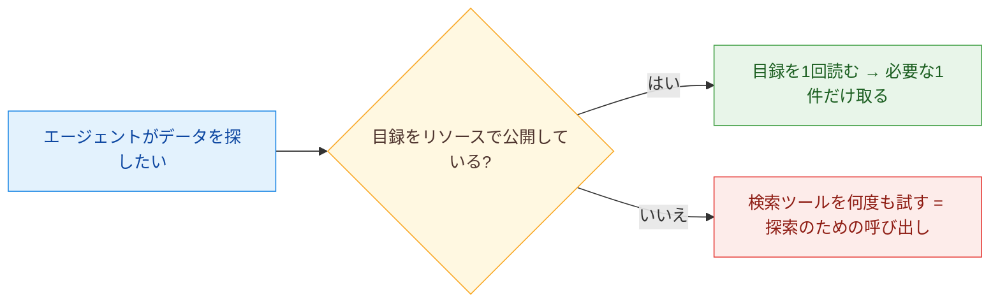

# MCP のツールとリソースの使い分けと、既存の MCP サーバーの活用

> ドメイン: 2. ツール設計と MCP の組み込み（18%） ／ 更新: 2026-11-20

!!! abstract "ひとことで"
    動作（書き込み・外部 API の実行）は ==ツール（tools）==、読ませたいデータの一覧や中身は ==リソース（resources）== で公開する。Jira や GitHub のような定番の連携は既存の MCP サーバーを使い、自作はチーム独自の業務に限る。

## 仕組み

MCP サーバーが公開する部品（primitive）は3つで、違いは「誰が使うかを決めるか」にある。ツールはモデルが自分で呼ぶ。リソースは読み取り用のデータで、副作用のある操作には向かない。プロンプトはユーザーが選んで使うひな形で、モデルが自分で呼ぶ部品ではない。

| 部品 | 誰が使うかを決めるか | 中身 | 例 | 主なメソッド |
|---|---|---|---|---|
| ツール | モデル（model-controlled） | 実行する関数。入力は JSON Schema | チケットを作る、DB を更新する | `tools/list`、`tools/call` |
| リソース | アプリ（application-controlled） | URI で指す読み取り用のデータ | 設計書の目次、DB のスキーマ | `resources/list`、`resources/read` |
| プロンプト（prompts） | ユーザー（user-controlled） | サーバーが用意した指示のひな形 | スラッシュコマンド | `prompts/list`、`prompts/get` |

エージェントが「何があるか」を探すために呼び出しを重ねているなら、中身の目録（content catalog）をリソースにして最初から見せる。目録を1回読めば、必要な1件だけを取りに行ける。目録が無いと、検索ツールの試し打ちが続き、呼び出しとトークンが増える。

既存のサーバーか自作かは、つなぐ先で決める。課題管理、チャット、リポジトリのような定番の SaaS には、既存のコミュニティ・公式の MCP サーバーを使う。チーム独自の業務手順や社内システムだけを自作する。既存のサーバーは MCP Registry（公開サーバーの公式の目録。プレビュー版）や Anthropic Directory で探せる。外部の内容を取るサーバーはプロンプトインジェクションの入口になるので、信頼できるか確かめてからつなぐ。

??? info "Claude Code でのリソースの扱い・ガイドとのずれ"
    - リソースは URI（例: `docs://adr/index`）で1件ずつ識別する。引数付きの URI はリソーステンプレート（resource templates、例: `alerts://{service}/open`）
    - Claude Code では `@サーバー名:URI` で参照すると、中身が添付として会話に入る。`claude -p`（非対話）では `@` の参照は普通の文字列のままで、自動では添付されない
    - Claude Code は、リソースを持つサーバーがあると、一覧と読み取りのツール（`ListMcpResourcesTool`、`ReadMcpResourceTool`）を自動で用意する。モデル自身もリソースを読める
    - 接続時に、設定した全サーバーのツール・プロンプト・リソースを取得する（設定のしかたは別ノート「[Claude Code と Agent SDK への MCP サーバーの組み込み](mcp-server-integration.md)」）
    - ずれ: ガイドは「接続時に全ツールが見つかり同時に使える」と書く。現行の Claude Code は既定で tool search（ツールの定義を必要になったときに読み込む仕組み）が有効。試験はガイドの書き方で答える

## 試験での見分け方

| 問われること | ○ 正しい | × ひっかけ |
|---|---|---|
| 「どんなデータがあるか」を知るためにツールを何度も呼んでいる | 目録をリソースで公開する | 検索ツールの試し打ちで中身を探らせる |
| 書き込みや外部への副作用がある操作 | ツールにする | リソースにする（リソースは読むだけ） |
| 定番の課題管理ツールと、社内独自の承認フローをつなぐ | 課題管理は既存の MCP サーバー、既存のものが無い承認フローだけ自作する | 既存のサーバーで足りるのに、同じ連携を一から作る |
| エージェントが MCP ツールより組み込みの Grep を選ぶ | ツールの説明文を改善する（別ノート「[ツールの説明文と境界の設計](tool-descriptions-boundaries.md)」） | 説明文を直さないまま使わせる |

## 確認問題

??? question "Q1. 社内の設計判断の記録（ADR）が数百件あり、エージェントが関係する記録を探すために検索ツールを毎回5〜6回呼んでいる。まず何をする？"
    ADR の目録（タイトル・日付・対象）をリソースで公開する。目録を1回読めば必要な記録だけを取れるので、探索のための呼び出しが減る。検索ツールを増やしても試し打ちは減らない。

??? question "Q2. 障害対応のエージェントに「監視のアラートを確認済みにする」機能を足したい。リソースとツールのどちらで公開する？"
    ツール。状態を変える操作は、モデルが呼ぶツールにする。リソースは読み取り用のデータで、副作用のある操作には向かない。

??? question "Q3. チームで GitHub の PR 一覧と、社内独自のリリース承認の手順の両方をエージェントに扱わせたい。どう組む？"
    GitHub は既存の MCP サーバーを使い、リリース承認だけを自作のサーバーにする。定番の連携を自作しても、保守の手間が増えるだけで得るものが少ない。

## 出典
- [MCP Specification 2026-07-28: Server Features Overview](https://modelcontextprotocol.io/specification/2026-07-28/server/index)（公式）
- [MCP Specification 2026-07-28: Resources](https://modelcontextprotocol.io/specification/2026-07-28/server/resources)（公式）
- [MCP Specification 2026-07-28: Tools](https://modelcontextprotocol.io/specification/2026-07-28/server/tools)（公式）
- [MCP Specification 2026-07-28: Prompts](https://modelcontextprotocol.io/specification/2026-07-28/server/prompts)（公式）
- [Understanding MCP servers](https://modelcontextprotocol.io/docs/learn/server-concepts)（公式）
- [The MCP Registry](https://modelcontextprotocol.io/registry/about)（公式）
- [Connect Claude Code to tools via MCP](https://code.claude.com/docs/en/mcp)（公式。Use MCP resources、Scale with MCP tool search、Find and build MCP servers）
- [Tools reference](https://code.claude.com/docs/en/tools-reference)（公式。ListMcpResourcesTool、ReadMcpResourceTool）
- Claude Certified Architect – Foundations Exam Guide v1.1（公式。タスクステートメント 2.4）
- 未確認: 「既存のサーバーを選ぶべき」という判断基準そのものは公式ドキュメントに明文が無く、ガイドの記述に基づく
