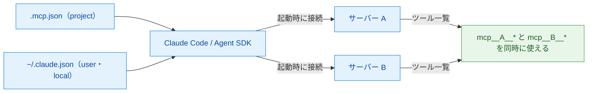

# Claude Code と Agent SDK への MCP サーバーの組み込み

> ドメイン: 2. ツール設計と MCP の組み込み（18%） ／ 更新: 2026-11-20

!!! abstract "ひとことで"
    チームで共有するサーバーは ==project スコープの `.mcp.json`== に書いてコミットし、個人や試験的なサーバーは `~/.claude.json` に書く。トークンは直接書かず、==`${GITHUB_TOKEN}` のような環境変数の展開==で各自の環境から渡す。

## 仕組み

MCP サーバーの設定には3つのスコープ（scope）がある。`claude mcp add --scope project|user|local ...` で追加し、`--scope` を省くと local になる。同じ名前のサーバーが複数のスコープにあると、local → project → user の順で優先する。項目は混ぜず、勝った側の定義をまるごと使う。

| スコープ | 保存先 | 効く範囲 | チームと共有 | 向いている用途 |
|---|---|---|---|---|
| project | プロジェクト直下の `.mcp.json` | そのプロジェクト | する（git で配る） | チーム共通のツール（課題管理、社内 DB など） |
| user | `~/.claude.json` | 自分の全プロジェクト | しない | 個人用・試験的なサーバー |
| local（既定） | `~/.claude.json` のプロジェクトの項 | そのプロジェクトだけ | しない | 1つのプロジェクトで試す個人用サーバー |

`.mcp.json` はリポジトリに入るので、秘密は値でなく変数名で書く。`${VAR}` と `${VAR:-default}`（未設定なら default）の2つの形が使え、書ける場所は `command`、`args`、`env`、`url`、`headers` だ。

```json
{ "mcpServers": { "github": {
    "type": "http",
    "url": "${GH_MCP_URL:-https://example.com/mcp}",
    "headers": { "Authorization": "Bearer ${GITHUB_TOKEN}" } } } }
```

ガイドの前提では、設定したすべてのサーバーに起動時に接続し、全サーバーのツールが組み込みツールと並んで同時に候補になる。ツール名は ==`mcp__<サーバー名>__<ツール名>`== だ。



Agent SDK では、`mcpServers` オプションでコードから渡すか、`settingSources` に `"project"` を含めて `.mcp.json` を読ませる（既定の `query()` では読む）。MCP ツールを自動で許可するには `allowedTools: ["mcp__github__*"]` のように書く。

??? info "細かい決まり・ガイドとのずれ"
    - 変数が未設定で既定値も無いと、警告を出したうえで `${VAR}` の文字のまま読み込む。`${VAR}` を空文字に設定すると「設定済み」扱いで、`:-default` は効かない
    - リモートサーバーの `url`・`headers` では、`ANTHROPIC_API_KEY` など Claude Code 自身の認証情報の変数は空として扱われる（漏えい防止）
    - `.mcp.json` のサーバーは、対話セッションでは使う前に承認を求められる。`claude -p` や Agent SDK では確認なしで読み込む
    - MCP の「local スコープ」は `~/.claude.json`（ホーム）に入る。`.claude/settings.local.json` とは別物
    - MCP 仕様では、クライアントが `tools/list` で一覧を取り、一覧が変わるとサーバーが `notifications/tools/list_changed` で知らせる。`.mcp.json`・スコープ・`${VAR}` の展開は Claude Code 側の設定で、MCP 仕様（tools・lifecycle・transports）には記述が無い
    - ずれ: ガイドは「接続時に全ツールが見つかる」と書く。現行の Claude Code は既定でツール検索（tool search）が有効で、起動時に読むのはツール名とサーバーの instructions だけ。定義は必要になったときに読む。古いモデル、Azure 上の Microsoft Foundry、`ENABLE_TOOL_SEARCH=false` では最初から全部読む

## 試験での見分け方

<div class="vs" markdown>

| 問われること | ○ 正しい | × ひっかけ |
|---|---|---|
| チーム全員に同じサーバーを配る | project スコープの `.mcp.json` をコミットする | 各自の `~/.claude.json` に手で書かせる（設定がばらつく） |
| 自分だけで新しいサーバーを試す | `~/.claude.json`（user か local） | `.mcp.json` に足す（共有ファイルを汚す） |
| トークンが要るサーバーを共有する | `.mcp.json` には `${VAR}` だけ書き、値は各自の環境変数に置く | API キーやトークンを `.mcp.json` に直接書いてコミットする |
| 高機能な MCP ツールがあるのに、組み込みの Grep で探し回る | MCP ツールの説明文に、何ができるか（Grep にできない範囲）、何を返すか、いつ使うかを詳しく書く | 説明文を「検索する」程度のままにする（Claude は説明文で選ぶので、なじみのある Grep と区別できない） |
| 課題管理など定番の連携 | 既存のコミュニティのサーバーを使い、独自サーバーはチーム固有の処理に限る | 定番の連携を自作する |
| 中身の一覧（スキーマ、文書の目次など）を見せて探索の呼び出しを減らす | MCP resources で公開する | 検索ツールを何度も呼ばせる |

</div>

最後の2行は、別ノート「[MCP のツールとリソースの使い分け](mcp-resources-vs-tools.md)」で詳しく扱う。

## 確認問題

??? question "Q1. 社内の在庫 DB を引く MCP サーバーを、開発チーム全員の Claude Code で使えるようにしたい。接続には各自の個人トークンが要る。どう設定する？"
    リポジトリ直下の `.mcp.json` にサーバーを書いてコミットする。トークンは `"Authorization": "Bearer ${INVENTORY_TOKEN}"` のように環境変数の展開で参照し、値は各自の環境変数に置く。トークンを直接書くと秘密がリポジトリに残る。各自の `~/.claude.json` に書かせると設定がばらつく。

??? question "Q2. ある開発者が、評価中の翻訳用 MCP サーバーを自分の全プロジェクトで試したい。チームのリポジトリには入れたくない。どのスコープにする？"
    user スコープ（`~/.claude.json`、`claude mcp add --scope user`）。全プロジェクトで効き、共有されない。project スコープだとチームに配られ、local だとそのプロジェクトでしか使えない。

??? question "Q3. `.mcp.json` の `wiki` サーバーと、自分の local スコープの `wiki` サーバーが別の URL を指している。どちらが使われる？"
    local スコープの定義。優先順位は local → project → user だ。項目は混ざらず、勝った側の定義をまるごと使う。

## 出典
- [Connect Claude Code to tools via MCP](https://code.claude.com/docs/en/mcp)（公式。スコープ、優先順位、環境変数の展開、承認、tool search）
- [Connect to external tools with MCP（Agent SDK）](https://code.claude.com/docs/en/agent-sdk/mcp)（公式。`mcpServers`、`settingSources`、ツール名、`allowedTools`）
- [MCP Specification: Tools](https://modelcontextprotocol.io/specification/latest/server/tools)（公式。`tools/list`、`listChanged`）
- Claude Certified Architect – Foundations Exam Guide v1.1、Task Statement 2.4（公式）
- 確認済み: Agent SDK が読む `.mcp.json` でも `${VAR}` は実行時に展開される（Agent SDK のページの Authentication 節）
- 未確認: コードで渡す `mcpServers` の文字列に `${VAR}` 展開が効くかは記述が無い（例は `process.env` で値を渡す形のみ）
