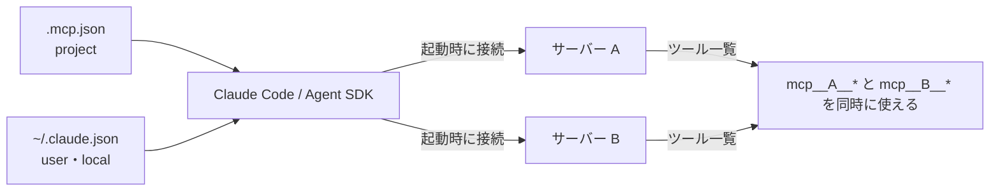

# Claude Code と Agent SDK への MCP サーバーの組み込み

> ドメイン: 2. ツール設計と MCP の組み込み（18%） ／ 更新: 2026-11-20

## 3行まとめ
- チームで共有するサーバーは **プロジェクトスコープの `.mcp.json`**（リポジトリにコミット）、個人・試験的なサーバーはユーザースコープの `~/.claude.json` に書く
- 認証トークンは `.mcp.json` に直接書かず、`${GITHUB_TOKEN}` のような環境変数の展開（environment variable expansion）で各自の環境から渡す
- 設定したすべてのサーバーのツールは接続時に見つかり、同時に使える。名前は `mcp__<サーバー名>__<ツール名>`

## 仕組み

### スコープ（scope）
| スコープ | 保存先 | 効く範囲 | チームと共有 | 向いている用途 |
|---|---|---|---|---|
| project | プロジェクト直下の `.mcp.json` | そのプロジェクト | する（git で配る） | チーム共通のツール（課題管理、社内 DB など） |
| user | `~/.claude.json` | 自分の全プロジェクト | しない | 個人用・試験的なサーバー |
| local（既定） | `~/.claude.json` のプロジェクトの項 | そのプロジェクトだけ | しない | 1つのプロジェクトで試す個人用サーバー |

- 追加: `claude mcp add --scope project|user|local ...`（`--scope` を省くと local）
- 同じ名前が複数のスコープにあると、local → project → user の順で優先。項目は混ぜず、勝った側の定義をまるごと使う

### 環境変数の展開
```json
{ "mcpServers": { "github": {
    "type": "http",
    "url": "${GH_MCP_URL:-https://example.com/mcp}",
    "headers": { "Authorization": "Bearer ${GITHUB_TOKEN}" } } } }
```
- 書ける場所: `command`、`args`、`env`、`url`、`headers`
- 形: `${VAR}` と `${VAR:-default}`（未設定なら default）
- 変数が未設定で既定値も無いと、警告を出したうえで `${VAR}` の文字のまま読み込む

### 接続とツールの発見

- MCP 仕様では、クライアントが `tools/list` で一覧を取り、一覧が変わるとサーバーが `notifications/tools/list_changed` で知らせる
- `.mcp.json`・スコープ・`${VAR}` の展開は Claude Code 側の設定。MCP 仕様（tools・lifecycle・transports）には記述が無い
- Agent SDK: `mcpServers` オプションでコードから渡すか、`settingSources` に `"project"` を含めて `.mcp.json` を読ませる（既定の `query()` では読む）
- Agent SDK で MCP ツールを自動で許可するには `allowedTools: ["mcp__github__*"]` のように書く

## 試験で問われそうなポイント
- チーム全員に同じサーバーを配りたい → project スコープの `.mcp.json` をコミット
- 自分だけで新しいサーバーを試したい → `~/.claude.json`（user か local）。共有ファイルを汚さない
- トークンが要るサーバーを共有したい → `.mcp.json` には `${VAR}` だけ書き、値は各自の環境変数に置く
- 複数のサーバーをつないだ → 全サーバーのツールが同時に候補になる。組み込みの Grep などより MCP ツールを選ばせたいなら、ツールの説明文で能力と出力を詳しく書く（→ 別ノート: ツールの説明文と境界の設計）
- 課題管理など定番の連携 → 既存のコミュニティのサーバーを使い、独自サーバーはチーム固有の処理に限る（→ 別ノート: MCP のツールとリソースの使い分け）
- 中身の一覧（スキーマ、文書の目次など）を見せて探索の呼び出しを減らす → MCP resources（→ 別ノート: MCP のツールとリソースの使い分け）

## 間違えやすいところ
- アンチパターン: API キーやトークンを `.mcp.json` に直接書いてコミットする。環境変数の展開を使う
- アンチパターン: チームで使うサーバーを各自の `~/.claude.json` に手で書かせる。設定がばらつく
- MCP の「local スコープ」は `~/.claude.json`（ホーム）に入る。`.claude/settings.local.json` とは別物
- `.mcp.json` のサーバーは、対話セッションでは使う前に承認を求められる。`claude -p` や Agent SDK では確認なしで読み込む
- `${VAR}` を空文字に設定すると「設定済み」扱いで、`:-default` は効かない
- リモートサーバーの `url`・`headers` では、`ANTHROPIC_API_KEY` など Claude Code 自身の認証情報の変数は空として扱われる（漏えい防止）
- ガイドは「接続時に全ツールが見つかる」と書くが、現行の Claude Code は既定でツール検索（tool search）が有効で、起動時に読むのはツール名だけ。定義は必要になったときに読む

## 確認問題
1. 社内の在庫 DB を引く MCP サーバーを、開発チーム全員の Claude Code で使えるようにしたい。接続には各自の個人トークンが要る。どう設定するか。
   <details><summary>答え</summary>リポジトリ直下の `.mcp.json` にサーバーを書いてコミットし、トークンは `"Authorization": "Bearer ${INVENTORY_TOKEN}"` のように環境変数の展開で参照する。値は各自の環境変数に置く。トークンを直接書くと秘密がリポジトリに残り、各自の `~/.claude.json` に書かせると設定がばらつく。</details>
2. ある開発者が、評価中の翻訳用 MCP サーバーを自分の全プロジェクトで試したい。チームのリポジトリには入れたくない。どのスコープか。
   <details><summary>答え</summary>user スコープ（`~/.claude.json`、`claude mcp add --scope user`）。全プロジェクトで効き、共有されない。project スコープだとチームに配られ、local だとそのプロジェクトでしか使えない。</details>
3. `.mcp.json` の `wiki` サーバーと、自分の local スコープの `wiki` サーバーが別の URL を指している。どちらが使われるか。
   <details><summary>答え</summary>local スコープの定義。優先順位は local → project → user で、項目は混ざらず、勝った側の定義をまるごと使う。</details>

## 出典
- [Connect Claude Code to tools via MCP](https://code.claude.com/docs/en/mcp)（公式。スコープ、優先順位、環境変数の展開、承認、tool search）
- [Connect to external tools with MCP（Agent SDK）](https://code.claude.com/docs/en/agent-sdk/mcp)（公式。`mcpServers`、`settingSources`、ツール名、`allowedTools`）
- [MCP Specification: Tools](https://modelcontextprotocol.io/specification/latest/server/tools)（公式。`tools/list`、`listChanged`）
- Claude Certified Architect – Foundations Exam Guide v1.1、Task Statement 2.4（公式）
- 未確認: Agent SDK の `mcpServers` に `.mcp.json` と同じ `${VAR}` 展開が効くかは、SDK のページに記述が無い（コード側は `process.env` で渡す例のみ。MCP 仕様の範囲外のため、仕様でも確かめられない）
