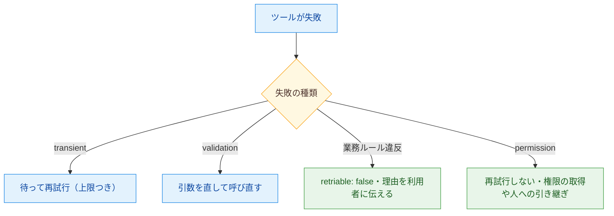

# MCP ツールの構造化エラー応答

> ドメイン: 2. ツール設計と MCP の組み込み（18%） ／ 更新: 2026-11-20

!!! abstract "ひとことで"
    ツールの失敗は、結果の中に ==`isError: true`== を立て、分類・再試行してよいか・人が読める説明を付けて返す。決め手は==再試行の可否==で、一時的な障害だけを再試行する。

## 仕組み

MCP（Model Context Protocol）のツールのエラーは2種類ある。ツールの中で起きた失敗は、結果として返せばエージェント（LLM）が読んで次の手を決められる。一律の「Operation failed」では一時的か恒久的かが分からないので、無駄な再試行か早すぎる断念を招く。

| 種類 | 返し方 | 例 | LLM に渡すか |
|---|---|---|---|
| プロトコルエラー（Protocol Error） | JSON-RPC の `error`（例: `-32602`） | 存在しないツール名、リクエストの形の崩れ | 渡してもよい（MAY）。自力で直せることは少ない |
| ツール実行エラー（Tool Execution Error） | `result` の中で `isError: true` | API の失敗、入力値の検証エラー、業務ロジックのエラー | 渡すべき（SHOULD）。自分で直して呼び直せる |



| 分類（ガイドの4分類） | 例 | isRetryable | エージェントの次の手 |
|---|---|---|---|
| 一時的（transient） | タイムアウト、サービス停止中 | true | 間を置いて同じ呼び出しを再試行 |
| 検証（validation） | 日付の形式違い、範囲外の値 | false（同じ入力では） | 入力を直して呼び直す |
| 業務（business） | 返金の上限超え、規定違反 | false | 利用者向けの説明をそのまま伝える |
| 権限（permission） | 閲覧権限が無い | false | 別の手段か、人に引き継ぐ |

検証・業務・権限のエラーは、同じ入力で何度呼んでも失敗する。だから再試行するのは一時的な障害だけだ。構造化したメタデータは、`content` のテキストに JSON で入れて返す。

```json
{ "content": [{ "type": "text", "text": "{\"retriable\":false,\"message\":\"返金は購入から30日以内に限られます。この注文は45日前です。\"}" }],
  "isError": true }
```

??? info "フィールド名・仕様の版・SDK の細かい決まり"
    - `errorCategory`・`isRetryable` は MCP 仕様のフィールドではない。ガイドが示す設計上の慣習で、`errorCategory` の値は transient / validation / permission の3つ。業務エラーは `errorCategory` を使わず、`retriable: false` と顧客向けの説明を付ける（上の例）
    - 名前の揺れ: ガイドは `isRetryable` と `retriable: false` の両方の綴りを使う。どちらも仕様で決まった名前ではない
    - Claude API で自前のツールを動かすときは、同じ役目を `tool_result` の `is_error: true` が担う
    - 入力の検証エラーは、2025-11-25 版以降（現行の 2026-07-28 版も）の仕様ではツール実行エラー（`isError`）側に入る。JSON-RPC のプロトコルエラーで返すのは誤り。2025-06-18 版はプロトコルエラーに「Invalid arguments」、ツール実行エラーに「Invalid input data」と両方に書いていた。「LLM に渡す SHOULD / MAY」の文も 2025-11-25 版で入った
    - Agent SDK では、例外を投げっぱなしにすると生の例外メッセージが Claude に渡るだけになる。自分で捕まえて、次に何をすべきかを書いた `isError` の結果を作る
    - Claude は `is_error` を見て同じツールを呼び直すことがある。ループ側で再試行の上限を決めておく
    - サブエージェントで一時的な失敗が起きたら、まずその場で再試行する。直らないものだけを、途中の結果と試したことを添えてコーディネーターに返す（詳しくは 5.3 の multiagent-error-propagation のノート）

## 試験での見分け方

<div class="vs" markdown>

| 問われること | ○ 正しい | × ひっかけ |
|---|---|---|
| 失敗をエージェントに知らせる | 例外で落とさず、`isError: true` の結果として返す | 失敗を空の成功結果に見せかける（「データが無い」と誤って結論づける） |
| 再試行が無駄に繰り返される | 分類と `isRetryable` を返し、再試行してよいものを見分けさせる | 一律の「Operation failed」を返す、すべてのエラーを再試行する |
| 業務ルール違反を利用者に伝える | `retriable: false` と、利用者に見せられる説明を付ける | 再試行させる |
| 検索が0件だった | 失敗ではないので、`isError` を立てず「0件」として返す | `isError: true` で返す（アクセスできなかった場合と区別できない） |

</div>

## 確認問題

**Q1.** 通販サイトのサポートエージェントが、在庫照会の MCP ツールを使っている。ツールは、倉庫 API のタイムアウトでも、SKU の形式違いでも、同じ「Error」だけを返す。エージェントはどちらの場合も3回再試行してから諦める。最も適切な直し方はどれか。（1つ選べ）
{ .quiz-q }

<div class="quiz" data-answer="A" markdown>

- A. `isError: true` に、タイムアウトは transient・再試行可、形式違いは validation・再試行不可と説明を付ける
- B. どちらの失敗も JSON-RPC のプロトコルエラー（`-32602`）として返し、ツールの結果とは分ける
- C. 一時的な失敗に備えて、どちらの場合も再試行の回数を3回から5回に増やす
- D. 失敗したときは空の在庫一覧を成功として返し、エージェントには「在庫なし」として扱わせる

</div>

??? success "答えと解説"
    **正解: A。** 分類と再試行の可否を返せば、エージェントはタイムアウトだけを再試行し、形式違いは SKU を直して呼び直せる。

    - B: 入力の検証エラーは、現行の仕様ではツール実行エラー（`isError`）側に入る。プロトコルエラーで返すのは誤り
    - C: 形式違いは同じ入力で何度呼んでも失敗する。すべてを再試行すると無駄が増えるだけだ
    - D: 失敗を空の成功に見せかけると、エージェントは「在庫が無い」と誤って結論づける

**Q2.** 会員サポートのエージェントが、ポイントを商品券に交換する MCP ツールを使う。交換は1回 10,000 ポイントまでという規定があり、それを超える申請が来た。エージェントが利用者に正しく伝えられるようにする、ツールの返し方として適切なものはどれか。（2つ選べ）
{ .quiz-q }

<div class="quiz" data-answer="C,E" markdown>

- A. `errorCategory: "transient"` と `isRetryable: true` を付け、時間を置いて再試行させる
- B. JSON-RPC のプロトコルエラーとして返し、エージェント（LLM）には渡さない
- C. 結果に `isError: true` を立て、`retriable: false` を付けて、再試行させない
- D. `isError` は立てず、「交換できませんでした」のテキストを成功の結果として返す
- E. 上限の値と超えたことを、利用者にそのまま見せられる説明として結果に付ける

</div>

??? success "答えと解説"
    **正解: C と E。** 業務ルール違反は再試行しても結果が変わらないので、`retriable: false` と利用者向けの説明を付けて返す。

    - A: 一時的な障害ではない。同じ申請を何度呼んでも失敗する
    - B: 業務ロジックのエラーはツール実行エラーとして結果で返し、LLM に渡すべきだ
    - D: 成功に見せかけると、失敗だったことも理由もエージェントに伝わらない

**Q3.** 社内文書を調べるマルチエージェントの調査システムで、検索の MCP ツールは、条件に合う文書が0件のとき `isError: true` と「見つかりません」を返す。調査エージェントはこれをアクセスの失敗と区別できず、再試行を繰り返したあと「検索できなかった」と報告する。最も適切な直し方はどれか。（1つ選べ）
{ .quiz-q }

<div class="quiz" data-answer="C" markdown>

- A. 0件のときも `isError: true` のままにし、`errorCategory: "permission"` を付ける
- B. 0件のときは `isRetryable: true` を付け、条件を変えずに再試行させる
- C. 0件は検索が正常に終わった結果として、`isError` を立てずに「0件」と返す
- D. 0件のときは JSON-RPC のプロトコルエラーを返し、ツール実行エラーと分ける

</div>

??? success "答えと解説"
    **正解: C。** 0件は失敗ではないので、エラーにしない。エラーにすると、検索先に届かなかった場合と区別できない。

    - A: 権限の問題ではない。誤った分類は、別の手段や人への引き継ぎという誤った次の手を招く
    - B: 同じ条件で呼び直しても0件のままだ。無駄な再試行が増える
    - D: 0件は失敗ではない。プロトコルエラーは存在しないツール名や形の崩れたリクエストに使う

## 出典
- Claude Certified Architect – Foundations Exam Guide v1.1, Task Statement 2.2（公式、PDF）: https://cc.sj-cdn.net/instructor/6nizmqk8tpzpfjvt6qmmav7rh/public/1794946250/Claude_Certified_Architect_-_Foundations_Exam_Guide.pdf
- [MCP Specification 2026-07-28（現行版）: Tools（Error Handling）](https://modelcontextprotocol.io/specification/2026-07-28/server/tools)（公式）
- [MCP Specification 2026-07-28: Schema（CallToolResult、InvalidParamsError）](https://modelcontextprotocol.io/specification/2026-07-28/schema)（公式。`isError` の既定は false、ツールの引数の誤りは `isError` で返す）
- [MCP Specification 2025-11-25: Tools](https://modelcontextprotocol.io/specification/2025-11-25/server/tools) ／ [2025-06-18: Tools](https://modelcontextprotocol.io/specification/2025-06-18/server/tools)（公式。版による違いの確認）
- [Handle tool calls](https://platform.claude.com/docs/en/agents-and-tools/tool-use/handle-tool-calls)（公式。`is_error`、「failed」ではなく次に何をすべきかを書く、再試行の上限）
- [Custom tools（Handle errors）](https://code.claude.com/docs/en/agent-sdk/custom-tools)（公式、Agent SDK）
- [Writing effective tools for AI agents](https://www.anthropic.com/engineering/writing-tools-for-agents)（公式、エンジニアリングブログ、2025-09。不透明なエラーコードより具体的で実行できる改善を伝える）
- `isError: true` のときの `structuredContent`: 仕様に明記は無く、禁止もされていない。ただし `outputSchema` があるときは「Servers MUST provide structured results that conform to this schema」に `isError` の例外が書かれていないので、入れるならスキーマに合わせる必要がある
