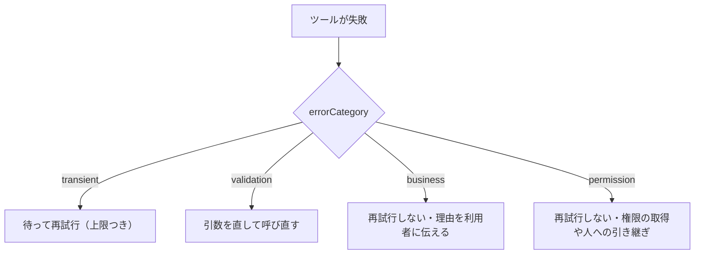

# MCP ツールの構造化エラー応答

> ドメイン: 2. ツール設計と MCP の組み込み（18%） ／ 更新: 2026-11-20

## 3行まとめ
- ツールの失敗は、結果の中に `isError: true` を立てて返す。エージェント（LLM）が失敗を読んで、次の手を決められる
- エラーは「分類・再試行してよいか・人が読める説明」を付けた構造で返す。一律の「Operation failed」は回復の判断を奪う
- 判断の決め手は再試行の可否。一時的な障害だけ再試行し、入力の誤りは直して呼び直し、業務ルール違反と権限エラーは再試行しない

## 仕組み

MCP（Model Context Protocol）のツールのエラーは2種類ある。

| 種類 | 返し方 | 例 | LLM に渡すか |
|---|---|---|---|
| プロトコルエラー（Protocol Error） | JSON-RPC の `error`（例: `-32602`） | 存在しないツール名、リクエストの形の崩れ | 渡してもよい（MAY）。自力で直せることは少ない |
| ツール実行エラー（Tool Execution Error） | `result` の中で `isError: true` | API の失敗、入力値の検証エラー、業務ロジックのエラー | 渡すべき（SHOULD）。自分で直して呼び直せる |



エラーの分類（ガイドの4分類）:

| 分類 | 例 | isRetryable | エージェントの次の手 |
|---|---|---|---|
| 一時的（transient） | タイムアウト、サービス停止中 | true | 間を置いて同じ呼び出しを再試行 |
| 検証（validation） | 日付の形式違い、範囲外の値 | false（同じ入力では） | 入力を直して呼び直す |
| 業務（business） | 返金の上限超え、規定違反 | false | 利用者向けの説明をそのまま伝える |
| 権限（permission） | 閲覧権限が無い | false | 別の手段か、人に引き継ぐ |

返し方の最小例（構造化したメタデータを `content` のテキストに JSON で入れる）:

```json
{ "content": [{ "type": "text", "text": "{\"errorCategory\":\"business\",\"isRetryable\":false,\"message\":\"返金は購入から30日以内に限られます。この注文は45日前です。\"}" }],
  "isError": true }
```

- `errorCategory`・`isRetryable` は MCP 仕様のフィールドではない。ガイドが示す設計上の慣習で、ツールの作り手が中身に入れる
- Claude API で自前のツールを動かすときは、同じ役目を `tool_result` の `is_error: true` が担う

## 試験で問われそうなポイント
- 失敗をエージェントに知らせたい → 例外で落とさず、`isError: true` の結果として返す
- 再試行が無駄に繰り返される → `isRetryable` と分類を返し、再試行してよいものを見分けさせる
- 業務ルール違反を利用者に伝えさせたい → `isRetryable: false` と、利用者に見せられる説明を付ける
- 検索が0件だった → 失敗ではない。`isError` を立てず「0件」として返す（アクセスの失敗とは分ける）
- サブエージェントで一時的な失敗が起きた → まずその場で再試行し、直らないものだけを、途中の結果と試したことを添えてコーディネーターに返す（詳しくは 5.3 の multiagent-error-propagation のノート）

## 間違えやすいところ
- 一律の「Operation failed」を返す → アンチパターン。一時的か恒久的か分からず、無駄な再試行か早すぎる断念を招く
- すべてのエラーを再試行する → 検証・業務・権限のエラーは、同じ入力で何度呼んでも失敗する
- 0件の結果を `isError: true` で返す → 「アクセスできなかった」と区別できなくなる
- 失敗を空の成功結果に見せかける → エージェントが「データが無い」と誤って結論づける
- 入力の検証エラーを JSON-RPC のプロトコルエラーで返す → 2025-11-25 版以降（現行の 2026-07-28 版も）の仕様では、ツール実行エラー（`isError`）側に入る。2025-06-18 版はプロトコルエラーの例に「Invalid arguments」を挙げていた
- 例外を投げっぱなしにする → Agent SDK では生の例外メッセージが Claude に渡るだけ。自分で捕まえて、次に何をすべきかを書いた `isError` の結果を作る
- 名前の揺れ → ガイドは `isRetryable` と `retriable: false` の両方の綴りを使う。どちらも仕様で決まった名前ではない
- 再試行の回数 → Claude は `is_error` を見て同じツールを呼び直すことがある。ループ側で上限を決めておく

## 確認問題
1. 在庫照会の MCP ツールが、倉庫 API のタイムアウトでも、SKU の形式違いでも、同じ「Error」だけを返している。エージェントはどちらでも3回再試行してから諦める。どう直すか
   <details><summary>答え</summary>`isError: true` に加えて、タイムアウトは errorCategory: transient・isRetryable: true、形式違いは validation・isRetryable: false と、何が悪いかの説明を返す。前者だけ再試行し、後者は SKU を直して呼び直せる。</details>
2. 経費精算のツールで、承認者の上限額を超える申請が来た。エージェントが利用者に正しく伝えられるようにするには、どう返すか
   <details><summary>答え</summary>業務エラーとして `isError: true`、isRetryable: false、利用者に見せられる説明（上限額と、どうすればよいか）を返す。再試行しても結果は変わらないので、再試行させない。</details>
3. 顧客検索のツールが、条件に合う顧客がいないときに `isError: true` と「見つかりません」を返している。何が問題か
   <details><summary>答え</summary>0件は正常に検索できた結果なので、エラーにしない。エラーにすると、検索先に届かなかった場合と区別できず、無駄な再試行や誤った報告につながる。</details>

## 出典
- Claude Certified Architect – Foundations Exam Guide v1.1, Task Statement 2.2（公式、PDF）: https://cc.sj-cdn.net/instructor/6nizmqk8tpzpfjvt6qmmav7rh/public/1794946250/Claude_Certified_Architect_-_Foundations_Exam_Guide.pdf
- [MCP Specification 2026-07-28（現行版）: Tools（Error Handling）](https://modelcontextprotocol.io/specification/2026-07-28/server/tools)（公式）
- [MCP Specification 2026-07-28: Schema（CallToolResult、InvalidParamsError）](https://modelcontextprotocol.io/specification/2026-07-28/schema)（公式。`isError` の既定は false、ツールの引数の誤りは `isError` で返す）
- [MCP Specification 2025-11-25: Tools](https://modelcontextprotocol.io/specification/2025-11-25/server/tools) ／ [2025-06-18: Tools](https://modelcontextprotocol.io/specification/2025-06-18/server/tools)（公式。版による違いの確認）
- [Handle tool calls](https://platform.claude.com/docs/en/agents-and-tools/tool-use/handle-tool-calls)（公式。`is_error`、「failed」ではなく次に何をすべきかを書く、再試行の上限）
- [Custom tools（Handle errors）](https://code.claude.com/docs/en/agent-sdk/custom-tools)（公式、Agent SDK）
- [Writing effective tools for AI agents](https://www.anthropic.com/engineering/writing-tools-for-agents)（公式、エンジニアリングブログ、2025-09。不透明なエラーコードより具体的で実行できる改善を伝える）
- 未確認: `isError: true` のときに `structuredContent` へエラー情報を入れてよいか（`outputSchema` との関係）。2026-07-28 版の仕様には、これについての記述が見当たらない
