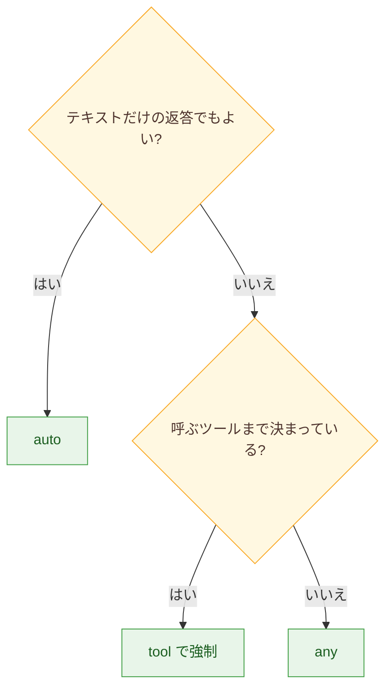
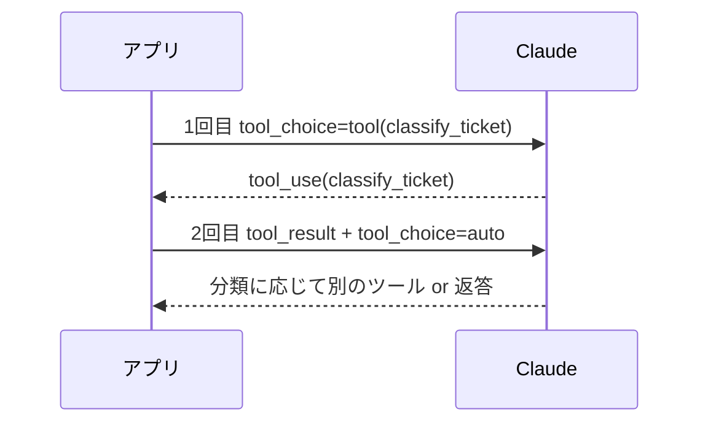

# tool_choice の設定（auto / any / 特定ツールの強制）

> ドメイン: 2. ツール設計と MCP の組み込み（18%） ／ 更新: 2026-11-20

!!! abstract "ひとことで"
    必ずツールを呼ばせたいなら ==any==（どれかは任せる）、決まったツールを先に呼ばせたいなら ==tool==、会話の返答もありうるなら auto。決め手は「テキストで返されると困るか」「どのツールかまで決まっているか」の2点だ。

## 仕組み

`tool_choice` は、ツールを呼ぶかどうかと、どれを呼ぶかを指定するリクエストのパラメータで、auto / any / tool / none の4種類がある。auto は「呼ぶかどうか」も Claude に任せるので、ツールを渡しただけでは呼ばれる保証は無い。any は「どれかを必ず呼ぶ」で、特定のツールは選べない。

| 値 | 書き方 | ツールを呼ぶか | どのツールか | 使う場面 |
|---|---|---|---|---|
| auto | `{"type": "auto"}` | Claude が決める（テキストだけの返答もある） | Claude が選ぶ | 普通の対話・エージェント。`tools` があるときの既定 |
| any | `{"type": "any"}` | 必ず呼ぶ | Claude が選ぶ | 抽出スキーマが複数あり、文書の種類が分からない |
| tool | `{"type": "tool", "name": "..."}` | 必ず呼ぶ | 指定した1つ | 最初に必ず特定の処理を通したい |
| none | `{"type": "none"}` | 呼ばない | — | ツールを使わせない。`tools` が無いときの既定 |

tool_choice はリクエストごとの指定で、強制は==そのリクエストの最初の応答にしか効かない==。段階を踏む処理は、1回目だけ tool で強制し、次の段階は続くターンで auto に戻して進める。複数ターンにわたる呼び出し順の保証（A を通るまで B を呼ばせない、など）は、プログラム側の前提チェックで行う。

any / tool のときは、応答が tool_use から始まる。前置きの説明文は出ない（頼んでも出ない）。呼ぶ前に考えさせたいなら、auto のままプロンプトで「このツールを使って」と指示する。

??? info "併用の制約・ガイドとのずれ・細かい決まり"
    - `disable_parallel_tool_use: true`（1回の応答で呼ぶツールを1つまでにする）は tool_choice の中に書く。auto なら「最大1つ」、any / tool なら「ちょうど1つ」
    - 構文の正しさは強制の効果ではない。tool use と JSON スキーマ（＋strict tool use）なら構文は正しくなるが、値の意味の誤り（合計が合わない、別の欄に入る）は防げない（別ノート: tool_use と JSON スキーマによる構造化出力）
    - 手動の拡張思考（extended thinking、`thinking: {type: "enabled"}`）と any / tool は併用できず、エラーになる。強制すると思考ブロック（thinking）も出ない
    - ガイドとのずれ: 現行ドキュメントでは、新しい一部のモデル（Opus 5.5、Sonnet 5.5 など）は any / tool を 400 エラーで拒否し、auto と strict tool use（スキーマどおりの入力を保証する設定）か structured outputs を使うよう案内している。試験はガイドの書き方（any / tool で強制）を主に覚える
    - tool_choice を変えると、プロンプトキャッシュのうちメッセージ部分は作り直しになる（ツール定義とシステムプロンプトのキャッシュは残る）

## 試験での見分け方

| 問われること | ○ 正しい | × ひっかけ |
|---|---|---|
| 構造化出力が必要なのに、時々テキストで返る | auto をやめて any（または tool）にする | auto のまま、ツールを渡しただけで呼ばれると期待する |
| 抽出ツールが種類別に複数あり、文書の種類が事前に分からない | any にして、どのスキーマで抽出するかは Claude に選ばせる | tool で1つに固定する（種類を判定できない） |
| 必ず呼ばせ、入力もスキーマどおりにしたい | any とツール定義の `strict: true`（strict tool use）を組み合わせる | any だけで入力もスキーマどおりになると考える（構文の正しさは強制の効果ではない） |
| 後続の前提になる抽出・分類を必ず先に通す | tool で強制し、残りは続くターンで処理する | 複数ターンの順序を tool_choice やプロンプトの指示だけで保証する |
| ツールが多すぎて選び間違える、役割外のツールを使う | ツールの割り振りの問題として直す（別ノート: エージェントへのツールの割り振り） | tool_choice で解決しようとする |

## 確認問題

**Q1.** CI で PR をレビューするエージェントに、変更されたファイルを一覧する `list_changed_files` と、レビュー用のツールを Claude API で渡している。1回目の応答で必ず変更範囲を取らせたい。`tool_choice` の設定として最も適切なものはどれか。（1つ選べ）
{ .quiz-q }

- A. すべてのリクエストを any にし、必ずどれかのツールを呼ばせる
- B. 1回目だけ `list_changed_files` を tool で指定し、以降は auto にする
- C. すべてのリクエストで、tool で `list_changed_files` に固定する
- D. auto のまま、システムプロンプトに「最初に必ず `list_changed_files` を呼べ」と書く

??? success "答えと解説"
    **正解: B。** 呼ぶツールまで決まっているので tool で強制し、続くターンは auto に戻して変更範囲に応じたレビューを進める。（ガイドの前提。現行の一部のモデルは any / tool を 400 エラーで拒否する。上の折りたたみを参照）

    - A: any はどれかを呼ぶだけで、ツールは選べない。レビュー用のツールを先に選ぶ余地が残る
    - C: 毎回一覧だけが呼ばれ、次の段階のレビューに進めない
    - D: auto では、呼ぶかどうかもどれを呼ぶかも Claude が決める。指示だけでは保証されない

**Q2.** 経理部門に届く PDF から項目を抜き出すシステムを作っている。PDF が請求書・領収書・納品書のどれかは事前に分からないので、種類ごとの抽出ツールを3つ用意した。auto だと「この文書は領収書のようです」と文章だけで返ることがある。`tool_choice` の設定として最も適切なものはどれか。（1つ選べ）
{ .quiz-q }

- A. auto のまま、システムプロンプトに「必ずツールで答えること」と書き足す
- B. `{"type": "tool", "name": "extract_invoice"}` にして、請求書の抽出ツールに固定する
- C. `{"type": "none"}` にして、まず文書の種類だけを文章で答えさせる
- D. `{"type": "any"}` にして、どの抽出ツールを使うかは Claude に選ばせる

??? success "答えと解説"
    **正解: D。** テキストで返されると困るが、どのツールかは文書次第なので、any で必ず呼ばせて選択は任せる。（ガイドの前提。現行の一部のモデルは any / tool を 400 エラーで拒否する。上の折りたたみを参照）

    - A: auto はテキストだけの返答もありうる設定だ。ツールを渡しただけで呼ばれる保証は無い
    - B: 1つに固定すると、種類を判定できない。領収書にも請求書のスキーマが当てられる
    - C: none はツールを呼ばせない設定だ。構造化した抽出結果が得られない

**Q3.** 開発者向けの社内ツールで、Claude API に `run_lint` と `run_tests` を渡し、`{"type": "any"}` で必ずどちらかを呼ばせている。呼ぶ前に、なぜそのツールを選ぶかを1〜2文で書かせたい。プロンプトで頼んだが、説明が出てこない。最も適切な対応はどれか。（1つ選べ）
{ .quiz-q }

- A. auto に戻し、ユーザーメッセージで「このどちらかのツールを使って答えて」と指示する
- B. any のまま、システムプロンプトで説明を書くよう、もっと強い言葉で指示する
- C. any をやめて tool にし、呼ぶツールを名前で1つ指定する
- D. any のまま、手動の拡張思考（`thinking: {type: "enabled"}`）を有効にする

??? success "答えと解説"
    **正解: A。** any / tool では応答が tool_use から始まり、前置きは頼んでも出ない。考えを書かせるなら auto のままプロンプトで指示する。

    - B: 指示の強さの問題ではない。any では前置きが出ない仕様だ
    - C: tool でも応答は tool_use から始まる。説明は出ない
    - D: 手動の拡張思考は any / tool と併用できず、エラーになる

## 出典
- [Define tools — Forcing tool use](https://platform.claude.com/docs/en/agents-and-tools/tool-use/define-tools#forcing-tool-use)（公式）
- [Parallel tool use](https://platform.claude.com/docs/en/agents-and-tools/tool-use/parallel-tool-use)（公式）
- [Errors — Forced tool use not supported](https://platform.claude.com/docs/en/api/errors#forced-tool-use-not-supported)（公式）
- Claude Certified Architect – Foundations Exam Guide v1.1、タスクステートメント 2.3・4.3（公式）
- 未確認: Claude Code / Agent SDK の設定から tool_choice を直接指定できるかは、今回は確かめていない
