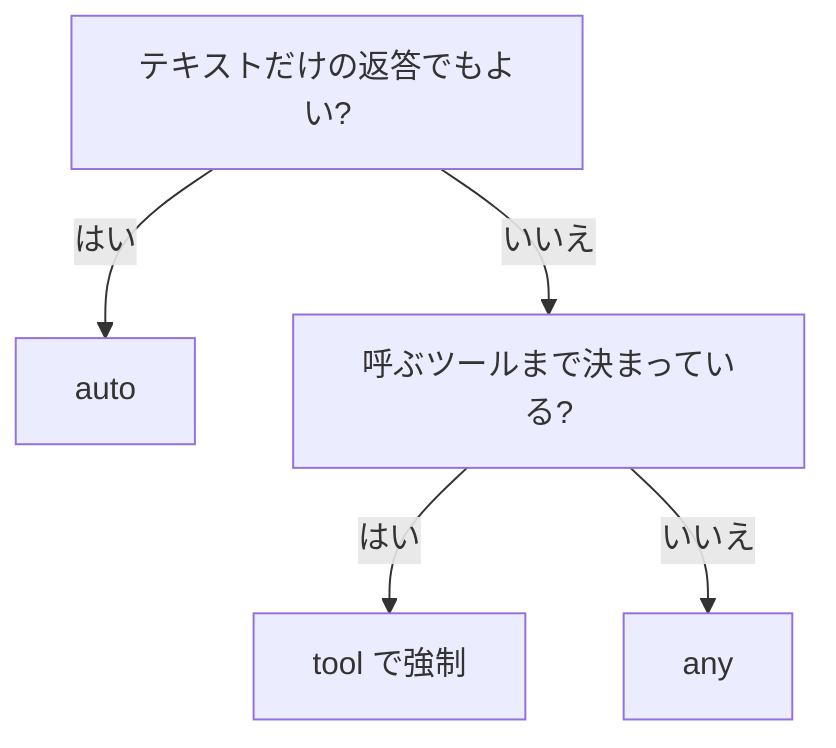
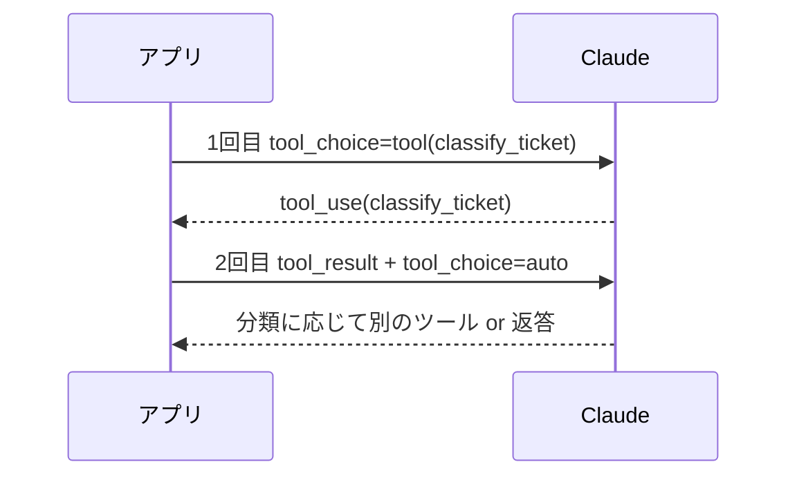

# tool_choice の設定（auto / any / 特定ツールの強制）

> ドメイン: 2. ツール設計と MCP の組み込み（18%） ／ 更新: 2026-11-20

## 3行まとめ
- `tool_choice`（ツールを呼ぶかどうかと、どれを呼ぶかを指定するリクエストのパラメータ）は auto / any / tool / none の4種類
- 必ずツールを呼ばせたいなら **any**（どれかは任せる）、決まったツールを先に呼ばせたいなら tool。会話の返答もありうるなら auto
- 試験での決め手は「テキストで返されると困るか」「どのツールかまで決まっているか」の2点

## 仕組み

| 値 | 書き方 | ツールを呼ぶか | どのツールか | 使う場面 |
|---|---|---|---|---|
| auto | `{"type": "auto"}` | Claude が決める（テキストだけの返答もある） | Claude が選ぶ | 普通の対話・エージェント。`tools` があるときの既定 |
| any | `{"type": "any"}` | 必ず呼ぶ | Claude が選ぶ | 抽出スキーマが複数あり、文書の種類が分からない |
| tool | `{"type": "tool", "name": "..."}` | 必ず呼ぶ | 指定した1つ | 最初に必ず特定の処理を通したい |
| none | `{"type": "none"}` | 呼ばない | — | ツールを使わせない。`tools` が無いときの既定 |

- tool_choice はリクエストごとの指定。強制は「そのリクエストの最初の応答」にしか効かない
- 段階を踏む処理は、1回目だけ tool で強制し、次の段階は続くターンで auto に戻して進める

- any / tool のときは、応答が tool_use から始まる。前置きの説明文は出ない（頼んでも出ない）
- `disable_parallel_tool_use: true`（1回の応答で呼ぶツールを1つまでにする）は tool_choice の中に書く。auto なら「最大1つ」、any / tool なら「ちょうど1つ」

## 試験で問われそうなポイント
- 構造化出力が必ずほしいのに、時々テキストで返ってくる → auto をやめて any（または tool）にする
- 抽出用のツールが種類別に複数あり、届く文書の種類が事前に分からない → any にして、どのスキーマで抽出するかは Claude に選ばせる
- 必ずツールを呼ばせ、入力もスキーマどおりにしたい → any とツール定義の `strict: true`（strict tool use）を組み合わせる
- 後続の処理の前提になる抽出・分類を必ず先に通したい → tool でそのツールを強制し、残りは続くターンで処理する
- ツールの説明に加えて、呼ぶ前に考えさせたい・前置きを書かせたい → auto のままプロンプトで「このツールを使って」と指示する
- ツールを増やしすぎて選び間違える、役割外のツールを使う → tool_choice ではなくツールの割り振りの問題（→ 別ノート: エージェントへのツールの割り振り）

## 間違えやすいところ
- auto は「呼ぶかどうか」も任せる。ツールを渡しただけでは呼ばれる保証は無い
- any は「どれかを必ず呼ぶ」で、特定のツールは選べない。特定のツールなら tool
- 強制は1リクエスト分だけ。複数ターンにわたる呼び出し順の保証（A を通るまで B を呼ばせない、など）は、プログラム側の前提チェックで行う。プロンプトの指示だけに頼るのは誤り
- 構文の正しさは強制の効果ではない。tool use と JSON スキーマ（＋strict tool use）なら構文は正しくなるが、値の意味の誤り（合計が合わない、別の欄に入る）は防げない（→ 別ノート: tool_use と JSON スキーマによる構造化出力）
- 手動の拡張思考（extended thinking、`thinking: {type: "enabled"}`）と any / tool は併用できずエラー。強制すると思考ブロック（thinking）も出ない
- ガイドとのずれ: 現行ドキュメントでは、新しい一部のモデル（Opus 5.5、Sonnet 5.5 など）は any / tool を 400 エラーで拒否し、auto と strict tool use（スキーマどおりの入力を保証する設定）か structured outputs を使うよう案内している。試験はガイドの書き方（any / tool で強制）を主に覚える
- tool_choice を変えると、プロンプトキャッシュのうちメッセージ部分は作り直しになる（ツール定義とシステムプロンプトのキャッシュは残る）

## 確認問題
1. 社内問い合わせを分類する `classify_ticket` と、分類ごとの対応ツールを持つエージェントがある。分類を飛ばしていきなり対応ツールを呼ぶことがある。1回目の応答で必ず分類させるには?
   

答え
1回目のリクエストを <code>tool_choice: {"type": "tool", "name": "classify_ticket"}</code> にし、結果を返す2回目以降は auto に戻す。any だと対応ツールを先に選ぶ余地が残る。ただし複数ターンにわたる順序の保証（分類を通るまで対応ツールを呼ばせない）はプログラム側の前提チェックで行う（tool_choice は1リクエスト分だけ）。

2. 届いた PDF が見積書・発注書・納品書のどれかは分からない。それぞれ専用の抽出ツールを用意したが、auto だと「この文書は発注書のようです」と文章で返ることがある。どうする?
   

答え
<code>tool_choice: {"type": "any"}</code> にする。必ずどれかの抽出ツールを呼び、種類の判断は Claude に任せられる。tool で1つに固定すると種類の判定ができない。

3. 強制したツールを呼ぶ前に、なぜそれを選ぶかを短く書かせたい。any のままプロンプトで頼んだが説明が出ない。なぜで、どうする?
   

答え
any / tool では応答が tool_use から始まり、前置きが出ない仕様。auto にして、ユーザーメッセージで「◯◯ツールを使って答えて」と指示する。

## 出典
- [Define tools — Forcing tool use](https://platform.claude.com/docs/en/agents-and-tools/tool-use/define-tools#forcing-tool-use)（公式）
- [Parallel tool use](https://platform.claude.com/docs/en/agents-and-tools/tool-use/parallel-tool-use)（公式）
- [Errors — Forced tool use not supported](https://platform.claude.com/docs/en/api/errors#forced-tool-use-not-supported)（公式）
- Claude Certified Architect – Foundations Exam Guide v1.1、タスクステートメント 2.3・4.3（公式）
- 未確認: Claude Code / Agent SDK の設定から tool_choice を直接指定できるかは、今回は確かめていない
