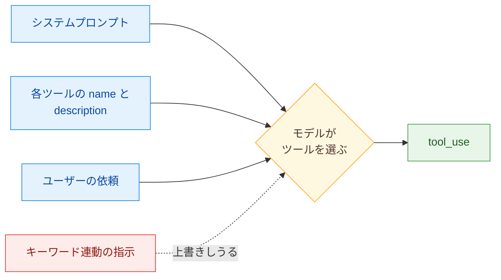

# ツールの説明文と境界の設計

> ドメイン: 2. ツール設計と MCP の組み込み（18%） ／ 更新: 2026-11-20

!!! abstract "ひとことで"
    モデルがどのツールを使うかは、主に==説明文（description）==で決まる。選択がおかしいときは、説明文と、==システムプロンプトのキーワード連動の指示==の両方を点検する。

## 仕組み

API に `tools` を渡すと、ツール定義・ツール設定（tool configuration）・システムプロンプトから、特別なシステムプロンプトが組み立てられる。モデルはそれとユーザーの依頼を見てツールを選ぶ。だから説明文は人向けのメモではなく、モデルが選ぶときの主な判断材料になる。1行だけの説明では、似たツールの取り違えが起きる。システムプロンプトにキーワードを含む指示があると、意図しないツールとの結び付きができ、良い説明文を上書きしうる。

説明文には、目的・受け付ける入力の形式・返す出力・例の問い合わせ・エッジケース・境界（いつ使い、いつ似た別のツールを使うか）を書く。機能の重なりは、改名と説明の書き直し、汎用ツールの分割で無くす。

| 症状 | 直し方 | 例（自作） |
|---|---|---|
| 説明が短く、似たツールを取り違える | 説明文に入力形式・出力・例・境界を足す | `search_docs` に「社内マニュアルだけ。障害チケットは `search_tickets`」 |
| 名前も説明もほぼ同じ2つのツール | 改名し、説明を専用の内容に書き直す（rename） | `fetch_info` → `fetch_shipping_status`（配送状況だけ） |
| 1つの汎用ツールが目的の違う仕事を抱える | 目的ごとに分割し、入力と出力の約束（contract）を決める（split） | `process_invoice` → `extract_line_items` / `check_totals` / `flag_duplicates` |
| システムプロンプトの「〜と言われたら X を使え」 | キーワードで決め打つ指示を消し、説明文に判断を任せる | 「"履歴" と出たら `get_order_history`」を削る |

選択の確かさは、現実の使い方に基づくタスクと検証できる答えの組で評価し、生のトランスクリプトを読んで確かめる（ブログ）。ツールの数と役割ごとの割り振り（2.3）と tool_choice（2.3・4.3）は別ノートで扱う。

??? info "ツール定義の項目と、公式との細かい違い"
    - `name`: `^[a-zA-Z0-9_-]{1,128}$`。用途が分かる名前にする
    - `description`: 何をするか、いつ使うか（使わないか）、各パラメーターの意味、制限（何を返さないか）。公式は少なくとも3〜4文を勧める
    - `input_schema`: 入力の JSON Schema。パラメーター名は `user` より `user_id` のように曖昧さをなくす（Anthropic のエンジニアリングブログ）
    - `input_examples`（任意）: 入力の例。説明文を優先し、複雑なツールで足す
    - MCP のツール定義も `name`（一意の識別子）・`description`・`inputSchema` を持ち、任意で `outputSchema`（出力の形の JSON Schema。出すときはサーバーが従う）を付けられる
    - 公式の best practices の「関連する操作を少数のツールにまとめる」（例: `create_pr` / `review_pr` / `merge_pr` を `action` パラメーター付きの1つに）は、何でも受ける汎用ツールとは別物だ。操作は `action` で明示する。目的は、小さなツールの乱立による選択の曖昧さを減らすこと。分割（ガイド 2.1）とまとめる（公式）は、どちらも選択と入出力の曖昧さを無くすための手段
    - 名前の接頭辞での区別（namespacing、例: `github_list_prs`）も公式は勧めるが、ガイドの 2.1 には出てこない
    - 「キーワード連動の指示がツール選択を歪める」をそのまま述べた公式ドキュメントは未確認（根拠はガイド）
    - 近い公式の記述: 「CRITICAL: You MUST use this tool…」や「If in doubt, use [tool]」のような強い指示は、呼びすぎ（overtriggering）を招く。こちらは取り違えではなく呼びすぎの話

## 試験での見分け方

| 問われること | ○ 正しい | × ひっかけ |
|---|---|---|
| 似たツールを取り違える | 説明文を、目的・入力・出力・使い分けが分かる形に直す | 説明文は人向けのメモとみなし、ほかを先に疑う |
| 機能が重なる2つのツール | 改名と説明の書き直しで、それぞれを専用の役割にする | ほぼ同じ説明のまま2つ並べておく |
| 汎用ツールが曖昧な結果を返す | 目的別に分割し、それぞれの入力と出力を決める | 何でも受け、中で何をするかを勝手に決めるツールのままにする |
| 説明文は良いのに選択が偏る | システムプロンプトのキーワード連動の指示を点検し、消す | 説明文をさらに書き足すだけで済ませる |

## 確認問題

**Q1.** 通信会社のサポートエージェントに、請求書を表示する `get_invoice` と、料金プランを変える `change_plan` を渡している。両方の説明文は、目的・入力・出力・使い分けまで書き直した。それでも「プラン」という語を含む問い合わせは、請求書の確認であっても `change_plan` に送られる。最も適切な次の対応はどれか。（1つ選べ）
{ .quiz-q }

- A. `change_plan` の説明文に、使わない場面の例をさらに書き足す
- B. システムプロンプトに、キーワードでツールを決め打つ指示が無いかを点検し、あれば消す
- C. `change_plan` を `modify_subscription_plan` に改名し、「プラン」の語と結び付きにくくする
- D. システムプロンプトに「CRITICAL: 請求書の確認には必ず `get_invoice` を使え」と書き足す

??? success "答えと解説"
    **正解: B。** 説明文が良いのに選択が偏るときは、システムプロンプトのキーワード連動の指示が説明文を上書きしていないかを疑う。

    - A: 説明文はすでに整っている。書き足すだけでは、上書きしている指示が残る
    - C: 改名は機能の重なりを直す手段。説明文を上書きしている指示があれば、名前を変えても偏りは残る
    - D: 原因になりうる指示を残したまま、強い指示をもう1つ足すだけ。強い指示は呼びすぎも招く

**Q2.** 法務部門向けに、契約書から情報を抜き出すシステムを作っている。1つの `process_contract` ツールが、条項の抜き出し・要約・社内規程との照合をすべて受け、どの処理をするかはツールが依頼文から判断する。結果の形が依頼ごとに違い、後続の処理が読めないことがある。最も適切な直し方はどれか。（1つ選べ）
{ .quiz-q }

- A. 説明文に「結果は JSON で返す」と書き足し、1つのツールのまま使い続ける
- B. `process_contract` の中で依頼文から処理を判定する部分を改善し、判定の精度を上げる
- C. 抜き出し・要約・照合を別々のツールに分け、それぞれの入力と出力の形を決める
- D. システムプロンプトに「"照合" と出たら照合の処理を選べ」と書き、判断を補う

??? success "答えと解説"
    **正解: C。** 目的の違う仕事を抱えた汎用ツールは、目的ごとに分割し、入力と出力の約束を決める。

    - A: 中で何をするかを勝手に決めるツールのままなので、結果の曖昧さは残る
    - B: 何をするかをツールが決める作りのままなので、結果の形は依頼ごとに揺れる
    - D: キーワード連動の指示は、意図しない結び付きを作り、選択を歪める

**Q3.** CI で PR を確かめるエージェントに、`fetch_info`（説明「情報を取得する」）と `get_details`（説明「詳細を取得する」）を渡している。どちらも PR の差分とビルドログの両方を返せる。差分が欲しい場面で、ビルドログが返ってくることが多い。最も適切な直し方はどれか。（1つ選べ）
{ .quiz-q }

- A. システムプロンプトに「"差分" と出たら `fetch_info` を使え」と書き足す
- B. 名前はそのままにし、2つの説明文に、返せるもの（差分とビルドログ）を詳しく書き足す
- C. 名前と説明はそのままにし、`input_examples` に入力の例をいくつか足して補う
- D. `get_pr_diff`（差分だけ）と `get_build_log`（ログだけ）に改名し、説明文も専用の内容に書き直す

??? success "答えと解説"
    **正解: D。** 名前も説明もほぼ同じで機能が重なる2つのツールは、改名し、それぞれを専用の役割にして説明を書き直す。

    - A: キーワード連動の指示は説明文の代わりにならず、意図しない結び付きを作って選択を歪める
    - B: 詳しくしても、2つが同じものを返す重なりは残る。どちらを選ぶかの手がかりにならない
    - C: `input_examples` は任意の補助で、説明文が優先だ。機能の重なりは直らない

## 出典
- [Claude Certified Architect – Foundations Exam Guide v1.1（Task Statement 2.1、How to Prepare）](https://cc.sj-cdn.net/instructor/6nizmqk8tpzpfjvt6qmmav7rh/public/1794946250/Claude_Certified_Architect_-_Foundations_Exam_Guide.pdf)（公式）
- [Define tools](https://platform.claude.com/docs/en/agents-and-tools/tool-use/define-tools)（公式。ツール定義の項目、best practices、ツールとシステムプロンプトの組み立て）
- [Prompting best practices](https://platform.claude.com/docs/en/build-with-claude/prompt-engineering/claude-prompting-best-practices)（公式。強い指示による overtriggering）
- [Writing effective tools for agents — with agents](https://www.anthropic.com/engineering/writing-tools-for-agents)（公式ブログ。重なりと namespacing、`user_id` の例、評価とトランスクリプト）
- [MCP Specification 2025-06-18: Tools](https://modelcontextprotocol.io/specification/2025-06-18/server/tools)（公式。name・description・inputSchema・outputSchema）
