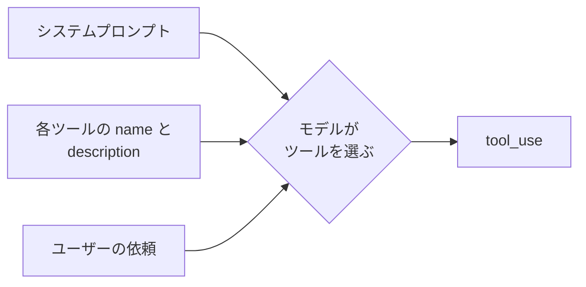

# ツールの説明文と境界の設計

> ドメイン: 2. ツール設計と MCP の組み込み（18%） ／ 更新: 2026-11-20

## 3行まとめ
- モデルがどのツールを使うかは、主にツールの説明文（description）で決まる。1行だけの説明では、似たツールの取り違えが起きる
- 説明文には、目的・入力の形式・例・境界（いつ使い、いつ似た別のツールを使うか）を書く。説明を直しても重なりが残るなら、改名や分割で役割を分ける
- 選択がおかしいときは、まず説明文を直す。システムプロンプトのキーワードを含む指示が、良い説明文を上書きしていないかも点検する

## 仕組み

API に `tools` を渡すと、ツール定義とシステムプロンプトから、特別なシステムプロンプトが組み立てられる。

| ツール定義の項目 | 中身 |
|---|---|
| `name` | `^[a-zA-Z0-9_-]{1,128}$`。用途が分かる名前にする |
| `description` | 何をするか、いつ使うか（使わないか）、各パラメーターの意味、制限（何を返さないか）。公式は少なくとも3〜4文を勧める |
| `input_schema` | 入力の JSON Schema。パラメーター名は `user` より `user_id` のように曖昧さをなくす |
| `input_examples`（任意） | 入力の例。説明文を優先し、複雑なツールで足す |

### 重なりの直し方
| 症状 | 直し方 | 例（自作） |
|---|---|---|
| 説明が短く、似たツールを取り違える | 説明文に入力形式・例・境界を足す | `search_docs` に「社内マニュアルだけ。障害チケットは `search_tickets`」 |
| 名前も説明もほぼ同じ2つのツール | 改名して説明を専用にする（rename） | `fetch_info` → `fetch_shipping_status`（配送状況だけ） |
| 1つの汎用ツールが目的の違う仕事を抱える | 目的ごとのツールに分割し、入力と出力の約束（contract）を決める（split） | `process_invoice` → `extract_line_items` / `check_totals` / `flag_duplicates` |
| システムプロンプトの「〜と言われたら X を使え」 | キーワードで決め打つ指示を消し、説明文に判断を任せる | 「"履歴" と出たら `get_order_history`」を削る |

## 試験で問われそうなポイント
- 似た2つのツールの取り違え → 最初の一手は説明文の拡充。few-shot・ルーティング層・統合より手間が小さく、原因に直接効く
- 説明文に書くこと → 目的、受け付ける入力の形式、例の問い合わせ、エッジケース、似たツールとの境界
- 説明文を直しても重なる → 改名して名前と説明を専用にする
- 汎用ツールが曖昧な結果を返す → 目的別に分割し、それぞれの入力と出力を決める
- 説明文は良いのに選択が偏る → システムプロンプトにキーワード連動の指示が無いかを点検する
- 選択の確かさを確かめる → 曖昧な依頼を混ぜた評価を回し、ログ（トランスクリプト）を読む
- ツールの数と役割ごとの割り振り（2.3）、tool_choice（2.3・4.3）は別ノートが主

## 間違えやすいところ
- 説明文は人向けのメモではない。モデルが選ぶときの主な判断材料
- アンチパターン: システムプロンプトのキーワードを含む指示が、意図しないツールとの結び付きを作り、良い説明文を上書きする
- アンチパターン: ほぼ同じ説明の2つのツールを並べる（取り違えの原因）
- アンチパターン: 何でも受ける汎用ツール1つにまとめ、入力と出力の約束が無い
- 公式の best practices には「関連する操作は少数のツールにまとめる（`action` パラメーター）」もある。分割と矛盾しない。まとめるのは同じ対象への関連操作、分けるのは目的と出力が違う仕事
- 名前の接頭辞での区別（namespacing、例: `github_list_prs`）も公式は勧めるが、ガイドの 2.1 には出てこない
- 「キーワード連動の指示がツール選択を歪める」をそのまま述べた公式ドキュメントは未確認（ガイドの記述が根拠。公式には「プロンプトは auto での選択に影響する」とある）

## 確認問題
1. 社内ヘルプデスクのエージェントに `search_docs`（説明「文書を検索する」）と `search_tickets`（説明「検索する」）がある。障害の問い合わせでもマニュアルを検索してしまう。最初にやることは？
   

答え
両方の説明文を拡充する。対象のデータ、入力の形式、例の問い合わせ、「障害の事例は search_tickets」のような境界を書く。説明が主な選択の手がかりなので、原因に直接効き、手間も小さい。

2. 説明文を整えたのに、「請求」という語を含む問い合わせが必ず `refund_payment` に送られる。どこを点検する？
   

答え
システムプロンプト。「請求と言われたら refund_payment」のようなキーワード連動の指示があると、説明文より優先されて選択が歪む。その指示を消すか、判断を説明文に任せる形に書き直す。

3. `handle_contract` という1つのツールが、条項の抜き出し・要約・規程との照合をすべて受け、結果の形がばらばらになる。どう直す？
   

答え
目的ごとのツール（例: extract_clauses、summarize_contract、check_against_policy）に分割し、それぞれの入力と出力の形を決め、説明文で使い分けを書く。

## 出典
- [Claude Certified Architect – Foundations Exam Guide v1.1（Task Statement 2.1、How to Prepare）](https://cc.sj-cdn.net/instructor/6nizmqk8tpzpfjvt6qmmav7rh/public/1794946250/Claude_Certified_Architect_-_Foundations_Exam_Guide.pdf)（公式）
- [Define tools](https://platform.claude.com/docs/en/agents-and-tools/tool-use/define-tools)（公式。ツール定義の項目、best practices、ツールとシステムプロンプトの組み立て）
- [Writing effective tools for agents — with agents](https://www.anthropic.com/engineering/writing-tools-for-agents)（公式ブログ。重なりと namespacing、新人に説明するように書く、評価とトランスクリプト）
- MCP 仕様のツール定義（modelcontextprotocol.io）は、この環境から読めず未確認
