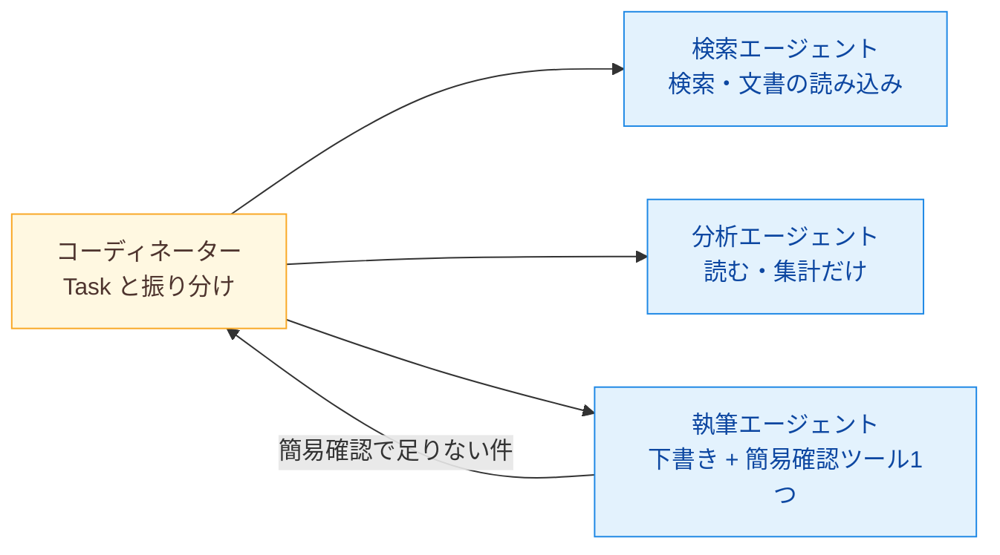

# エージェントへのツールの割り振り

> ドメイン: 2. ツール設計と MCP の組み込み（18%） ／ 更新: 2026-11-20

!!! abstract "ひとことで"
    1つのエージェントに渡すツールは、==役割に要るものだけ==に絞る。役割外でも頻繁に要る単純な処理だけは、==範囲を絞ったツールを1つ==渡し、複雑なケースはコーディネーター経由に残す。

## 仕組み

ツールが増えると、どれを使うかの判断が複雑になり（decision complexity）、選択の精度が落ちる。ガイドの例では、18個より4〜5個の方がよい。専門外のツールを持つエージェントは、それを使ってしまいがちだ（ガイドの例: 統合役が自分で Web 検索を始める）。だから役割外のツールは渡さず、汎用ツールは入力を検証する制約付きのツールに置き換える。



| 渡し方 | 何をするか | 選ぶ場面 |
|---|---|---|
| 役割ごとに限定（scoped tool access） | 役割に要るツールだけを渡す | 既定。サブエージェントは原則これ |
| 制約付きの代替ツール | 汎用ツールを、入力を検証する専用ツールに置き換える | 汎用ツールで想定外の使い方が起きる・起きうる |
| 範囲を絞った役割外のツール（scoped cross-role tool） | 頻繁に要る単純な処理だけを専用ツールで渡す | 単純な依頼の往復がコーディネーター経由で多い |
| コーディネーター経由 | 専門のエージェントに回す | 複雑・まれなケース |

Agent SDK では `AgentDefinition` の `tools` で絞る。省略すると、サブエージェントは使えるツールをすべて継承するので、読むだけの役割でも書き込みや実行ができてしまう。

```python
"report-writer": AgentDefinition(
    description="集めた結果から報告書を書く",
    prompt="あなたは報告書の執筆担当です。…",
    tools=["Read", "lookup_glossary_term"])  # 検索ツールは渡さない。用語確認だけ専用ツールで
```

tool_choice（auto / any / 特定ツールの強制）で「呼ばせ方」を決める話は、別ノート「tool_choice の設定」で扱う。

??? info "数の目安のずれと、公式との違い"
    - 数の目安: ガイドは「18個より4〜5個」。公式の tool search のページは「30〜50個を超えると選択精度が落ちる」。試験ではガイドの考え方（少なく絞る）で答える
    - 同じページは、10個以上なら tool search（必要なツールを検索して読み込む仕組み）を検討、とも書く。1回の依頼で読み込むのはふつう3〜5個
    - 「ツールを減らす」には、似た操作を1つのツールにまとめる（action 引数）という手もある（公式の define-tools）。役割で絞る話とは別
    - 現行 Claude Code では Task ツールは Agent に改名された（Task は別名として有効）。ガイドは Task と書く
    - 役割外のツールを1つだけ渡す設計（high-frequency の例外）を公式ドキュメントが直接説明しているかは未確認。ガイドの記述に基づく

## 試験での見分け方

<div class="vs" markdown>

| 問われること | ○ 正しい | × ひっかけ |
|---|---|---|
| 十数個のツールを持つエージェントが取り違える | 役割ごとにエージェントを分け、1つあたりのツールを絞る | 全サブエージェントに全ツールを渡す |
| サブエージェントが専門外の操作をする | `tools` からそのツールを外す | プロンプトで禁止するだけにする |
| 汎用の URL 取得で想定外のサイトを読む | 取得先を検証する専用ツールに置き換える（ガイドの例: fetch_url → load_document） | 汎用ツールをそのまま渡しておく |
| 役割外の能力がときどき要る | 最小権限（least privilege）で、用途を1つに絞ったツールまでにとどめる | 別の役割のツール一式を持たせる |
| `tools` を書かずに定義した | 全ツールを継承すると気づき、必要なものを列挙する | 何も渡していないつもりでいる |

</div>

## 確認問題

**Q1.** 家電メーカーのサポートで、注文・配送・保証・修理受付・在庫・会員情報など 22 個のツールを1つのエージェントに渡したところ、誤ったツールを呼ぶことが増えた。最も適切な直し方はどれか。（1つ選べ）
{ .quiz-q }

<div class="quiz" data-answer="B" markdown>

- A. 領域ごとのサブエージェントに分けるが、どのサブエージェントにも 22 個すべてを渡す
- B. 領域ごとのサブエージェントに分け、それぞれに関連する4〜5個だけを渡して振り分ける
- C. 1つのエージェントのまま、取り違えやすい領域ごとに専用版のツールをさらに足す
- D. 1つのエージェントのまま、システムプロンプトに 22 個の使い分けの一覧を書き足す

</div>

??? success "答えと解説"
    **正解: B。** ツールが多いと選択の判断が複雑になり、精度が落ちる。役割ごとに分け、1つあたりのツールを絞る。

    - A: 分けても全ツールを渡せば、1つあたりの判断の複雑さは変わらない
    - C: ツールをさらに増やすので、選択の精度はもっと落ちる
    - D: 一覧を足しても、22 個から選ぶ判断の複雑さはそのまま残る

**Q2.** 家電通販のサポートを、Agent SDK のマルチエージェントで作っている。返品受付のサブエージェントは `AgentDefinition` の `tools` を書かずに定義しており、受付の途中で Bash を使ってスクリプトを実行していた。また、返品できるかの判断で配送状況を頻繁に確かめる必要があり、そのたびにコーディネーター経由で配送担当のサブエージェントに回している。このサブエージェントへのツールの渡し方として適切なものはどれか。（2つ選べ）
{ .quiz-q }

<div class="quiz" data-answer="B,D" markdown>

- A. `tools` は省略したまま、プロンプトに「スクリプトを実行しないこと」と書き足す
- B. `tools` に、返品受付に要るツール（返品の登録など）だけを列挙する
- C. `tools` に要るツールと Bash を列挙し、Bash は必要なときだけ使うようプロンプトで指示する
- D. 配送状況の確認は、状況を読むだけの専用ツールを1つ渡して済ませる
- E. 配送担当と同じツール一式（住所変更・再配送の手配を含む）を渡し、自分で確かめさせる

</div>

??? success "答えと解説"
    **正解: B と D。** 役割に要るツールだけを渡し、頻繁に要る単純な役割外の処理だけは、範囲を絞ったツールを1つ渡す。

    - A: `tools` を省略すると、使えるツールをすべて継承する（だから Bash を使えた）。プロンプトで禁じるだけでは確実でない
    - C: 要らない Bash が残る。プロンプトで使い方を縛るだけでは、最小権限に反する
    - E: 別の役割のツール一式を持たせると、住所変更のような専門外の操作を始めやすい。最小権限に反する

**Q3.** 契約書から当事者・期間・金額を抜き出すエージェントに、汎用の HTTP リクエストツールを渡し、社内の契約書管理システムを読ませている。ときどき社外のサイトにもアクセスしていた。最も適切な直し方はどれか。（1つ選べ）
{ .quiz-q }

<div class="quiz" data-answer="D" markdown>

- A. 汎用の HTTP ツールはそのままにし、プロンプトで社外へのアクセスを禁じる
- B. 汎用の HTTP ツールの説明文に「社内の契約書管理システム専用」と書き足す
- C. 汎用の HTTP ツールは残し、契約書 ID で読む専用ツールも足して、どちらを使うかは任せる
- D. 契約書 ID を受け取り、管理システムの決まった場所だけを読む専用ツールに替える

</div>

??? success "答えと解説"
    **正解: D。** 汎用ツールで想定外の使い方が起きたら、入力をツール側で検証する制約付きの専用ツールに置き換える。

    - A: プロンプトで禁じるだけでは確実でない。取得先を選べるツールが残る
    - B: 説明文はツールを選ぶときの手がかりで、取得先は制限しない
    - C: 取得先を選べるツールが残る。汎用ツールは置き換えるのであって、専用ツールを足すのではない

## 出典
- [Claude Certified Architect – Foundations Exam Guide v1.1（Task Statement 2.3）](https://cc.sj-cdn.net/instructor/6nizmqk8tpzpfjvt6qmmav7rh/public/1794946250/Claude_Certified_Architect_-_Foundations_Exam_Guide.pdf)（公式）
- [Subagents in the SDK（Tool restrictions、Common tool combinations）](https://code.claude.com/docs/en/agent-sdk/subagents)（公式。`tools` の省略で全部継承）
- [Create custom subagents](https://code.claude.com/docs/en/sub-agents)（公式。Limit tool access、`tools` と `disallowedTools`）
- [Tool search tool](https://platform.claude.com/docs/en/agents-and-tools/tool-use/tool-search-tool)（公式。30〜50個を超えると選択精度が落ちる）
- [Define tools](https://platform.claude.com/docs/en/agents-and-tools/tool-use/define-tools)（公式。関連する操作を少ないツールにまとめる）
- [Writing effective tools for agents](https://www.anthropic.com/engineering/writing-tools-for-agents)（公式ブログ。ツールは多いほど良いわけではない、重なるツールは迷わせる）
