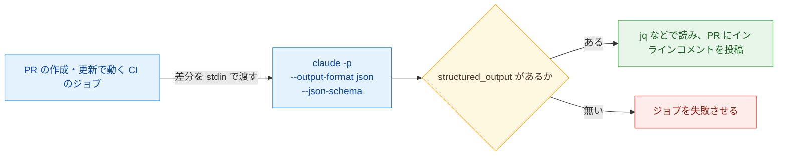

# CI での Claude Code の非対話実行と構造化出力

> ドメイン: 3. Claude Code の設定とワークフロー（20%） ／ 更新: 2026-11-20

!!! abstract "ひとことで"
    CI では ==`claude -p`== で動かす。結果をプログラムが読むなら `--output-format json` に `--json-schema` を組み合わせ、使えるツールは `--allowedTools` / `--permission-mode` で絞る。

## 仕組み

`claude -p`（`--print`、非対話モード（non-interactive mode））は、対話画面を開かずに応答を出力して終わる。付け忘れると対話モードで起動し、入力待ちのままジョブがタイムアウトまで止まる。後段のスクリプトが読む出力は、`--json-schema` で形を固定して `structured_output` から読む。自由な文章は形が揺れるので、切り出す処理が壊れる。



| フラグ | 役割 | CI での使いどころ |
|---|---|---|
| `-p` / `--print` | 非対話で実行して終わる | CI では必ず付ける |
| `--output-format` | `text`（既定、回答の文章だけ）/ `json` / `stream-json` を選ぶ | 人がログで読むなら `text`、後段のスクリプトが読むなら `json` |
| `--json-schema` | 出力を JSON Schema に合わせて検証する（print mode 専用） | 指摘を file・line・severity などの決まった形で受け取る |
| `--allowedTools` | 確認なしで使えるツールを決める（例: `"Bash(npm test *)"`） | 必要なツールだけ許す |
| `--permission-mode` | セッション全体の権限の基準（`dontAsk`、`acceptEdits` など） | `dontAsk` は確認が要る呼び出しをすべて拒否する。締めた CI 向け |
| `--max-turns` / `--max-budget-usd` | ターン数・推定費用の上限（どちらも print mode 専用） | 暴走と費用の歯止め |
| `--append-system-prompt(-file)` | 既定のシステムプロンプトに指示を足す | レビューの観点を足す |
| `--bare` | hooks・スキル・MCP・CLAUDE.md などの自動読み込みを省いて速く起動する | スクリプト向けに推奨。ただし CLAUDE.md も読まない |

`--output-format json` だけでは、スキーマは強制されない。文章は `result` の文字列のままで、決まった形が入るのは `--json-schema` を付けたときの `structured_output` だ。その `structured_output` も、Claude が依頼を断ったときなどは無いことがあるので、使う前に有無を確かめる。

```bash
gh pr diff "$PR" | claude -p "この差分の問題点を挙げて" \
  --output-format json --json-schema "$(cat findings.schema.json)" \
  --allowedTools "Read,Grep" --max-turns 10 > out.json
jq -e '.structured_output.findings' out.json   # 無ければ失敗させる
```

??? info "出力・権限・終了コードの細かい決まり"
    - `json` の中身: `result`（文章）、`session_id`、`total_cost_usd` など。`--json-schema` を付けると `structured_output` も入る
    - `stream-json`: 1行1イベントの JSON を順に出す（`--verbose` と一緒に使う）。進み具合を逐次表示するとき向け
    - 不正なスキーマは、実行前に `Error: --json-schema is not a valid JSON Schema` で終わる（v2.1.329 で確かめた）。`format`（例: `email`）は注釈扱いで、検証されない
    - 終了コード: 成功は 0、失敗は 0 以外。ただし実行中の失敗（認証が無いなど）は stdout の結果として出る
    - `-p` で許可していないツールは、入力待ちで止まらずに拒否される。v2.1.302 以降、`--permission-mode` や `permissions.defaultMode` で何も設定していなければ、`-p` は Manual mode で始まる
    - `-p` は信頼の確認ダイアログを出さない。プロジェクトの `.claude/settings.json` の hooks や `.mcp.json` のサーバーも動く
    - ガイドに出てくるのは `-p`、`--output-format json`、`--json-schema` まで。`--bare` や `--permission-prompts none` は、現行ドキュメントにある追加の仕組み
    - 規約・テストの基準・レビューの観点を CI に伝えるのは CLAUDE.md。その使い方、再レビューでの重複コメントの避け方、既存テストの渡し方、生成とは別のインスタンスでのレビューは [ci-review-test-quality](ci-review-test-quality.md) で扱う

??? info "GitHub Actions で使うとき"
    - `anthropics/claude-code-action@v1` に `prompt` を渡すと自動実行（automation mode）になる。CLI のフラグは `claude_args` で渡し、キーは `anthropic_api_key: ${{ secrets.ANTHROPIC_API_KEY }}` のように secrets を参照する
    - `claude_args` に `--json-schema` を渡すと、全フィールドが1つの JSON 文字列として、アクションの出力 `structured_output` に入る。後続のステップは `fromJSON(steps.<id>.outputs.structured_output).<欄>` で読むか、`env:` で渡して jq で取り出す
    - `${{ }}` をスクリプトに直接埋め込まない。引用符などでスクリプトが壊れたり、コマンドとして実行されたりするので、`env:` 経由で渡す

## 試験での見分け方

<div class="vs" markdown>

| 問われること | ○ 正しい | × ひっかけ |
|---|---|---|
| CI で止まらずに動かす | `claude -p` で実行する | `-p` を付けずに `claude "..."` を実行する（入力待ちで止まる） |
| レビュー結果を PR のインラインコメントに自動投稿する | `json` + `--json-schema` で形を決め、`structured_output` を読む | 自由な文章を正規表現で切り出す。プロンプトで「JSON で答えて」と頼むだけにする |
| CI で使うツールを絞る | `--allowedTools` で必要なものだけ許す。全部拒否を基準にするなら `--permission-mode dontAsk` | `bypassPermissions` で全部許す（CI では広すぎる） |
| ジョブは成功なのに何もしていない | 許可していないツールが拒否されたことを疑う | 入力待ちで止まったと考える |
| `--bare` で CLAUDE.md の規約が効かない | `--bare` を外すか、`--append-system-prompt-file` で渡す | プロンプトの文言を強める |

</div>

## 確認問題

**Q1.** 開発基盤チームが、毎晩の CI ジョブで `claude -p` に古くなった依存パッケージを調べさせ、後段のスクリプトがパッケージごとに issue を作っている。出力の書き方が毎回少しずつ違い、スクリプトがよく失敗する。最も適切な直し方はどれか。（1つ選べ）
{ .quiz-q }

<div class="quiz" data-answer="A" markdown>

- A. `packages` を必須にした `--json-schema` を `json` 出力に添え、`structured_output` の有無を確かめてから読む
- B. `--output-format json` だけを付け、`result` に入った文字列を JSON として解析する
- C. プロンプトに「パッケージの一覧を JSON だけで答えて」と書き足し、出力を jq で読む
- D. 出力の文章からパッケージ名と版を正規表現で切り出し、揺れに合わせてパターンを増やす

</div>

??? success "答えと解説"
    **正解: A。** 形が決まるのは `--json-schema` を付けたときの `structured_output` だ。断ったときなどは無いことがあるので、有無を確かめてから使う。

    - B: `--output-format json` だけではスキーマは強制されない。`result` は文章の文字列のままだ
    - C: プロンプトで頼むだけでは、形は保証されない
    - D: 自由な文章は形が揺れるので、切り出す処理が壊れる

**Q2.** CI で `claude -p 'テストを実行して、失敗したら直して'` を動かすと、ジョブは成功で終わるのに何も直っていない。ログには、テストのコマンドが拒否された記録がある。直し方として最も適切なものはどれか。（1つ選べ）
{ .quiz-q }

<div class="quiz" data-answer="C" markdown>

- A. 入力待ちで止まっているとみて、ジョブのタイムアウトを延ばす
- B. `--permission-mode bypassPermissions` を付け、すべてのツールを確認なしで使えるようにする
- C. `--allowedTools "Bash(npm test *),Read,Edit"` のように、要るツールだけを許す
- D. `--permission-mode dontAsk` を付け、確認を求めずに先へ進めるようにする

</div>

??? success "答えと解説"
    **正解: C。** `-p` では、許可していないツールは入力待ちで止まらずに拒否される。要るツールだけを `--allowedTools` で許す。

    - A: ジョブは成功で終わっており、止まってはいない。許可していないツールが拒否されたことを疑う
    - B: すべて許すのは、CI では広すぎる
    - D: `dontAsk` は確認が要る呼び出しをすべて拒否する。テストのコマンドは拒否されたままだ

**Q3.** あるチームが CI のレビュージョブの起動を速くするため、`claude -p` に `--bare` を足した。すると、CLAUDE.md に書いたレビューの観点が無視されるようになった。最も適切な対応はどれか。（1つ選べ）
{ .quiz-q }

<div class="quiz" data-answer="D" markdown>

- A. プロンプトの冒頭で「CLAUDE.md の観点に必ず従うこと」と強調する
- B. `--output-format json` に切り替え、観点ごとの結果を受け取れるようにする
- C. CLAUDE.md の観点を短く書き直し、読み込まれやすくする
- D. `--bare` を外すか、観点を書いたファイルを `--append-system-prompt-file` で渡す

</div>

??? success "答えと解説"
    **正解: D。** `--bare` は CLAUDE.md の自動読み込みも省く。読ませたいなら `--bare` を外すか、別の経路で渡す。

    - A: CLAUDE.md は読み込まれていないので、文言を強めても観点は伝わらない
    - B: 出力の形式を変えても、何が読み込まれるかは変わらない
    - C: `--bare` では CLAUDE.md をまったく読まないので、短くしても効かない

## 出典
- [Run Claude Code programmatically（Basic usage、Start faster with bare mode、Get structured output、Auto-approve tools）](https://code.claude.com/docs/en/headless)（公式）
- [CLI reference（CLI flags）](https://code.claude.com/docs/en/cli-reference)（公式）
- [Claude Code GitHub Actions（Interactive and automation modes、Pass CLI arguments）](https://code.claude.com/docs/en/github-actions)（公式）
- [claude-code-action docs/usage.md（Structured Outputs）](https://github.com/anthropics/claude-code-action/blob/main/docs/usage.md)（公式）
- [Claude Certified Architect – Foundations Exam Guide v1.1（Task Statement 3.6）](https://cc.sj-cdn.net/instructor/6nizmqk8tpzpfjvt6qmmav7rh/public/1794946250/Claude_Certified_Architect_-_Foundations_Exam_Guide.pdf)（公式）
