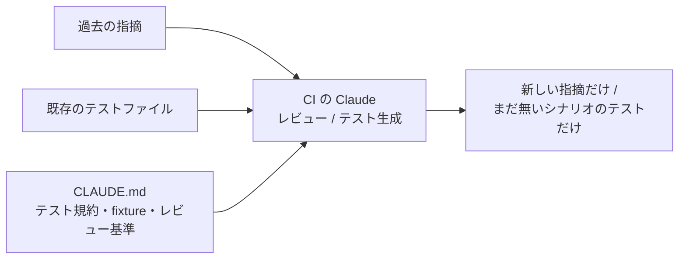

# CI での自動レビューとテスト生成の質を上げる工夫

> ドメイン: 3. Claude Code の設定とワークフロー（20%） ／ 更新: 2026-11-20

## 3行まとめ
- CI の Claude の出力の質は「何を文脈に渡すか」で決まる。過去の指摘・既存テスト・CLAUDE.md・書いた本人ではないレビュアーの4つ
- 再レビューには過去の指摘を渡して「新しい問題か、まだ直っていない問題だけ」を報告させる。テスト生成には既存テストを渡す
- 決め手: 重複コメント → 過去の指摘、重複テスト → 既存テスト、低価値なテスト → CLAUDE.md の基準、自己レビューの甘さ → 別のインスタンス

## 仕組み

| 困りごと | 渡すもの・やること | 効き目 |
|---|---|---|
| 新しいコミットのたびに同じ指摘が並ぶ | 前回の指摘を文脈に入れ、新規か未対応のものだけ報告させる | 重複コメントが減る |
| 既にあるケースのテストを提案する | 既存のテストファイルを文脈に入れる | 重複シナリオが減る |
| どうでもいいテストが量産される | CLAUDE.md にテスト規約・価値あるテストの基準・使える fixture（テスト用の固定データや準備処理）を書く | 低価値な出力が減る |
| 自分の変更に甘いレビューになる | 生成とは別のインスタンス（セッション）でレビューする | 生成時の推論に引きずられない |

### CLAUDE.md の役割
- CI で起動した Claude にもプロジェクトの文脈を渡す仕組み。GitHub Actions のドキュメントは、レビュー基準やプロジェクトのルールを CLAUDE.md に書くよう勧める
- 書くのはコードを読んでも分からないこと（例: テストの実行コマンド、チームで決めた規約）。毎回読まれるので短く保つ
- Code Review（GitHub の PR を自動でレビューするマネージドサービス）も CLAUDE.md を読み、規約違反を指摘にする

### 独立したレビュー
- 生成したセッションは自分の推論の文脈を持ったまま読むので、自分の誤りに気づきにくい。CI では生成ジョブとレビュージョブを分ける
- 独立したインスタンスと複数パスのレビューそのものは → 別ノート（4.6）
- `-p` や `--output-format json`、`--json-schema` での非対話実行と、指摘を PR のインラインコメントにする構造化出力は → 別ノート（CI での非対話実行）

## 試験で問われそうなポイント
- 再レビューで同じコメントが重複する → 過去の指摘を渡し、新規・未対応だけを報告させる（プロンプトを強めるのではない）
- 生成テストが既存と重なる → 既存のテストファイルを文脈に入れる
- テストの質が低い・規約に合わない → CLAUDE.md にテスト基準と fixture を書く（毎回プロンプトに書き足すのではない）
- 生成と同じセッションでレビューさせている → 別のインスタンスでレビューする

## 間違えやすいところ
- アンチパターン: コードを書いたセッションに、そのままそのコードをレビューさせる
- アンチパターン: 既存テストを渡さずにテストを生成させ、カバー済みのシナリオを重複させる
- アンチパターン: 再レビューで前回の指摘を渡さず、毎回ゼロから指摘させて重複コメントを出す
- 「レビュアーに問題を探せ」と頼むと何かしら見つける。全部直すと不要な抽象化や起こり得ないケースのテストが増える（公式の best practices）。基準で絞る
- 現行の Code Review サービスでは、push の後などに自動で走る後続レビューは前回からの変更に絞る（`@claude review` で頼むと PR 全体を見直す）。直ったと判断した自分の古いスレッドは解決する。試験では「過去の指摘を文脈に渡す」という自作パイプラインの設計として問われる
- Code Review サービスは CLAUDE.md と REVIEW.md（PR レビュー専用の指示）を読む。ローカルの `/code-review` は CLAUDE.md だけを読む。ガイドは CLAUDE.md だけを挙げる

## 確認問題
1. CI でコミットのたびに Claude が PR をレビューしている。修正済みの問題や前回と同じ指摘が毎回コメントされ、開発者が無視し始めた。最も効果的な対策は？
   

答え
前回のレビューの指摘を文脈に入れ、新しい問題とまだ直っていない問題だけを報告させる。「重複させないで」と強調するだけでは、何が既出か Claude には分からない。

2. 決済モジュールの単体テストを CI で自動生成させたら、既にあるテストと同じ境界値のケースばかり提案され、社内の fixture も使われない。どう直す？
   

答え
既存のテストファイルを文脈に渡して重複を防ぐ。テスト規約・価値あるテストの基準・使える fixture は CLAUDE.md に書き、CI のたびに読まれるようにする。

3. 1つの CI ジョブで、Claude に機能を実装させ、同じ会話の続きでその差分をレビューさせている。指摘がほとんど出ない。設計のどこが問題？
   

答え
生成したセッションは自分の推論に引きずられ、自分の誤りを見落としやすい。レビューは生成の文脈を持たない別のインスタンスで行う。

## 出典
- [Claude Certified Architect – Foundations Exam Guide v1.1](https://cc.sj-cdn.net/instructor/6nizmqk8tpzpfjvt6qmmav7rh/public/1794946250/Claude_Certified_Architect_-_Foundations_Exam_Guide.pdf) タスクステートメント 3.6（公式）
- [Claude Code GitHub Actions](https://code.claude.com/docs/en/github-actions)（公式）: CLAUDE.md にレビュー基準を書く、CLAUDE.md を簡潔に
- [Best practices](https://code.claude.com/docs/en/best-practices)（公式）: CLAUDE.md に書くもの、書いた本人でないレビュアー、`skip style` の注意
- [Code Review](https://code.claude.com/docs/en/code-review)・[Customize Code Review](https://code.claude.com/docs/en/code-review-customize)・[Read and request reviews](https://code.claude.com/docs/en/code-review-pull-requests)（公式）: CLAUDE.md・REVIEW.md の読み方、後続レビューの範囲
- 未確認: 「既存のテストファイルを渡して重複シナリオを避ける」「過去の指摘を渡して新規・未対応だけ報告させる」を自作パイプラインの手法として説明した公式ドキュメントは見つからなかった（ガイドの記述のみ）
