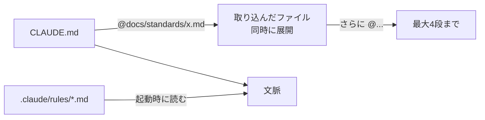

# CLAUDE.md のモジュール化（@import と .claude/rules/）

> ドメイン: 3. Claude Code の設定とワークフロー（20%） ／ 更新: 2026-11-20

## 3行まとめ
- 大きくなった CLAUDE.md は、`@path` の import（取り込み）か `.claude/rules/`（トピック別のルールファイル置き場）に分ける
- import は「必要な規約ファイルだけを、その CLAUDE.md に選んで取り込む」とき、rules は「1つの巨大な CLAUDE.md をトピックごとのファイルに割る」ときに使う
- どちらも整理のための仕組み。`paths` の無いルールと import 先は毎回読み込まれるので、文脈（context）の量は減らない

## 仕組み

| | `@path` の import | `.claude/rules/` |
|---|---|---|
| 書く場所 | CLAUDE.md の本文（どこでもよい） | `.claude/rules/` の下に `.md` を置く（サブフォルダも再帰で探す） |
| 何を読むか | 名指ししたファイルだけ | ディレクトリ内の全ルールファイル |
| 向いている場面 | パッケージごとに、関係する規約だけを選ぶ | 1ファイル1トピックで、チームで分担して保守する |
| 読み込むとき | 取り込み元の CLAUDE.md と同時 | `paths` が無ければ起動時。`.claude/CLAUDE.md` と同じ優先度 |
| パスの基準 | 取り込み元のファイルからの相対パス（作業ディレクトリではない） | ファイル名は内容が分かる名前（例: `testing.md`） |

- 例（自作）: `packages/billing/CLAUDE.md` に `@../../docs/standards/payments-security.md` だけを書き、`packages/mobile/` には書かない
- 例（自作）: 300行の CLAUDE.md を `.claude/rules/` の `code-style.md`・`testing.md`・`release.md` に割る
- バッククォートで囲んだ `` `@README` `` は取り込まれない（コードの中は無視される）
- リポジトリの外を指す import は、初回に承認のダイアログが出る。断ると無効のまま
- `~/.claude/rules/` は全プロジェクトに効く個人用のルール。プロジェクトのルールより先に読まれる
- ルールの frontmatter の `paths`（glob で条件付きに読む）→ 別ノート（path-scoped-rules、3.3）
- 階層（ユーザー / プロジェクト / ディレクトリ）と `/memory` での確認 → 別ノート（claude-md-hierarchy）

## 試験で問われそうなポイント
- パッケージごとに必要な規約が違う → 各パッケージの CLAUDE.md で、関係する規約ファイルだけを `@` で取り込む
- 1つの CLAUDE.md が長く、担当ごとに編集がぶつかる → `.claude/rules/` にトピック別のファイルで分ける
- 規約ファイルの中身を、複数の CLAUDE.md に書き写している → 1か所に置いて import する
- ある領域のファイルを触るときだけ要るルール → 常時読む rules ではなく、`paths` 付きのルールを考える（3.3）

## 間違えやすいところ
- アンチパターン: 何でも1つの CLAUDE.md に書き足す（monolithic）。ガイドは rules をその代わりに挙げる
- import で分けても文脈の量は減らない。取り込んだ先も一緒に読み込まれる
- `paths` の無いルールも毎回読み込まれる。「rules に移せば軽くなる」は誤り
- import の相対パスは、作業ディレクトリではなく取り込み元のファイルが基準
- 名前のずれ: ガイドは「@import 構文」、公式ドキュメントは「Import additional files（`@path/to/import`）」と書く。中身は同じ
- 公式の目安は CLAUDE.md 1ファイル 200行未満。長いと従いにくくなる
- import とルールファイル同士が矛盾すると、Claude はどちらかを任意に選ぶ。分けたら矛盾を点検する

## 確認問題
1. モノレポの `api/` だけが社内の認証規約に従う必要がある。規約は `docs/auth.md` にある。`web/` の作業では読ませたくない。どうする？
   

答え
`api/CLAUDE.md` に `@../docs/auth.md` を書く。import は取り込み元と一緒に読まれるので、`api/` の CLAUDE.md が読まれるときだけ効く。ルート CLAUDE.md に書くと全体に効いてしまう。

2. 400行の CLAUDE.md を `@` で5ファイルに分けた。「文脈の消費が減ったはず」という説明は正しい？
   

答え
誤り。import 先は取り込み元と一緒に展開されるので量は同じ。減らしたいなら、一部の作業でしか要らない内容を `paths` 付きのルールやスキルに移す。

3. フロントとバックエンドの担当者が、同じ CLAUDE.md を毎週書き換えて衝突している。どう整理する？
   

答え
`.claude/rules/` に `frontend/`・`backend/` などトピック別のファイルを作って分ける。1ファイル1トピックで、担当ごとに保守できる。

## 出典
- [How Claude remembers your project（Import additional files / Organize rules with .claude/rules/ / My CLAUDE.md is too large）](https://code.claude.com/docs/en/memory)（公式）
- [Monorepos and large repos](https://code.claude.com/docs/en/large-codebases)（公式）
- Claude Certified Architect – Foundations Exam Guide v1.1、Task Statement 3.1（公式）
- 未確認: 試験がどの版の Claude Code の挙動（import の段数の上限など）を前提にしているか
