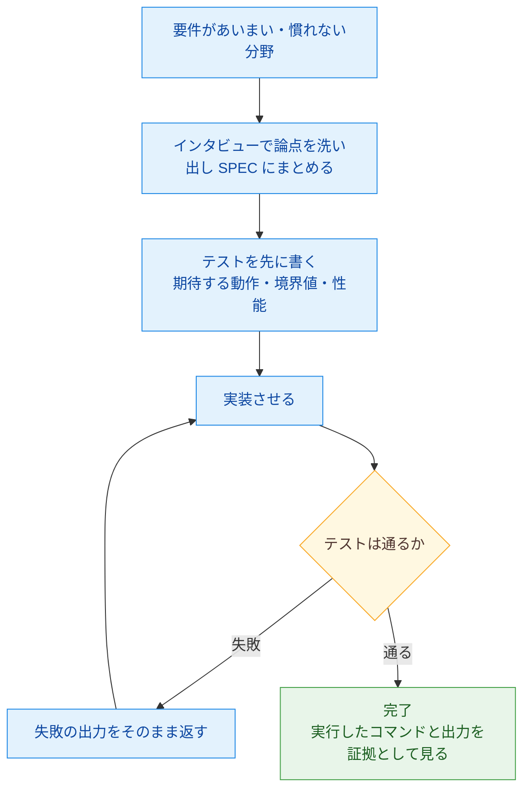

# Claude Code での反復的な改善

> ドメイン: 3. Claude Code の設定とワークフロー（20%） ／ 更新: 2026-11-20

!!! abstract "ひとことで"
    文章で伝えても解釈がぶれるなら、==具体的な入出力例を2〜3個==見せる。完成の基準はテストで先に決め、失敗の出力を返して直させる。

## 仕組み

文章の指示は、言い換えを重ねても解釈が揺れる。入力と期待する出力の組は、変換の中身をいちばん確実に伝える。「できた」の判定は、先に書いたテストに任せる。Claude は「できたように見える」ところで止まるので、判定できるチェックを渡す必要がある。

| 手法 | どんな状況で使うか | やり方 |
|---|---|---|
| 入出力例（input/output examples） | 変換のルールを文章で書いても、結果が毎回ぶれる | 入力と期待する出力の組を2〜3個示す |
| テスト駆動の反復（test-driven iteration） | 「できた」を機械的に判定したい。境界値や性能の要件がある | 先にテストを書き、失敗の出力を返して直させる |
| インタビュー（interview pattern） | 何を決めるべきかが自分でも分かっていない。慣れない分野 | 作る前に Claude に質問させ、答えを仕様にまとめる |
| 問題をまとめて伝える | 複数の問題の直し方が互いに影響する | 全部を1通の詳しいメッセージで渡す |
| 問題を1つずつ伝える | 複数の問題が互いに独立している | 1件ずつ直して確かめる |

入出力例は、特定の取りこぼしにも効く。たとえば移行スクリプトが null だけを誤るなら、その入力と期待する出力をテストケースとして渡す。インタビューは開発者が頼んで始める使い方で、Claude が勝手に質問攻めにする機能ではない。洗い出す論点には、キャッシュの無効化（cache invalidation）の方針や、失敗したときの振る舞い（failure modes）がある。

??? info "細かい決まり・ガイドとの食い違い"
    - 例の数: ガイドは2〜3個、プロンプト全般の公式ドキュメントは3〜5個を勧める。この項目ではガイドの2〜3個で覚える
    - 公式の best practices は、インタビューの結果を SPEC.md に書かせ、新しいセッションでそれを元に作る流れを勧めている
    - 同じ指摘を2回しても直らないときは、3回目を重ねずに `/clear` し、学んだことを入れたプロンプトで出し直す（公式の best practices）
    - 絡み合う問題を1つずつ直すのが誤りである理由と、独立した問題を1通に詰め込むのが誤りである理由は、どちらも筆者の推論（下の表の括弧書き）
    - 例を使ったプロンプト全般（few-shot prompting）は 4.2 で扱う

## 試験での見分け方

| 問われること | ○ 正しい | × ひっかけ |
|---|---|---|
| 言い換えても出力の形がそろわない | 入出力例を2〜3個示す | 指示の文章をさらに長く細かくする（解釈の揺れが残る） |
| 特定の入力（空文字や欠けた値）だけ扱いを誤る | その入力と期待する出力を添えたテストケースを渡す | 一般論の指示を足す |
| 実装の前に「完成」をどう決めるか | 期待する動作・境界値・性能を網羅したテストを先に書く | テストを後回しにして、見た目で完成を判断する |
| テストが落ちた | 失敗したテストの出力をそのまま返す | 「動かない」とだけ伝える |
| 初めて扱う分野（例: 分散キャッシュ） | 先にインタビューさせ、見落としそうな設計の論点を出させる | すぐ実装させる |
| 修正どうしが絡む複数の不具合 | 1通の詳しいメッセージにまとめる | 1つずつ直す（1つ目の修正が2つ目の前提を壊し、行ったり来たりになりやすい。推論） |
| 互いに独立した複数の不具合 | 1つずつ直して確かめる | 1通に詰め込む（どの修正がどの問題に効いたか確かめにくい。推論） |

## 確認問題

??? question "Q1. 日付の文字列を社内の標準形式にそろえる関数を書かせている。ルールを文章で何度言い直しても、和暦や時刻付きの入力の扱いが毎回変わる。次の一手は？"
    入力と期待する出力の組を2〜3個、和暦と時刻付きを含めて示す。文章の説明は解釈がぶれるが、具体例は変換の中身を一意に伝えやすい。

??? question "Q2. 経験の無い決済の再試行処理を作る。すぐ実装を頼むと、二重課金への配慮が抜けそうで不安だ。どう進める？"
    実装の前に Claude にインタビューさせ、冪等性や失敗時の振る舞いなど、自分が想定していない論点を質問として出させる。答えを仕様にまとめ、テストを先に書いてから実装させる。

??? question "Q3. CSV 取り込みで「文字コードの判定」と「その判定結果に依存する区切り文字の推定」が壊れている。別に、ログの文言の誤字が1つある。どう伝える？"
    文字コードと区切り文字は修正が絡むので、1通の詳しいメッセージにまとめて渡す。誤字は独立しているので、別の1件として直す。

## 出典
- Claude Certified Architect – Foundations Exam Guide v1.1, Task Statement 3.5（公式、PDF）: https://cc.sj-cdn.net/instructor/6nizmqk8tpzpfjvt6qmmav7rh/public/1794946250/Claude_Certified_Architect_-_Foundations_Exam_Guide.pdf
- [Best practices for Claude Code](https://code.claude.com/docs/en/best-practices)（公式。具体的なプロンプト、インタビュー（Brainstorm with Claude first）、失敗するテストを先に書く例、Give Claude a check to run、Steer the session）
- [Common workflows](https://code.claude.com/docs/en/common-workflows)（公式。Work with tests: 境界値のテストを足し、失敗を直させる手順）
- [Prompting best practices](https://platform.claude.com/docs/en/build-with-claude/prompt-engineering/claude-prompting-best-practices)（公式。Use examples effectively: 例の数は3〜5個を推奨）
- 未確認: 「絡み合う問題は1通にまとめ、独立した問題は1つずつ」の使い分けは、ガイドにはあるが、code.claude.com の現行ページでは同じ趣旨の記述を見つけられなかった
- 未確認: 「テストを先に書く」ことは公式で確かめたが、ガイドの「性能の要件もテストに含める」に当たる記述は公式ドキュメントで見つけられなかった
