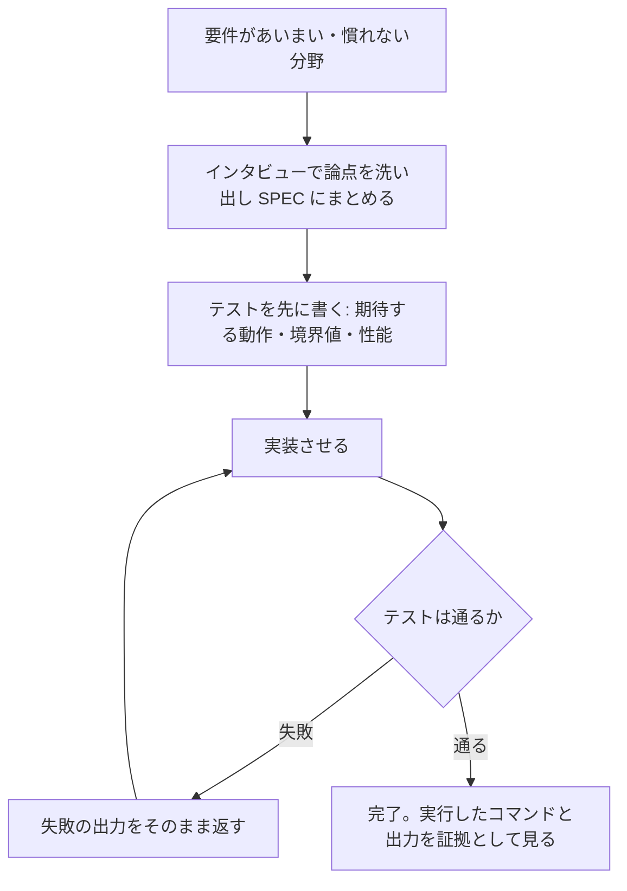

# Claude Code での反復的な改善

> ドメイン: 3. Claude Code の設定とワークフロー（20%） ／ 更新: 2026-11-20

## 3行まとめ
- 文章で伝えても解釈がぶれるときは、**具体的な入出力例を2〜3個**見せる。例がいちばん確実に変換の中身を伝える
- 完成の基準はテストで先に決め、失敗したテストの出力を返して直させる。慣れない分野では、作る前に Claude にインタビューさせて論点を洗い出す
- 直したい問題が絡み合っているなら1通にまとめて伝え、独立しているなら1つずつ直す

## 仕組み

| 手法 | どんな状況で使うか | やり方 |
|---|---|---|
| 入出力例（input/output examples） | 変換のルールを文章で書いても、結果が毎回ぶれる | 入力と期待する出力の組を2〜3個示す |
| テスト駆動の反復（test-driven iteration） | 「できた」を機械的に判定したい。境界値や性能の要件がある | 先にテストを書き、失敗の出力を返して直させる |
| インタビュー（interview pattern） | 何を決めるべきかが自分でも分かっていない。慣れない分野 | 作る前に Claude に質問させ、答えを仕様にまとめる |
| 問題をまとめて伝える | 複数の問題の直し方が互いに影響する | 全部を1通の詳しいメッセージで渡す |
| 問題を1つずつ伝える | 複数の問題が互いに独立している | 1件ずつ直して確かめる |

- 入出力例は、特定の取りこぼし（例: 移行スクリプトでの null）にも効く。入力と期待する出力を添えたテストケースとして渡す
- インタビューで洗い出す論点の例: キャッシュの無効化（cache invalidation）の方針、失敗したときの振る舞い（failure modes）
- 公式の best practices では、インタビューの結果を SPEC.md に書かせ、新しいセッションでそれを元に作る流れを勧めている
- 例を使ったプロンプト全般（few-shot prompting）は 4.2 で扱う

## 試験で問われそうなポイント
- 説明の言い換えを重ねても出力の形がそろわない → 文章を足すより、入出力例を2〜3個示す
- 実装の前に「完成」をどう決めるか → 期待する動作・境界値・性能を網羅したテストを先に書く
- テストが落ちたときの伝え方 → 「動かない」ではなく、失敗したテストの出力をそのまま返す
- 初めて扱う分野（例: 分散キャッシュ）で、すぐ実装させるか → 先にインタビューさせて、見落としそうな設計の論点を出させる
- 3つの不具合を直したい → 修正どうしが絡むなら1通にまとめる。独立なら1つずつ

## 間違えやすいところ
- 入出力例の代わりに、指示の文章をさらに長く細かくする → ぶれの原因（解釈の揺れ）が残る
- テストを後回しにして「見た目で完成」を判断する → Claude は「できたように見える」で止まる。判定できるチェックを渡す
- 絡み合う問題を1つずつ直す → 1つ目の修正が2つ目の前提を壊し、行ったり来たりになる
- 独立した問題を1通に詰め込む → どの修正がどの問題に効いたか確かめにくい
- インタビューを「Claude が勝手に質問攻めにする機能」と考える → 開発者が頼んで始める使い方
- 例の数: ガイドは2〜3個、プロンプト全般の公式ドキュメントは3〜5個を勧める。この項目ではガイドの2〜3個で覚える
- 同じ指摘を2回しても直らないときは、3回目を重ねず `/clear` して、学んだことを入れたプロンプトで出し直す（公式の best practices）

## 確認問題
1. 日付の文字列を社内の標準形式にそろえる関数を Claude に書かせている。ルールを文章で何度言い直しても、和暦や時刻付きの入力の扱いが毎回変わる。次の一手は何か
   

答え
入力と期待する出力の組を2〜3個（和暦・時刻付きを含めて）示す。文章の説明は解釈がぶれるが、具体例は変換の中身を一意に伝えやすい。

2. 経験の無い決済の再試行処理を作る。すぐ実装を頼むと、二重課金への配慮が抜けそうで不安だ。どう進めるか
   

答え
実装の前に Claude にインタビューさせ、冪等性や失敗時の振る舞いなど、自分が想定していない論点を質問として出させる。答えを仕様にまとめ、テストを先に書いてから実装させる。

3. CSV 取り込みで「文字コードの判定」と「その判定結果に依存する区切り文字の推定」の2つが壊れている。別に、ログの文言の誤字が1つある。どう伝えるか
   

答え
文字コードと区切り文字は修正が絡むので、1通の詳しいメッセージにまとめて渡す。誤字は独立しているので、別に1件として直す。

## 出典
- Claude Certified Architect – Foundations Exam Guide v1.1, Task Statement 3.5（公式、PDF）: https://cc.sj-cdn.net/instructor/6nizmqk8tpzpfjvt6qmmav7rh/public/1794946250/Claude_Certified_Architect_-_Foundations_Exam_Guide.pdf
- [Best practices for Claude Code](https://code.claude.com/docs/en/best-practices)（公式。具体的なプロンプト、インタビュー（Brainstorm with Claude first）、失敗するテストを先に書く例、Give Claude a check to run、Steer the session）
- [Common workflows](https://code.claude.com/docs/en/common-workflows)（公式。Work with tests: 境界値のテストを足し、失敗を直させる手順）
- [Prompting best practices](https://platform.claude.com/docs/en/build-with-claude/prompt-engineering/claude-prompting-best-practices)（公式。Use examples effectively: 例の数は3〜5個を推奨）
- 未確認: 「絡み合う問題は1通にまとめ、独立した問題は1つずつ」の使い分けは、ガイドにはあるが、code.claude.com の現行ページでは同じ趣旨の記述を見つけられなかった
- 未確認: 「テストを先に書く」ことは公式で確かめたが、ガイドの「性能の要件もテストに含める」に当たる記述は公式ドキュメントで見つけられなかった
