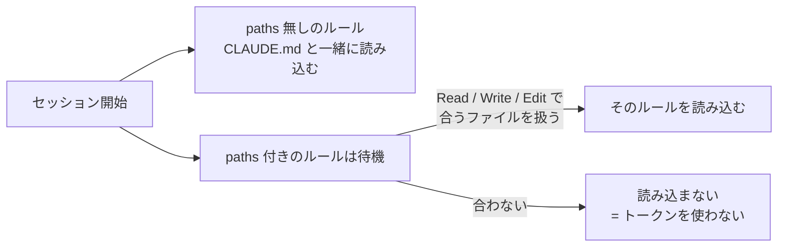

# パス指定ルールによる規約の条件付き読み込み

> ドメイン: 3. Claude Code の設定とワークフロー（20%） ／ 更新: 2026-11-20

## 3行まとめ
- `.claude/rules/*.md` の YAML frontmatter（ファイル先頭の `---` で囲んだ設定）に `paths` の glob パターンを書くと、合うファイルを扱うときだけそのルールが読み込まれる
- 一部のファイルにしか関係しない規約に使う。全セッションで要る規約は CLAUDE.md や `paths` 無しのルールに置く
- 決め手: 規約の対象が「ファイルの種類」でリポジトリ中に散らばるなら、ディレクトリごとの CLAUDE.md ではなく `paths` 付きのルール

## 仕組み



```markdown
---
paths:
  - "**/*.test.tsx"
  - "e2e/**/*.ts"
---
# テストの規約
- テスト名は「〜のとき〜する」の形で書く
```

- 読み込みのきっかけ: Read・Write・Edit ツールで合うファイルを扱ったとき。`cat` など読み取りに当たる Bash コマンドも含む
- パターンの基準: プロジェクトのルールは `.claude` フォルダがあるディレクトリ。ユーザーのルール（`~/.claude/rules/`）はセッションの作業ディレクトリ
- 書き方: YAML のリストか、カンマ区切りの文字列。`{ts,tsx}` の波括弧展開も使える
- `paths` は rules の frontmatter で唯一読まれる項目。ほかの項目は黙って無視される

| パターン | 合うファイル |
|---|---|
| `terraform/**/*` | 基準ディレクトリの `terraform/` の下すべて |
| `**/*.test.tsx` | どこにあっても `.test.tsx` のファイル |
| `*.md` | どこにあっても `.md`（直下だけではない） |
| `/*.md` | 基準ディレクトリ直下の `.md` だけ |

### paths 付きのルールとディレクトリごとの CLAUDE.md

| 観点 | `paths` 付きのルール | ディレクトリごとの CLAUDE.md |
|---|---|---|
| 置き場所 | `.claude/rules/` に集める | 対象のディレクトリに置く |
| 対象の決め方 | glob パターン（種類・場所を自由に組む） | そのディレクトリの下だけ |
| 読み込むとき | 合うファイルを扱ったとき | そのディレクトリのファイルを扱ったとき |
| 向いている規約 | テスト・マイグレーションなど散らばるファイル | 1か所にまとまったモジュール固有の事情 |

## 試験で問われそうなポイント
- テストファイルがあちこちのディレクトリにある → `**/*.test.*` のような `paths` 付きルールを1つ作る
- Terraform の規約を、アプリのコードを触るときには読ませたくない → `paths: ["terraform/**/*"]`
- CLAUDE.md が長く、一部のコードにしか関係ない規約が多い → その部分を `paths` 付きルールに移して、毎回のトークンを減らす
- 手順やワークフローで、必要なときだけ呼びたい → ルールではなくスキル（3.2 の範囲）

## 間違えやすいところ
- アンチパターン: 散らばったテストファイル向けの規約を、各ディレクトリの CLAUDE.md に書き写す。重複して保守がずれ、新しいディレクトリで漏れる
- `paths` の無いルールは条件付きではない。起動時に `.claude/CLAUDE.md` と同じ優先度で必ず読み込まれる
- `@path` の import（取り込み）で分けても、CLAUDE.md と一緒に読み込まれるのでトークンは減らない。減らせるのは `paths` 付きルール
- frontmatter の YAML が壊れていると、エラーで止まらず `paths` 無しとして毎回読み込まれる（`claude --debug` で分かる）
- 一度読み込まれたルールが、合うファイルから離れたあと外れるかは未確認
- トピックごとに `.claude/rules/` に分けること自体は 3.1 のノート（claude-md-modularization）、ディレクトリごとの CLAUDE.md は 3.1 のノート（claude-md-hierarchy）が主

## 確認問題
1. `db/migrations/` と各サービスの `migrations/` にマイグレーションファイルがある。「マイグレーションは必ず down も書く」を、必要なときだけ読ませたい。どう書くか
   <details><summary>答え</summary>`.claude/rules/migrations.md` に `paths: ["**/migrations/**/*"]` を書く。散らばったファイルを1つのパターンで拾え、ほかの作業ではトークンを使わない。各ディレクトリの CLAUDE.md に書くと重複し、新しいサービスで漏れる。</details>
2. `.claude/rules/style.md` の frontmatter に `paths` を書いたのに、関係ない作業でも毎回読み込まれている。まず何を疑うか
   <details><summary>答え</summary>frontmatter の YAML が解析できていない。壊れていると `paths` 無しとして起動時に読み込まれる。`claude --debug` で解析エラーを確かめる。</details>
3. 「コミットメッセージの形式」を `paths: ["src/**/*"]` 付きのルールに書いた。何がまずいか
   <details><summary>答え</summary>コミットの形式は触るファイルに関係なく全セッションで要る。`src/` のファイルを扱うまで読み込まれないので守られないことがある。CLAUDE.md か `paths` 無しのルールに置く。</details>

## 出典
- [How Claude remembers your project（Organize rules with .claude/rules/、Path-specific rules）](https://code.claude.com/docs/en/memory)（公式）
- [Claude Certified Architect – Foundations Exam Guide v1.1（Task Statement 3.3）](https://cc.sj-cdn.net/instructor/6nizmqk8tpzpfjvt6qmmav7rh/public/1794946250/Claude_Certified_Architect_-_Foundations_Exam_Guide.pdf)（公式）
