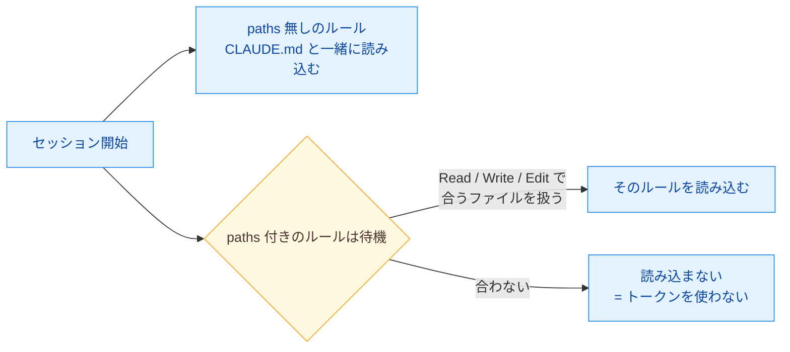

# パス指定ルールによる規約の条件付き読み込み

> ドメイン: 3. Claude Code の設定とワークフロー（20%） ／ 更新: 2026-11-20

!!! abstract "ひとことで"
    `.claude/rules/*.md` の frontmatter に `paths` の glob を書くと、==合うファイルを扱うときだけ== そのルールが読み込まれる。規約の対象が「ファイルの種類」でリポジトリ中に散らばるなら、ディレクトリごとの CLAUDE.md ではなくこれを使う。

## 仕組み

YAML frontmatter（ファイル先頭の `---` で囲んだ設定）に `paths` を書いたルールは、起動時には読まれず待機する。Read・Write・Edit ツールで合うファイルを扱ったときに、初めて読み込まれる。`cat` など読み取りに当たる Bash コマンドも含む。合わない作業ではトークンを使わないので、一部のファイルにしか関係しない規約に向く。全セッションで要る規約は、CLAUDE.md か `paths` 無しのルールに置く。



```markdown
---
paths:
  - "**/*.test.tsx"
  - "e2e/**/*.ts"
---
# テストの規約
- テスト名は「〜のとき〜する」の形で書く
```

| パターン | 合うファイル |
|---|---|
| `terraform/**/*` | 基準ディレクトリの `terraform/` の下すべて |
| `**/*.test.tsx` | どこにあっても `.test.tsx` のファイル |
| `*.md` | どこにあっても `.md`（直下だけではない） |
| `/*.md` | 基準ディレクトリ直下の `.md` だけ |

| 観点 | `paths` 付きのルール | ディレクトリごとの CLAUDE.md |
|---|---|---|
| 置き場所 | `.claude/rules/` に集める | 対象のディレクトリに置く |
| 対象の決め方 | glob パターン（種類・場所を自由に組む） | そのディレクトリの下だけ |
| 読み込むとき | 合うファイルを扱ったとき | 作業ディレクトリより下: そこのファイルを扱ったとき。作業ディレクトリとその上: 起動時 |
| 向いている規約 | テスト・マイグレーションなど散らばるファイル | 1か所にまとまったモジュール固有の事情 |

読み込まれたルールは会話履歴に入る。合うファイルから離れたときに外す仕組みは、公式に記述が無い（なので離れても残る、というのは推論）。消えるのは compaction（古い会話を要約して詰めること）のときで、そのあと合うファイルを扱うと読み込み直される。compaction のあとも残したい規約は、`paths` を外すか、プロジェクト直下の CLAUDE.md に移す。

??? info "書き方の細則"
    - パターンの基準: プロジェクトのルールは `.claude` フォルダがあるディレクトリ。ユーザーのルール（`~/.claude/rules/`）はセッションの作業ディレクトリ
    - 書き方: YAML のリストか、カンマ区切りの文字列。`{ts,tsx}` の波括弧展開も使える
    - `paths` は rules の frontmatter で唯一読まれる項目。ほかの項目は黙って無視される
    - `paths` の無いルールは、起動時に `.claude/CLAUDE.md` と同じ優先度で読み込まれる。`--setting-sources` で `project` を外したときは読み込まれない
    - frontmatter の YAML が壊れていると、エラーで止まらず `paths` 無しとして毎回読み込まれる（`claude --debug` で分かる）
    - `.claude/rules/` にトピックごとに分けること自体は [CLAUDE.md のモジュール化](claude-md-modularization.md)、ディレクトリごとの CLAUDE.md は [CLAUDE.md の階層](claude-md-hierarchy.md)（どちらも 3.1）が主

## 試験での見分け方

<div class="vs" markdown>

| 問われること | ○ 正しい | × ひっかけ |
|---|---|---|
| テストファイルがあちこちのディレクトリにある | `**/*.test.*` のような `paths` 付きルールを1つ作る | 各ディレクトリの CLAUDE.md に書き写す（重複して保守がずれ、新しいディレクトリで漏れる） |
| Terraform の規約を、アプリのコードを触るときには読ませたくない | `paths: ["terraform/**/*"]` | `paths` 無しのルールに置く（条件付きにならず、起動時に読まれる） |
| CLAUDE.md が長く、一部のコードにしか関係ない規約が多い | その部分を `paths` 付きルールに移して、毎回のトークンを減らす | `@path` の import で分ける（CLAUDE.md と一緒に読まれるので減らない） |
| 手順やワークフローを、必要なときだけ呼びたい | ルールではなくスキル（3.2 の範囲） | `paths` 付きのルールにする |
| `paths` を書いたのに毎回読まれる | frontmatter の YAML の解析エラーを疑う | `paths` の仕組みが効かないと考える |

</div>

## 確認問題

??? question "Q1. `db/migrations/` と各サービスの `migrations/` にマイグレーションファイルがある。「マイグレーションは必ず down も書く」を、必要なときだけ読ませたい。どう書く？"
    `.claude/rules/migrations.md` に `paths: ["**/migrations/**/*"]` を書く。散らばったファイルを1つのパターンで拾え、ほかの作業ではトークンを使わない。各ディレクトリの CLAUDE.md に書くと重複し、新しいサービスで漏れる。

??? question "Q2. `.claude/rules/style.md` の frontmatter に `paths` を書いたのに、関係ない作業でも毎回読み込まれている。まず何を疑う？"
    frontmatter の YAML が解析できていないことを疑う。壊れていると `paths` 無しとして起動時に読み込まれる。`claude --debug` で解析エラーを確かめる。

??? question "Q3. 「コミットメッセージの形式」を `paths: ["src/**/*"]` 付きのルールに書いた。何がまずい？"
    コミットの形式は、触るファイルに関係なく全セッションで要る。`src/` のファイルを扱うまで読み込まれないので、守られないことがある。CLAUDE.md か `paths` 無しのルールに置く。

## 出典
- [How Claude remembers your project（Organize rules with .claude/rules/、Path-specific rules）](https://code.claude.com/docs/en/memory)（公式）
- [Explore the context window（What survives compaction）](https://code.claude.com/docs/en/context-window)（公式）
- [Claude Certified Architect – Foundations Exam Guide v1.1（Task Statement 3.3）](https://cc.sj-cdn.net/instructor/6nizmqk8tpzpfjvt6qmmav7rh/public/1794946250/Claude_Certified_Architect_-_Foundations_Exam_Guide.pdf)（公式）
