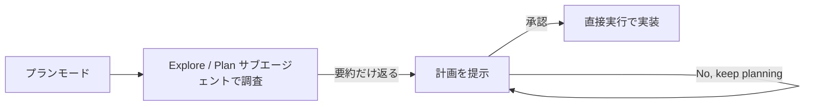

# プランモードと直接実行の使い分け、Explore サブエージェント

> ドメイン: 3. Claude Code の設定とワークフロー（20%） ／ 更新: 2026-11-20

## 3行まとめ
- プランモード（plan mode。読んで調べて計画を出すだけで、承認するまで編集しない権限モード）は、大きく・選択肢が複数ある変更のためのもの
- 範囲がはっきりした小さな変更（原因の分かったバグ1件など）は、計画を挟まず直接実行（direct execution）する
- 決め手は **設計の判断が要るか**。要るならプランモードで調べて計画し、承認後に直接実行で実装する。大量の調査は Explore サブエージェントに任せる

## 仕組み

### どちらを選ぶか

| 見るところ | プランモード | 直接実行 |
|---|---|---|
| 変更の規模 | 多数のファイル、大規模 | 1ファイル・1関数程度 |
| やり方の選択肢 | 複数あり、比べて選ぶ必要がある | ほぼ1つに決まっている |
| 設計への影響 | アーキテクチャの判断を含む | 含まない |
| 原因・範囲 | まだ分かっていない | スタックトレースなどで分かっている |
| 自作の例 | ログ基盤を別ライブラリへ移す（60ファイル）。キューを自前で持つかマネージドにするか決める | 価格が負なら例外を投げる条件を1つ足す。typo で落ちるテストを直す |

### 調べる → 計画 → 承認 → 実装

- 入り方: `Shift+Tab` で切り替え、プロンプトの先頭に `/plan`、または `claude --permission-mode plan`
- 承認の選択肢は「Yes, and use auto mode」（auto mode が使えなければ「Yes, auto-accept edits」）、「Yes, manually approve edits」、「No, keep planning」。承認するとプランモードを抜けて編集が始まる
- `Ctrl+G` で計画をエディタで直してから進められる
- プロジェクトの既定にするなら `.claude/settings.json` の `permissions.defaultMode` を `plan` にする（VS Code 拡張は `claudeCode.initialPermissionMode`）

### Explore サブエージェント

| 項目 | 内容 |
|---|---|
| 役割 | ファイル探し・コード検索・コードベースの理解（変更はしない） |
| ツール | 読み取り専用。Write と Edit は使えない |
| 効果 | 長い調査結果を別のコンテキストに閉じ込め、メインの会話には要約だけが戻る |
| 徹底度 | quick / medium / very thorough を Claude が指定する |
| 読み込まないもの | CLAUDE.md と git status のスナップショット（速く安くするため） |

- プランモード中の調査は、同じく読み取り専用の Plan サブエージェントが担う
- 大きなコードベースでのコンテキスト管理全般は 5.4（large-codebase-context）で扱う

## 試験で問われそうなポイント
- プランモードの価値は、変更を確定する前に、編集せずに安全に調べて設計できること。これで高くつくやり直しを防ぐ
- 多数のファイルに及ぶ移行、統合方式の選択、サービス構成の見直し → プランモード
- 原因が分かった1ファイルのバグ修正、条件分岐1つの追加 → 直接実行。計画を挟むのは手間が増えるだけ
- 何段階もの作業で、調査の出力が大量になる → Explore に調べさせ、要約だけをメインに戻す
- 「計画はプランモード、実装は直接実行」の組み合わせが、大きな変更の基本形

## 間違えやすいところ
- アンチパターン: 認証方式の入れ替えのような変更を、影響範囲を調べずにいきなり編集から始める。呼び出し元を後で見つけるたびに書き直しになる
- 長い指示文はコードを読む前の想定にすぎず、調査の代わりにならない。プランモードかどうかは、着手前に規模と不確かさで決める
- 小さな変更までプランモードにするのは過剰。規模と不確かさで選ぶ
- Explore は調査専用で編集できない。実装まで任せる先ではない
- プランモードでもシェルコマンドは動く（読み取り専用の範囲外は承認か、auto mode の分類器の判定）。「何も実行しない」わけではない
- 公式の Best practices は「What you can stop doing」の表で、「コンテキストを守るためにサブエージェントを使う」を The old advice に挙げる（今はコンテキスト切れがまれなため）
  - 今も有効な利点は、並列作業・うるさい出力を外に出す・独立したレビューの3つで、どれも余分にトークンを使う。ガイドとは強調点がずれるが、試験はガイドの書き方で答える

## 確認問題
1. 決済処理を同期呼び出しからイベント駆動に変えたい。キューの製品が2候補あり、影響は30ファイルほど。どう進める？
   

答え
プランモードで依存関係を調べ、候補を比べた計画を作り、承認後に直接実行で実装する。選択肢が複数あり設計判断を含むため。

2. 社内 CLI で `--verbose` を付けるとログが二重に出る。原因は1つのファイルにある出力処理の重複と特定済み。どう進める？
   

答え
直接実行で直す。範囲が明確で、直し方も1つに決まる。プランモードは手間が増えるだけ。

3. 何段階もある改修で、最初の「使われている箇所の洗い出し」の出力が数千行になりそう。メインの会話を保つには？
   

答え
Explore サブエージェントに洗い出しを任せ、要約だけを受け取る。読み取り専用で、詳細は別コンテキストに残る。

## 出典
- [Claude Certified Architect – Foundations Exam Guide v1.1](https://cc.sj-cdn.net/instructor/6nizmqk8tpzpfjvt6qmmav7rh/public/1794946250/Claude_Certified_Architect_-_Foundations_Exam_Guide.pdf) タスクステートメント 3.4（公式）
- [Choose a permission mode（Plan mode）](https://code.claude.com/docs/en/permission-modes)（公式）
- [Common workflows（Plan before editing）](https://code.claude.com/docs/en/common-workflows)（公式）
- [Create custom subagents（Built-in subagents: Explore / Plan）](https://code.claude.com/docs/en/sub-agents)（公式）
- [Best practices for Claude Code](https://code.claude.com/docs/en/best-practices)（公式）
