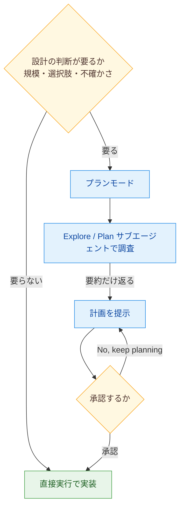

# プランモードと直接実行の使い分け、Explore サブエージェント

> ドメイン: 3. Claude Code の設定とワークフロー（20%） ／ 更新: 2026-11-20

!!! abstract "ひとことで"
    決め手は ==設計の判断が要るか== だ。要るならプランモードで調べて計画し、承認してから直接実行で実装する。範囲のはっきりした小さな変更は、計画を挟まずに直接実行する。

## 仕組み

プランモード（plan mode）は、読んで調べて計画を出すだけの権限モードだ。承認するまで編集しないので、変更を確定する前に安全に調べて設計できる。そのぶん、高くつくやり直しを防げる。一方、原因の分かったバグ1件のような小さな変更に計画を挟むと、手間が増えるだけになる。だから直接実行（direct execution）を選ぶ。

| 見るところ | プランモード | 直接実行 |
|---|---|---|
| 変更の規模 | 多数のファイル、大規模 | 1ファイル・1関数程度 |
| やり方の選択肢 | 複数あり、比べて選ぶ必要がある | ほぼ1つに決まっている |
| 設計への影響 | アーキテクチャの判断を含む | 含まない |
| 原因・範囲 | まだ分かっていない | スタックトレースなどで分かっている |
| 自作の例 | ログ基盤を別ライブラリへ移す（60ファイル）。キューを自前で持つかマネージドにするか決める | 価格が負なら例外を投げる条件を1つ足す。typo で落ちるテストを直す |

大きな変更の基本形は「計画はプランモード、実装は直接実行」の組み合わせだ。どちらにするかは、着手前に規模と不確かさで決める。

調査の出力が大量になるときは、==Explore サブエージェント==に任せる。長い調査結果は別のコンテキストに閉じ込められ、メインの会話には要約だけが戻る。Explore は読み取り専用で Write と Edit が使えないので、実装まで任せる先ではない。プランモード中の調査は、同じく読み取り専用の Plan サブエージェントが担う。

??? info "プランモードの操作"
    - 入り方: `Shift+Tab` で切り替え、プロンプトの先頭に `/plan`、または `claude --permission-mode plan`
    - 承認の選択肢: 「Yes, and use auto mode」（auto mode が使えなければ「Yes, auto-accept edits」）、「Yes, manually approve edits」、「No, keep planning」。承認するとプランモードを抜けて編集が始まる
    - `Ctrl+G` で、計画をエディタで直してから進められる
    - プロジェクトの既定にするなら、`.claude/settings.json` の `permissions.defaultMode` を `plan` にする（VS Code 拡張は `claudeCode.initialPermissionMode`）

??? info "Explore の細かい決まりと、公式 Best practices との食い違い"
    - 役割: ファイル探し・コード検索・コードベースの理解。変更はしない
    - 徹底度: quick / medium / very thorough を Claude が指定する
    - CLAUDE.md と git status のスナップショットを読み込まない（速く安くするため）
    - 公式の Best practices は「What you can stop doing」の表で、「コンテキストを守るためにサブエージェントを使う」を The old advice に挙げる（今はコンテキスト切れがまれなため）。今も有効な利点は、並列作業・うるさい出力を外に出す・独立したレビューの3つで、どれも余分にトークンを使う。ガイドとは強調点がずれるが、試験はガイドの書き方で答える
    - 大きなコードベースでのコンテキスト管理全般は 5.4（large-codebase-context）で扱う

## 試験での見分け方

| 問われること | ○ 正しい | × ひっかけ |
|---|---|---|
| 多数のファイルに及ぶ移行、統合方式の選択、サービス構成の見直し | プランモードで調べて計画し、承認後に直接実行で実装する | 認証方式の入れ替えなどを、影響範囲を調べずに編集から始める（呼び出し元を見つけるたびに書き直しになる） |
| 原因が分かった1ファイルのバグ修正、条件分岐1つの追加 | 直接実行する | プランモードを挟む（手間が増えるだけ） |
| 詳しく長い指示文を用意した | それでも規模と不確かさで、プランモードにするかを決める | 指示が詳しいので調査を省く（指示はコードを読む前の想定にすぎない） |
| 何段階もの作業で、調査の出力が大量になる | Explore に調べさせ、要約だけをメインに戻す | Explore に実装まで任せる（調査専用で編集できない） |
| プランモード中のシェルコマンド | 動く。読み取り専用の範囲外は、承認か auto mode の分類器の判定を通る | 「何も実行しない」と考える |

## 確認問題

??? question "Q1. 決済処理を同期呼び出しからイベント駆動に変えたい。キューの製品が2候補あり、影響は30ファイルほど。どう進める？"
    プランモードで依存関係を調べ、候補を比べた計画を作る。承認してから、直接実行で実装する。選択肢が複数あり、設計の判断を含むからだ。

??? question "Q2. 社内 CLI で `--verbose` を付けるとログが二重に出る。原因は、1つのファイルにある出力処理の重複と特定済み。どう進める？"
    直接実行で直す。範囲が明確で、直し方も1つに決まる。プランモードは手間が増えるだけだ。

??? question "Q3. 何段階もある改修で、最初の「使われている箇所の洗い出し」の出力が数千行になりそう。メインの会話を保つには？"
    Explore サブエージェントに洗い出しを任せ、要約だけを受け取る。Explore は読み取り専用で、詳細は別のコンテキストに残る。

## 出典
- [Claude Certified Architect – Foundations Exam Guide v1.1](https://cc.sj-cdn.net/instructor/6nizmqk8tpzpfjvt6qmmav7rh/public/1794946250/Claude_Certified_Architect_-_Foundations_Exam_Guide.pdf) タスクステートメント 3.4（公式）
- [Choose a permission mode（Plan mode）](https://code.claude.com/docs/en/permission-modes)（公式）
- [Common workflows（Plan before editing）](https://code.claude.com/docs/en/common-workflows)（公式）
- [Create custom subagents（Built-in subagents: Explore / Plan）](https://code.claude.com/docs/en/sub-agents)（公式）
- [Best practices for Claude Code](https://code.claude.com/docs/en/best-practices)（公式）
