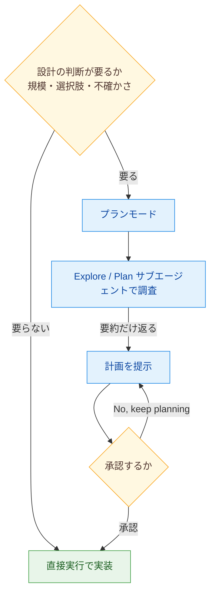

# プランモードと直接実行の使い分け、Explore サブエージェント

> ドメイン: 3. Claude Code の設定とワークフロー（20%） ／ 更新: 2026-11-20

!!! abstract "ひとことで"
    決め手は ==設計の判断が要るか== だ。要るならプランモードで調べて計画し、承認してから直接実行で実装する。範囲のはっきりした小さな変更は、計画を挟まずに直接実行する。

## 仕組み

プランモード（plan mode）は、読んで調べて計画を出すだけの権限モードだ。承認するまで編集しないので、変更を確定する前に安全に調べて設計できる。そのぶん、高くつくやり直しを防げる。一方、原因の分かったバグ1件のような小さな変更に計画を挟むと、手間が増えるだけになる。だから直接実行（direct execution）を選ぶ。

| 見るところ | プランモード | 直接実行 |
|---|---|---|
| 変更の規模 | 多数のファイル、大規模 | 1ファイル・1関数程度 |
| やり方の選択肢 | 複数あり、比べて選ぶ必要がある | ほぼ1つに決まっている |
| 設計への影響 | アーキテクチャの判断を含む | 含まない |
| 原因・範囲 | まだ分かっていない | スタックトレースなどで分かっている |
| 自作の例 | ログ基盤を別ライブラリへ移す（60ファイル）。キューを自前で持つかマネージドにするか決める | 価格が負なら例外を投げる条件を1つ足す。typo で落ちるテストを直す |

大きな変更の基本形は「計画はプランモード、実装は直接実行」の組み合わせだ。どちらにするかは、着手前に規模と不確かさで決める。

調査の出力が大量になるときは、==Explore サブエージェント==に任せる。長い調査結果は別のコンテキストに閉じ込められ、メインの会話には要約だけが戻る。Explore は読み取り専用で Write と Edit が使えないので、実装まで任せる先ではない。プランモード中の調査は、同じく読み取り専用の Plan サブエージェントが担う。

??? info "プランモードの操作"
    - 入り方: `Shift+Tab` で切り替え、プロンプトの先頭に `/plan`、または `claude --permission-mode plan`
    - 承認の選択肢: 「Yes, and use auto mode」（auto mode が使えなければ「Yes, auto-accept edits」）、「Yes, manually approve edits」、「No, keep planning」。承認するとプランモードを抜けて編集が始まる
    - `Ctrl+G` で、計画をエディタで直してから進められる
    - プロジェクトの既定にするなら、`.claude/settings.json` の `permissions.defaultMode` を `plan` にする（VS Code 拡張は `claudeCode.initialPermissionMode`）

??? info "Explore の細かい決まりと、公式 Best practices との食い違い"
    - 役割: ファイル探し・コード検索・コードベースの理解。変更はしない
    - 徹底度: quick / medium / very thorough を Claude が指定する
    - CLAUDE.md と git status のスナップショットを読み込まない（速く安くするため）
    - 公式の Best practices は「What you can stop doing」の表で、「コンテキストを守るためにサブエージェントを使う」を The old advice に挙げる（今はコンテキスト切れがまれなため）。今も有効な利点は、並列作業・うるさい出力を外に出す・独立したレビューの3つで、どれも余分にトークンを使う。ガイドとは強調点がずれるが、試験はガイドの書き方で答える
    - 大きなコードベースでのコンテキスト管理全般は 5.4（large-codebase-context）で扱う

## 試験での見分け方

| 問われること | ○ 正しい | × ひっかけ |
|---|---|---|
| 多数のファイルに及ぶ移行、統合方式の選択、サービス構成の見直し | プランモードで調べて計画し、承認後に直接実行で実装する | 認証方式の入れ替えなどを、影響範囲を調べずに編集から始める（呼び出し元を見つけるたびに書き直しになる） |
| 原因が分かった1ファイルのバグ修正、条件分岐1つの追加 | 直接実行する | プランモードを挟む（手間が増えるだけ） |
| 詳しく長い指示文を用意した | それでも規模と不確かさで、プランモードにするかを決める | 指示が詳しいので調査を省く（指示はコードを読む前の想定にすぎない） |
| 何段階もの作業で、調査の出力が大量になる | Explore に調べさせ、要約だけをメインに戻す | Explore に実装まで任せる（調査専用で編集できない） |
| プランモード中のシェルコマンド | 動く。読み取り専用の範囲外は、承認か auto mode の分類器の判定を通る | 「何も実行しない」と考える |

## 確認問題

**Q1.** EC サイトのバックエンドで、Claude Code を使って決済処理を同期呼び出しからイベント駆動に変えたい。キューの製品は2候補あり、影響は30ファイルほどに及ぶ。最も適切な進め方はどれか。（1つ選べ）
{ .quiz-q }

- A. 要件を詳しく書いた指示文を渡し、プランモードは使わずに直接実行で実装を始めさせる
- B. プランモードで依存関係を調べて候補を比べた計画を作らせ、承認してから直接実行で実装する
- C. 直接実行で、呼び出し元を見つけたところから順に書き換えさせ、壊れた箇所はテストで拾う
- D. Explore サブエージェントに、2候補の比較から30ファイルの書き換えまでをまとめて任せる

??? success "答えと解説"
    **正解: B。** 多数のファイルに及び、選択肢を比べる設計の判断を含むので、計画はプランモード、実装は直接実行で進める。

    - A: 指示が詳しくても、それはコードを読む前の想定にすぎない。規模と不確かさでプランモードにするかを決める
    - C: 影響範囲を調べずに編集から始めると、呼び出し元を見つけるたびに書き直しになる
    - D: Explore は読み取り専用で Write と Edit が使えない。実装まで任せる先ではない

**Q2.** 社内向け CLI ツールの開発で、`--verbose` を付けるとログが二重に出る。原因は、1つのファイルにある出力処理の重複だと特定済みだ。Claude Code での進め方として最も適切なものはどれか。（1つ選べ）
{ .quiz-q }

- A. プランモードに入り、出力処理の設計を見直す計画を作らせてから直す
- B. Explore サブエージェントに、ログ出力に関わる箇所をすべて洗い出させてから直す
- C. `permissions.defaultMode` を `plan` にし、以後の変更はすべて計画を経るようにする
- D. 直接実行で、特定済みの重複した出力処理を直させる

??? success "答えと解説"
    **正解: D。** 原因が分かった1ファイルの修正で、直し方もほぼ1つに決まるので、計画を挟まずに直接実行する。

    - A: 設計の判断が要らない小さな変更にプランモードを挟むと、手間が増えるだけになる
    - B: 原因は特定済みで、調べ直す必要が無い。Explore は調査の出力が大量になるときに使う
    - C: 小さな変更まで毎回計画を経ることになり、手間が増えるだけになる

**Q3.** 開発チームが Claude Code で何段階もある改修を進めている。最初の段階の「使われている箇所の洗い出し」は、出力が数千行になりそうだ。メインの会話を保ちながら進めるには、どうするのが最も適切か。（1つ選べ）
{ .quiz-q }

- A. 洗い出しを Explore サブエージェントに任せ、メインの会話には要約だけを戻させる
- B. 洗い出しから改修の実装までを Explore サブエージェントに任せ、結果だけを受け取る
- C. メインの会話で洗い出しを実行させ、結果の全文を次の段階の入力として残す
- D. 洗い出しは省き、改修を進めながら使われている箇所を見つけるたびに直させる

??? success "答えと解説"
    **正解: A。** 調査の出力が大量になるときは Explore に任せる。長い結果は別のコンテキストに閉じ込められ、メインには要約だけが戻る。

    - B: Explore は読み取り専用で編集できない。実装まで任せる先ではない
    - C: 数千行の出力がメインの会話に入り、会話を保つという目的に反する
    - D: 影響範囲を調べずに編集から始めると、箇所を見つけるたびに書き直しになる

## 出典
- [Claude Certified Architect – Foundations Exam Guide v1.1](https://cc.sj-cdn.net/instructor/6nizmqk8tpzpfjvt6qmmav7rh/public/1794946250/Claude_Certified_Architect_-_Foundations_Exam_Guide.pdf) タスクステートメント 3.4（公式）
- [Choose a permission mode（Plan mode）](https://code.claude.com/docs/en/permission-modes)（公式）
- [Common workflows（Plan before editing）](https://code.claude.com/docs/en/common-workflows)（公式）
- [Create custom subagents（Built-in subagents: Explore / Plan）](https://code.claude.com/docs/en/sub-agents)（公式）
- [Best practices for Claude Code](https://code.claude.com/docs/en/best-practices)（公式）
