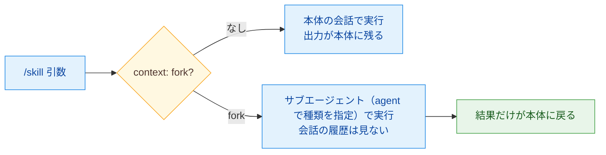

# SKILL.md の frontmatter（context: fork、allowed-tools、argument-hint）

> ドメイン: 3. Claude Code の設定とワークフロー（20%） ／ 更新: 2026-11-20

!!! abstract "ひとことで"
    frontmatter（SKILL.md の先頭の `---` で囲んだ YAML の設定）で、スキルの動き方を決める。本体のコンテキストを守りたいなら ==`context: fork`==、ツールを絞りたいなら `allowed-tools`、引数の入れ方を示したいなら `argument-hint` を使う。

## 仕組み

`context: fork` を付けたスキルは、別のサブエージェントの文脈で走る。途中経過は本体に残らず、結果だけが戻る。ただし fork は「今の会話のフォーク（履歴ごと渡す）」ではない。サブエージェントは ==会話の履歴を見ない== ので、必要な情報はすべて SKILL.md と引数に書く。スキルの本文がそのままサブエージェントへの指示になるので、手順の無いスキルを fork しても意味のある結果は返らない。



| 項目 | 意味 | 使いどころ |
|---|---|---|
| `context: fork` | 別のサブエージェントの文脈でスキルを実行する | コードベース全体の分析、案出し（ブレインストーミング）など、途中経過が長いもの |
| `agent` | fork したときのサブエージェントの種類（例: `Explore`）。省くと general-purpose | 読むだけの調査なら Explore にする |
| `allowed-tools` | ガイドでは: 使えるツールを制限する（現行とのずれは下の箱） | ガイドの想定は破壊的な操作の防止 |
| `argument-hint` | 補完のときに出る、引数の書き方のヒント（例: `[issue-number]`） | 必要な引数を呼ぶ人に示したいとき（ガイドは「引数なしのときに入力を促す」と書く） |
| `description` | 何をするか・いつ使うか。Claude が自動で使うかの判断に使う | どのスキルにも書く（推奨はこれだけ） |
| `disable-model-invocation` | `true` で Claude が自分からは呼ばない | デプロイなど、副作用があり人が起動したいもの |

引数は、本文の `$ARGUMENTS`（呼び出し時の引数全体）と `$0`・`$1`（位置ごとの引数）に入る。

```yaml
---
description: リポジトリ全体の依存関係を調べて報告する
context: fork
agent: Explore
argument-hint: "[対象ディレクトリ]"
---
$ARGUMENTS 以下の依存関係を洗い出し、要点を5行で報告する。
```

!!! warning "ガイドと現行ドキュメントのずれ"
    ガイドは `allowed-tools` を「ツールを制限する」と書く。現行ドキュメントでは「許可なしで使えるツールの事前承認」で、制限はしない。そのターンだけ確認なしで使えるツールを並べる（例: `Read Grep`）。現行で絞るなら `disallowed-tools` か deny ルールを使う。`argument-hint` も現行では補完のときに出るヒントで、引数を必須にする仕組みではない。

??? info "細かい決まり"
    - フィールド名を打ち間違えると、エラーにならず黙って無視される
    - fork は既定で裏（background）で動く。結果を待つなら `background: false`
    - `argument-hint` などは Claude Code の拡張。claude.ai や Skills API にそのまま上げるとエラーになる
    - 置き場所とスコープ（`.claude/skills/`、`~/.claude/skills/`）、CLAUDE.md との使い分けは [カスタムスラッシュコマンドとスキル](slash-commands-and-skills.md) で扱う

## 試験での見分け方

<div class="vs" markdown>

| 問われること | ○ 正しい | × ひっかけ |
|---|---|---|
| 分析の途中経過で本体の会話が埋まる | `context: fork` を付ける | CLAUDE.md に「短く」と書く。fork なしで動かし続ける |
| スキル実行中に削除などをさせたくない | frontmatter の `allowed-tools` で使えるツールを絞る（ガイドの前提。現行とのずれは上の箱） | 何も指定せずに任せる |
| 引数なしで呼ばれて失敗が続く | `argument-hint` で必要な引数を示す（補完のヒントで、必須にはならない） | `argument-hint` で引数を必須にできると考える |
| fork したスキルが前の会話の内容に頼る | 必要な情報をすべて SKILL.md と引数に書く | 会話の履歴が渡ると考える |
| 規約を書いただけで手順の無いスキル | fork せず本体で使う（または CLAUDE.md へ） | `context: fork` を付ける（サブエージェントにやることが無い） |

</div>

## 確認問題

??? question "Q1. 移行の候補を10案出して比べるスキルを使うと、本体の会話がその検討で埋まり、元の作業の指示が薄れる。どう直す？"
    frontmatter に `context: fork` を付ける。別のサブエージェントで検討させ、結論だけを本体に戻す。途中経過は本体のコンテキストに残らない。

??? question "Q2. `/release` を引数なしで打つ人が多く、毎回「バージョンは？」と聞き返している。frontmatter で何を足す？"
    `argument-hint: "[version]"` を足し、補完のときに必要な引数を見せる。打ち忘れが減ることを期待するもので、必須にはならない。本文では `$ARGUMENTS` で受け取る。

??? question "Q3. 「API の命名規約」だけを書いたスキルに `context: fork` を付けたら、何も返ってこない。なぜ？"
    fork すると、スキルの本文がサブエージェントへの指示になる。規約だけで手順が無いので、やることが無い。規約は fork せず本体で使う（または CLAUDE.md へ）。

## 出典
- [Extend Claude with skills — Frontmatter reference / Run skills in a subagent / Pre-approve tools for a skill / Pass arguments to skills](https://code.claude.com/docs/en/skills)（公式）
- Claude Certified Architect – Foundations Exam Guide v1.1、タスクステートメント 3.2（公式）
- 未確認: 試験が `allowed-tools` を「制限」の意味で出題するかどうか（ガイドの文面は制限、現行ドキュメントは事前承認）
