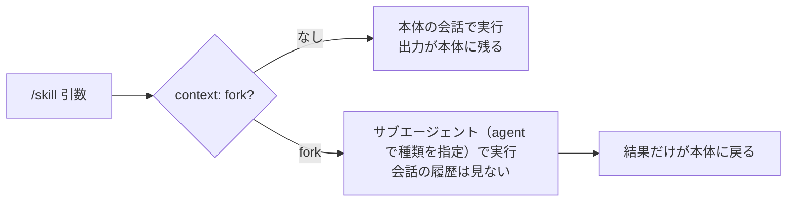

# SKILL.md の frontmatter（context: fork、allowed-tools、argument-hint）

> ドメイン: 3. Claude Code の設定とワークフロー（20%） ／ 更新: 2026-11-20

## 3行まとめ
- frontmatter（SKILL.md の先頭の `---` で囲んだ YAML の設定）で、スキルの動き方を決める
- 出力が多い・寄り道が多いスキルは **`context: fork`** で別のサブエージェントに走らせ、本体の会話を汚さない
- 試験の決め手は「本体のコンテキストを守りたいか（fork）」「ツールを絞りたいか（allowed-tools）」「引数の入れ方を示したいか（argument-hint）」

## 仕組み



| 項目 | 意味 | 使いどころ |
|---|---|---|
| `context: fork` | 別のサブエージェントの文脈でスキルを実行する | コードベース全体の分析、案出し（ブレインストーミング）など、途中経過が長いもの |
| `agent` | fork したときのサブエージェントの種類（例: `Explore`）。省くと general-purpose | 読むだけの調査なら Explore にする |
| `allowed-tools` | ガイドでは: 使えるツールを制限する／現行: そのターンだけ確認なしで使えるツールの事前承認（例: `Read Grep`） | ガイドの想定は破壊的な操作の防止。現行で外すなら `disallowed-tools` |
| `argument-hint` | 補完のときに出る、引数の書き方のヒント（例: `[issue-number]`） | 必要な引数を呼ぶ人に示したいとき（ガイドは「引数なしのときに入力を促す」と書く） |
| `description` | 何をするか・いつ使うか。Claude が自動で使うかの判断に使う | どのスキルにも書く（推奨はこれだけ） |
| `disable-model-invocation` | `true` で Claude が自分からは呼ばない | デプロイなど、副作用があり人が起動したいもの |

- 本文の `$ARGUMENTS`（呼び出し時の引数全体）、`$0`・`$1`（位置ごとの引数）に、引数が入る
- 置き場所とスコープ（`.claude/skills/`、`~/.claude/skills/`）、CLAUDE.md との使い分け → 別ノート（カスタムスラッシュコマンドとスキル）

```yaml
---
description: リポジトリ全体の依存関係を調べて報告する
context: fork
agent: Explore
argument-hint: "[対象ディレクトリ]"
---
$ARGUMENTS 以下の依存関係を洗い出し、要点を5行で報告する。
```

## 試験で問われそうなポイント
- 分析の途中経過で本体の会話が埋まる → `context: fork` を付ける（CLAUDE.md に「短く」と書くのではない）
- スキル実行中に削除などをさせたくない → frontmatter の `allowed-tools` で使えるツールを絞る（ガイドの前提。現行で絞るなら `disallowed-tools` か deny ルール）
- 引数なしで呼ばれて失敗が続く → `argument-hint` で必要な引数を示す（補完のヒントで、必須にはならない）
- fork したスキルは会話の履歴を見ない → 必要な情報はすべて SKILL.md と引数に書く

## 間違えやすいところ
- アンチパターン: 出力の多い分析スキルを `context: fork` なしで動かし、本体のコンテキストを汚す
- アンチパターン: 「この規約に従う」だけで手順の無いスキルを fork する。サブエージェントにやることが無く、意味のある結果が返らない
- `context: fork` は「今の会話のフォーク（履歴ごと渡す）」ではない。履歴に頼る作業には向かない
- ガイドとのずれ: ガイドは `allowed-tools` を「ツールを制限する」と書くが、現行ドキュメントでは「許可なしで使えるツールの事前承認」で、制限はしない。外すのは `disallowed-tools`
- ガイドとのずれ: `argument-hint` は現行ドキュメントでは「補完のときに出るヒント」。引数を必須にする仕組みではない
- フィールド名を打ち間違えると、エラーにならず黙って無視される
- fork は既定で裏（background）で動く。結果を待つなら `background: false`
- `argument-hint` などは Claude Code の拡張。claude.ai や Skills API にそのまま上げるとエラーになる

## 確認問題
1. 移行の候補を10案出して比べるスキルを使うと、本体の会話がその検討で埋まり、元の作業の指示が薄れる。どう直す？
   <details><summary>答え</summary>frontmatter に `context: fork` を付け、別のサブエージェントで検討させて結論だけを本体に戻す。途中経過が本体のコンテキストに残らない。</details>
2. `/release` を引数なしで打つ人が多く、毎回「バージョンは？」と聞き返している。frontmatter で何を足す？
   <details><summary>答え</summary>`argument-hint: [version]` を足し、補完のときに必要な引数を見せる（打ち忘れが減ることを期待するもので、必須にはならない）。本文では `$ARGUMENTS` で受け取る。</details>
3. 「API の命名規約」だけを書いたスキルに `context: fork` を付けたら、何も返ってこない。なぜ？
   <details><summary>答え</summary>fork するとスキルの本文がサブエージェントへの指示になる。規約だけで手順が無いので、やることが無い。規約は fork せず本体で使う（または CLAUDE.md へ）。</details>

## 出典
- [Extend Claude with skills — Frontmatter reference / Run skills in a subagent / Pre-approve tools for a skill / Pass arguments to skills](https://code.claude.com/docs/en/skills)（公式）
- Claude Certified Architect – Foundations Exam Guide v1.1、タスクステートメント 3.2（公式）
- 未確認: 試験が `allowed-tools` を「制限」の意味で出題するかどうか（ガイドの文面は制限、現行ドキュメントは事前承認）
