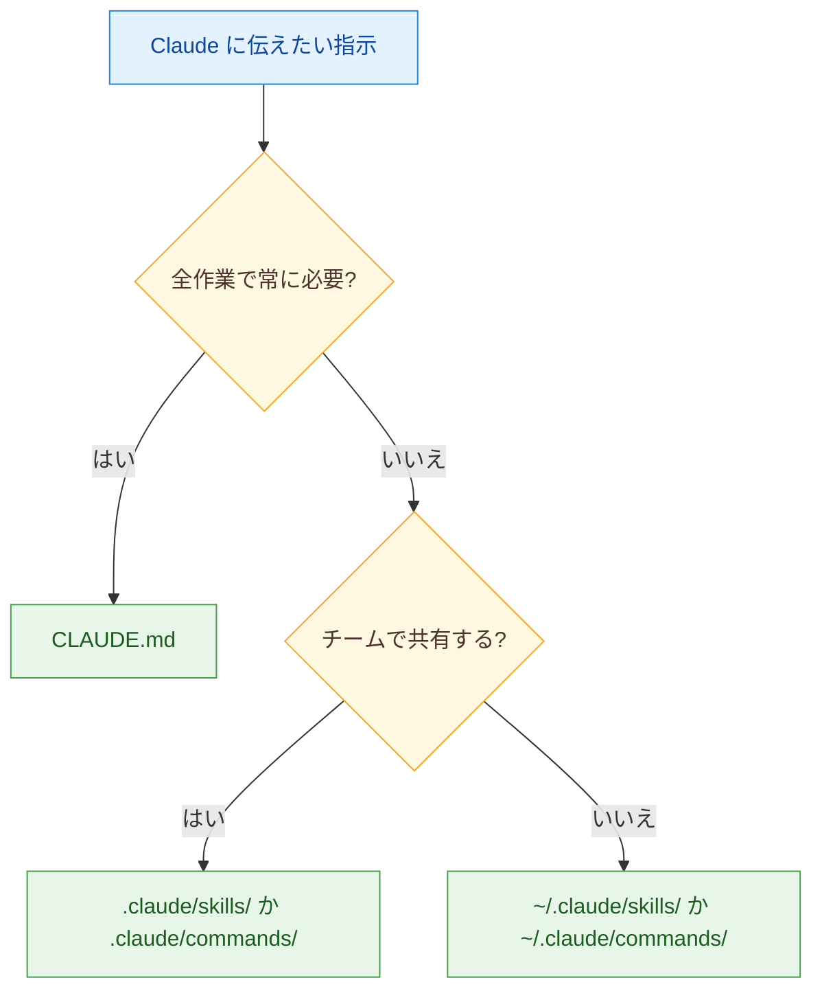

# カスタムスラッシュコマンドとスキルのスコープ、CLAUDE.md との使い分け

> ドメイン: 3. Claude Code の設定とワークフロー（20%） ／ 更新: 2026-11-20

!!! abstract "ひとことで"
    決め手は「誰に効かせたいか」と「常に必要か、その作業のときだけか」の2点だ。==`.claude/` はチームに共有、`~/.claude/` は自分だけ==。いつも守らせる規約は CLAUDE.md、特定の作業の手順はスキルに書く。

## 仕組み

置き場所でスコープが決まる。`.claude/` 配下（プロジェクト）はバージョン管理でチームに共有され、`~/.claude/` 配下（ユーザー）はそのマシンの自分だけに効く。SKILL.md はスキル本体のファイルで、frontmatter（先頭の `---` で囲んだ設定欄）と手順の本文からなる。

| 置き場所 | 効く範囲 | 共有 | 向いている用途 |
|---|---|---|---|
| `.claude/commands/<name>.md` | このリポジトリで作業する全員 | git でチームに共有 | チーム共通の定型作業（`/<name>` で呼ぶ） |
| `~/.claude/commands/<name>.md` | 自分の全プロジェクト（このマシン） | 共有されない | 自分だけの定型プロンプト |
| `.claude/skills/<name>/SKILL.md` | このリポジトリで作業する全員 | git でチームに共有 | チームの手順書。補助ファイル（スクリプト・テンプレート）も同じフォルダに置ける |
| `~/.claude/skills/<name>/SKILL.md` | 自分の全プロジェクト（このマシン） | 共有されない | 個人用の変種・実験中のスキル |

同じ名前のスキルが個人とプロジェクトの両方にあると、個人のほうが動く。公式の優先順位は ==エンタープライズ > 個人 > プロジェクト== だ。だから個人用の変種は、チームのスキルと別の名前で作る。

CLAUDE.md は毎回全文が読み込まれる。スキルは平常時には説明だけが入り、本文は呼ばれてから読み込まれる。常に守らせたい規約をスキルに書くと、呼ばれない限り効かない。逆に手順書を CLAUDE.md に書くと、毎回コンテキストを消費する。

| | CLAUDE.md | カスタムスラッシュコマンド（ガイドの前提） | スキル |
|---|---|---|---|
| 読み込まれるとき | 毎セッション、常に | `/name` で呼んだとき（現行は Claude も自分から使う） | `/name` で呼んだとき、または Claude が関係あると判断したとき |
| 平常時のコンテキストの消費 | 全文 | 本文は入らない | 説明（description）だけ。本文は呼ばれてから |
| 書く中身 | 全作業に共通の事実・規約（ビルド方法、命名規則） | 1ファイルで済む定型プロンプト | 複数手順の作業、長い参考資料 |
| 選ぶ場面 | 「いつも」守らせたい | 決まった作業をコマンド1つで始めたい | 「その作業のときだけ」必要 |

??? info "ガイドと現行ドキュメントのずれ、細かい決まり"
    - 現行の公式ドキュメントでは「カスタムコマンドはスキルに統合された」とされ、`.claude/commands/` は旧形式として引き続き動く。試験はガイドどおり両方の名前で出ると考える
    - 現行ではコマンドもスキルと同じく、説明（無ければ本文の最初の空でない行）が常にコンテキストに入り、Claude が自分から使う。自動で使わせないなら frontmatter に `disable-model-invocation: true`
    - 同じ名前のスキルと `.claude/commands/` のファイルがあると、スキルが優先される
    - frontmatter の各項目（`context: fork`、`allowed-tools`、`argument-hint`）は [SKILL.md の frontmatter](skill-frontmatter.md) で扱う

## 試験での見分け方

| 問われること | ○ 正しい | × ひっかけ |
|---|---|---|
| チーム全員に同じコマンドを使わせたい | `.claude/commands/`（または `.claude/skills/`）に置いてコミットする | `~/.claude/` に置く（自分のマシンにしか効かない） |
| 自分だけ手順を変えたい | チームのスキルは書き換えず、`~/.claude/skills/` に別の名前で作る | 実験中のスキルを `.claude/skills/` に置く（コミットすれば全員に効く）。同じ名前で `~/.claude/skills/` に作る（自分の環境ではチームのものを上書きする） |
| CLAUDE.md が手順書で膨らんだ | 手順の部分をスキルに移し、CLAUDE.md には常に必要な規約だけ残す | 手順書を CLAUDE.md に残す（毎回コンテキストを消費する） |
| 常に守らせたい規約 | CLAUDE.md に書く | スキルに書く（呼ばれない限り読み込まれない） |
| 別のマシンで作業するとコマンドが無い | どこでも使うならリポジトリの `.claude/commands/` に入れる | `~/.claude/commands/` のまま使う（そのマシンだけ） |

## 確認問題

??? question "Q1. 開発者 A が、変更履歴を作るスキルを自分好みに変えて試したい。リポジトリには `.claude/skills/changelog/` がある。どうする？"
    `~/.claude/skills/` に `changelog-draft` など別の名前で作る。`.claude/skills/changelog/` を書き換えると、コミット後にチーム全員へ影響する。同じ名前で個人側に作ると、自分の環境ではチームのものが隠れて、差分に気づきにくい。

??? question "Q2. 「DB のマイグレーション手順（10ステップ）」と「関数名は snake_case」を CLAUDE.md に書いたら、CLAUDE.md が長くなった。どう分ける？"
    マイグレーション手順はスキル（`.claude/skills/migrate/`）に移す。必要なときだけ読み込まれる。snake_case は全作業に共通なので CLAUDE.md に残す。

??? question "Q3. 開発者 B は `~/.claude/commands/bench.md` に性能計測の定型プロンプトを置いている。チームから「CI 用のマシンでも同じ `/bench` を使いたい」と頼まれた。どうする？"
    `.claude/commands/bench.md`（か `.claude/skills/bench/`）としてリポジトリにコミットする。`~/.claude/` は B のマシンだけに効き、ほかのマシンやチームには届かない。

## 出典
- [Extend Claude with skills](https://code.claude.com/docs/en/skills)（公式）: 置き場所の表、同名時の優先順位、コマンドのスキルへの統合、読み込みのタイミング
- [Explore the .claude directory](https://code.claude.com/docs/en/claude-directory)（公式）: `.claude/commands/` と `~/.claude/commands/`
- [How Claude remembers your project](https://code.claude.com/docs/en/memory)（公式）: CLAUDE.md に書くもの・スキルに移すもの
- Claude Certified Architect – Foundations Exam Guide v1.1、タスクステートメント 3.2（公式）
- 未確認: `~/.claude/commands/` と `.claude/commands/` に同じ名前のファイルがあるときにどちらが動くかは、公式に明記が見つからなかった
