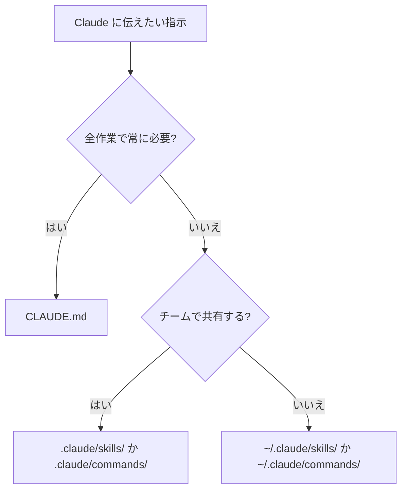

# カスタムスラッシュコマンドとスキルのスコープ、CLAUDE.md との使い分け

> ドメイン: 3. Claude Code の設定とワークフロー（20%） ／ 更新: 2026-11-20

## 3行まとめ
- 置き場所でスコープが決まる。`.claude/` 配下（プロジェクト）はバージョン管理でチームに共有、`~/.claude/` 配下（ユーザー）は自分だけ
- いつも守らせる共通ルールは CLAUDE.md（毎回読み込まれる）、特定の作業の手順は **スキル**（呼んだとき・関係するときだけ読み込まれる）
- 試験の決め手は「誰に効かせたいか」と「常に必要か、その作業のときだけか」の2点

## 仕組み

### 置き場所とスコープ

| 置き場所 | 効く範囲 | 共有 | 向いている用途 |
|---|---|---|---|
| `.claude/commands/<name>.md` | このリポジトリで作業する全員 | git でチームに共有 | チーム共通の定型作業（`/<name>` で呼ぶ） |
| `~/.claude/commands/<name>.md` | 自分の全プロジェクト（このマシン） | 共有されない | 自分だけの定型プロンプト |
| `.claude/skills/<name>/SKILL.md` | このリポジトリで作業する全員 | git でチームに共有 | チームの手順書。補助ファイル（スクリプト・テンプレート）も同じフォルダに置ける |
| `~/.claude/skills/<name>/SKILL.md` | 自分の全プロジェクト（このマシン） | 共有されない | 個人用の変種・実験中のスキル |

- SKILL.md（スキル本体のファイル。frontmatter（先頭の `---` で囲んだ設定欄）と手順の本文からなる）の frontmatter の各項目（`context: fork`、`allowed-tools`、`argument-hint`）→ 別ノート（SKILL.md の frontmatter）
- 同じ名前のスキルが個人とプロジェクトの両方にあると、個人のほうが動く（公式の優先順位: エンタープライズ > 個人 > プロジェクト）

### CLAUDE.md・コマンド・スキルの使い分け

| | CLAUDE.md | カスタムスラッシュコマンド（ガイドの前提） | スキル |
|---|---|---|---|
| 読み込まれるとき | 毎セッション、常に | `/name` で呼んだとき（現行は Claude も自分から使う） | `/name` で呼んだとき、または Claude が関係あると判断したとき |
| 平常時のコンテキストの消費 | 全文 | 本文は入らない | 説明（description）だけ。本文は呼ばれてから |
| 書く中身 | 全作業に共通の事実・規約（ビルド方法、命名規則） | 1ファイルで済む定型プロンプト | 複数手順の作業、長い参考資料 |
| 選ぶ場面 | 「いつも」守らせたい | 決まった作業をコマンド1つで始めたい | 「その作業のときだけ」必要 |

## 試験で問われそうなポイント
- チーム全員に同じコマンドを使わせたい → `.claude/commands/`（または `.claude/skills/`）に置いてコミットする
- 自分だけ手順を変えたい → チームのスキルを書き換えず、`~/.claude/skills/` に別の名前で作る
- CLAUDE.md が手順書で膨らんだ → 手順の部分をスキルに移し、CLAUDE.md には常に必要な規約だけ残す
- 別のマシンで作業するとコマンドが無い → `~/.claude/commands/` はそのマシンだけ。どこでも使うならリポジトリの `.claude/commands/` に入れる

## 間違えやすいところ
- アンチパターン: 個人用の実験的なスキルを `.claude/skills/` に置く。コミットすればチーム全員に効く。個人用は `~/.claude/skills/` に別の名前で作る
- 同じ名前で `~/.claude/skills/` に作ると、自分の環境ではチームのスキルを上書きしてしまう（個人 > プロジェクト）。だから「別の名前」にする
- 常に守らせたい規約をスキルに書くと、呼ばれない限り読み込まれない。逆に手順書を CLAUDE.md に書くと、毎回コンテキストを消費する
- ガイドとのずれ: 現行の公式ドキュメントでは「カスタムコマンドはスキルに統合された」とされ、`.claude/commands/` は旧形式として引き続き動く。試験はガイドどおり両方の名前で出ると考える
- ガイドとのずれ: 現行ではコマンドもスキルと同じく、説明（無ければ本文の最初の空でない行）が常にコンテキストに入り、Claude が自分から使う。自動で使わせないなら frontmatter に `disable-model-invocation: true`
- 同じ名前のスキルと `.claude/commands/` のファイルがあると、スキルが優先される

## 確認問題
1. 開発者 A が、変更履歴を作るスキルを自分好みに変えて試したい。リポジトリには `.claude/skills/changelog/` がある。どうするべきか。
   

答え
`~/.claude/skills/` に `changelog-draft` など別の名前で作る。`.claude/skills/changelog/` を書き換えるとコミット後にチーム全員へ影響する。同じ名前で個人側に作ると、自分の環境ではチームのものが隠れて差分に気づきにくい。

2. 「DB のマイグレーション手順（10ステップ）」と「関数名は snake_case」を CLAUDE.md に書いたところ、CLAUDE.md が長くなった。どう分けるか。
   

答え
マイグレーション手順はスキル（`.claude/skills/migrate/`）に移す。必要なときだけ読み込まれる。snake_case は全作業に共通なので CLAUDE.md に残す。

3. 開発者 B は `~/.claude/commands/bench.md` に性能計測の定型プロンプトを置いている。チームから「CI 用のマシンでも同じ `/bench` を使いたい」と頼まれた。どうするか。
   

答え
`.claude/commands/bench.md`（か `.claude/skills/bench/`）としてリポジトリにコミットする。`~/.claude/` は B のマシンだけに効き、他のマシンやチームには届かない。

## 出典
- [Extend Claude with skills](https://code.claude.com/docs/en/skills)（公式）: 置き場所の表、同名時の優先順位、コマンドのスキルへの統合、読み込みのタイミング
- [Explore the .claude directory](https://code.claude.com/docs/en/claude-directory)（公式）: `.claude/commands/` と `~/.claude/commands/`
- [How Claude remembers your project](https://code.claude.com/docs/en/memory)（公式）: CLAUDE.md に書くもの・スキルに移すもの
- Claude Certified Architect – Foundations Exam Guide v1.1、タスクステートメント 3.2（公式）
- 未確認: `~/.claude/commands/` と `.claude/commands/` に同じ名前のファイルがあるときにどちらが動くかは、公式に明記が見つからなかった
