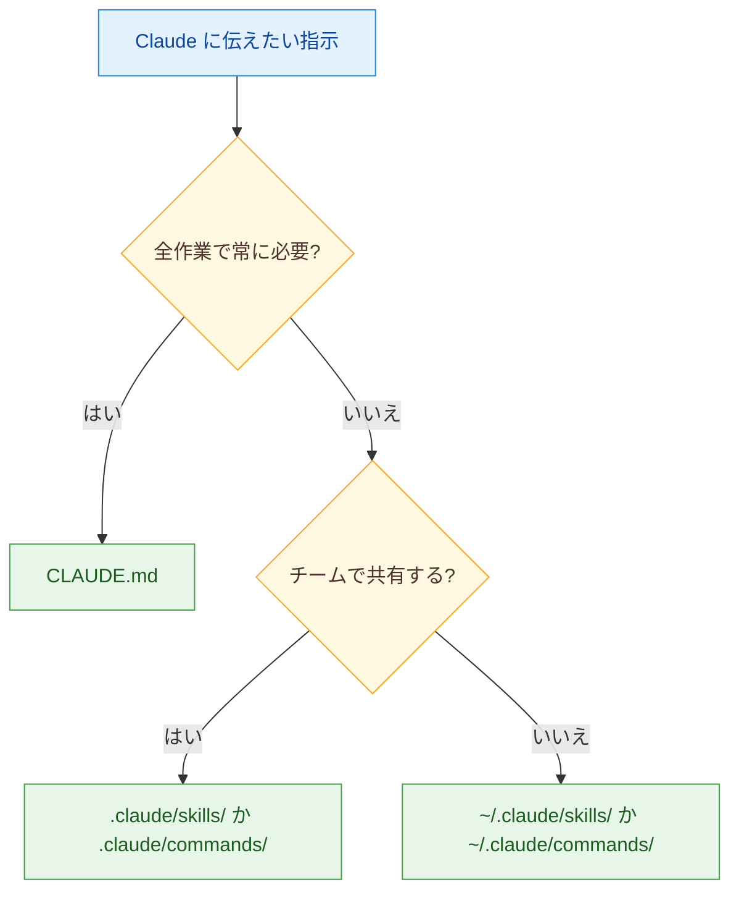

# カスタムスラッシュコマンドとスキルのスコープ、CLAUDE.md との使い分け

> ドメイン: 3. Claude Code の設定とワークフロー（20%） ／ 更新: 2026-11-20

!!! abstract "ひとことで"
    決め手は「誰に効かせたいか」と「常に必要か、その作業のときだけか」の2点だ。==`.claude/` はチームに共有、`~/.claude/` は自分だけ==。いつも守らせる規約は CLAUDE.md、特定の作業の手順はスキルに書く。

## 仕組み

置き場所でスコープが決まる。`.claude/` 配下（プロジェクト）はバージョン管理でチームに共有され、`~/.claude/` 配下（ユーザー）はそのマシンの自分だけに効く。SKILL.md はスキル本体のファイルで、frontmatter（先頭の `---` で囲んだ設定欄）と手順の本文からなる。

| 置き場所 | 効く範囲 | 共有 | 向いている用途 |
|---|---|---|---|
| `.claude/commands/<name>.md` | このリポジトリで作業する全員 | git でチームに共有 | チーム共通の定型作業（`/<name>` で呼ぶ） |
| `~/.claude/commands/<name>.md` | 自分の全プロジェクト（このマシン） | 共有されない | 自分だけの定型プロンプト |
| `.claude/skills/<name>/SKILL.md` | このリポジトリで作業する全員 | git でチームに共有 | チームの手順書。補助ファイル（スクリプト・テンプレート）も同じフォルダに置ける |
| `~/.claude/skills/<name>/SKILL.md` | 自分の全プロジェクト（このマシン） | 共有されない | 個人用の変種・実験中のスキル |

同じ名前のスキルが個人とプロジェクトの両方にあると、個人のほうが動く。公式の優先順位は ==エンタープライズ > 個人 > プロジェクト== だ。だから個人用の変種は、チームのスキルと別の名前で作る。

| | CLAUDE.md | カスタムスラッシュコマンド（ガイドの前提） | スキル |
|---|---|---|---|
| 読み込まれるとき | 毎セッション、常に | `/name` で呼んだとき（現行は Claude も自分から使う） | `/name` で呼んだとき、または Claude が関係あると判断したとき |
| 平常時のコンテキストの消費 | 全文 | 本文は入らない | 説明（description）だけ。本文は呼ばれてから |
| 書く中身 | 全作業に共通の事実・規約（ビルド方法、命名規則） | 1ファイルで済む定型プロンプト | 複数手順の作業、長い参考資料 |
| 選ぶ場面 | 「いつも」守らせたい | 決まった作業をコマンド1つで始めたい | 「その作業のときだけ」必要 |

??? info "ガイドと現行ドキュメントのずれ、細かい決まり"
    - 現行の公式ドキュメントでは「カスタムコマンドはスキルに統合された」とされ、`.claude/commands/` は旧形式として引き続き動く。試験はガイドどおり両方の名前で出ると考える
    - 現行ではコマンドもスキルと同じく、説明（無ければ本文の最初の空でない行）が常にコンテキストに入り、Claude が自分から使う。自動で使わせないなら frontmatter に `disable-model-invocation: true`
    - 同じ名前のスキルと `.claude/commands/` のファイルがあると、スキルが優先される
    - frontmatter の各項目（`context: fork`、`allowed-tools`、`argument-hint`）は [SKILL.md の frontmatter](skill-frontmatter.md) で扱う

## 試験での見分け方

| 問われること | ○ 正しい | × ひっかけ |
|---|---|---|
| チーム全員に同じコマンドを使わせたい | `.claude/commands/`（または `.claude/skills/`）に置いてコミットする | `~/.claude/` に置く（自分のマシンにしか効かない） |
| 自分だけ手順を変えたい | チームのスキルは書き換えず、`~/.claude/skills/` に別の名前で作る | 実験中のスキルを `.claude/skills/` に置く（コミットすれば全員に効く）。同じ名前で `~/.claude/skills/` に作る（自分の環境ではチームのものを上書きする） |
| CLAUDE.md が手順書で膨らんだ | 手順の部分をスキルに移し、CLAUDE.md には常に必要な規約だけ残す | 手順書を CLAUDE.md に残す（毎回コンテキストを消費する） |
| 常に守らせたい規約 | CLAUDE.md に書く | スキルに書く（呼ばれない限り読み込まれない） |
| 別のマシンで作業するとコマンドが無い | どこでも使うならリポジトリの `.claude/commands/` に入れる | `~/.claude/commands/` のまま使う（そのマシンだけ） |

## 確認問題

**Q1.** 家計簿アプリの開発チームが、Claude Code の変更履歴を作るスキル `.claude/skills/changelog/` をリポジトリで共有している。メンバーの1人が、このスキルを自分好みに変えて試したい。最も適切な方法はどれか。（1つ選べ）
{ .quiz-q }

- A. `.claude/skills/changelog/SKILL.md` を書き換えて試し、うまくいけばそのままコミットする
- B. `~/.claude/skills/changelog/` に同じ名前で作り、自分の環境だけで差し替えて試す
- C. `.claude/skills/changelog-draft/` に別の名前で作ってコミットし、自分だけが呼ぶ
- D. `~/.claude/skills/` に `changelog-draft` など別の名前で作って試す

??? success "答えと解説"
    **正解: D。** 個人用の変種は `~/.claude/skills/` に、チームのスキルと別の名前で作る。

    - A: コミットすると、試している途中の手順がチーム全員に効く
    - B: 同じ名前なら個人のほうが優先され、自分の環境ではチームのスキルが隠れて差に気づきにくい
    - C: `.claude/skills/` に置いてコミットすれば、別の名前でもチーム全員に共有される

**Q2.** 同じチームのリポジトリの CLAUDE.md に、「DB のマイグレーション手順（10ステップ）」と「関数名は snake_case」の両方を書いたら、CLAUDE.md が長くなった。適切な分け方はどれか。（2つ選べ）
{ .quiz-q }

- A. snake_case の規約もスキルに移し、CLAUDE.md をできるだけ短くする
- B. マイグレーション手順は `.claude/skills/migrate/` のスキルに移す
- C. 関数名は snake_case という規約は CLAUDE.md に残す
- D. マイグレーション手順は `~/.claude/skills/migrate/` のスキルに移す
- E. 両方とも CLAUDE.md に残し、見出しを付けて読みやすくする

??? success "答えと解説"
    **正解: B と C。** その作業のときだけ要る手順はスキル、いつも守らせる規約は CLAUDE.md に置く。

    - A: スキルは呼ばれない限り本文が読み込まれないので、常に守らせたい規約が抜ける
    - D: `~/.claude/` は自分のマシンにしか効かず、チームに共有されない
    - E: CLAUDE.md は毎セッション全文が読まれるので、手順書の分も毎回コンテキストを消費する

**Q3.** 同じチームの開発者の1人が、`~/.claude/commands/bench.md` に性能計測の定型プロンプトを置いている。チームから「CI のマシンでも、各自のマシンでも、同じ `/bench` を使いたい」と頼まれた。最も適切な対応はどれか。（1つ選べ）
{ .quiz-q }

- A. `~/.claude/skills/bench/SKILL.md` に移し替え、スキルとして共有する
- B. `.claude/commands/bench.md` としてリポジトリにコミットする
- C. 定型プロンプトの全文を CLAUDE.md に書き写し、毎セッション読ませる
- D. 各メンバーと CI のマシンに、`~/.claude/commands/bench.md` を手でコピーしてもらう

??? success "答えと解説"
    **正解: B。** どのマシンでも全員に使わせるなら、リポジトリの `.claude/commands/` に入れて git で共有する。

    - A: スコープは置き場所で決まる。`~/.claude/` の下なら、スキルにしても自分のマシンだけに効く
    - C: 決まった作業のプロンプトを、常に読まれる CLAUDE.md に入れると、毎回コンテキストを消費する
    - D: git で共有されないので、マシンごとに中身がずれる

## 出典
- [Extend Claude with skills](https://code.claude.com/docs/en/skills)（公式）: 置き場所の表、同名時の優先順位、コマンドのスキルへの統合、読み込みのタイミング
- [Explore the .claude directory](https://code.claude.com/docs/en/claude-directory)（公式）: `.claude/commands/` と `~/.claude/commands/`
- [How Claude remembers your project](https://code.claude.com/docs/en/memory)（公式）: CLAUDE.md に書くもの・スキルに移すもの
- Claude Certified Architect – Foundations Exam Guide v1.1、タスクステートメント 3.2（公式）
- 未確認: `~/.claude/commands/` と `.claude/commands/` に同じ名前のファイルがあるときにどちらが動くかは、公式に明記が見つからなかった
